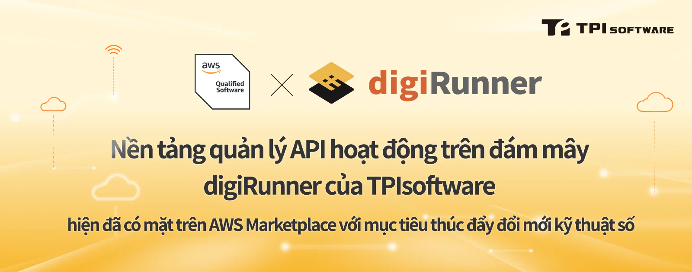

ĐÀI BẮC, 14/05/2024 /PRNewswire/ -- Đánh dấu bước tiến quan trọng trong các giải pháp phần mềm dựa trên đám mây, TPIsoftware tự hào thông báo chính thức niêm yết Nền tảng quản lý API cấp doanh nghiệp digiRunner trên AWS Marketplace, một danh mục kỹ thuật số được chọn lọc cho những khách hàng tìm kiếm phần mềm và dịch vụ của bên thứ ba để xây dựng giải pháp và vận hành doanh nghiệp của họ. Cột mốc quan trọng này diễn ra sau khi hoàn thành bài Đánh giá kỹ thuật cơ bản (FTR) của Amazon Web Services (AWS), cho phép Đối tác AWS xác định và khắc phục rủi ro trong phần mềm hoặc giải pháp của họ thông qua AWS, nền tảng đám mây toàn diện và được áp dụng rộng rãi nhất thế giới.

Là minh chứng cho sự đổi mới và khả năng đã được chứng minh, digiRunner, được phát triển nội bộ bởi đội ngũ chuyên nghiệp của TPIsoftware tại Đài Loan, đã được trao bảy bằng phát minh, chứng nhận ISO 27001 và Giải thưởng Taiwan Excellence trong hai năm liên tiếp là 2023 và 2024. Việc xuất sắc vượt qua AWS FTR giúp digiRunner trở thành yếu tố hỗ trợ triển khai ứng dụng nhanh chóng, hiệu quả và có quy mô linh hoạt trên đám mây AWS để thúc đẩy đổi mới kỹ thuật số cho doanh nghiệp. Được phát triển nội bộ bởi đội ngũ kỹ sư Đài Loan chuyên nghiệp, TPIsoftware đã trở thành Đối tác Nhà cung cấp phần mềm độc lập (ISV) của AWS với sản phẩm phần mềm được xác thực và được niêm yết trên AWS Marketplace, nhờ đó digiRunner giờ đây có thể tiếp cận tới hàng triệu khách hàng AWS.

Trong những năm gần đây, thị trường toàn cầu đã chứng kiến sự thay đổi toàn diện, với việc đáp ứng nhu cầu thị trường nhanh chóng là chìa khóa để luôn dẫn đầu xu thế, và đổi mới sáng tạo dựa trên đám mây đã tạo nên một chương phát triển mới cho chiến lược kỹ thuật số của các doanh nghiệp. Nền tảng quản lý API digiRunner nhằm mục đích giúp các doanh nghiệp quản lý các API lớn một cách hiệu quả, đồng thời đóng vai trò là nền tảng trung gian để đổi mới các dịch vụ kỹ thuật số. Được triển khai trên AWS, digiRunner cómức sử dụng tài nguyên tối thiểu và triển khai gọn nhẹ trong khi vẫn đảm bảo hoạt động nhất quán trên nhiều môi trường khác nhau. Nền tảng cũng giúpcác nhóm phát triển phần mềm đẩy nhanh quá trình phát triển, thử nghiệm và triển khai ứng dụng với thời gian đưa ra thị trường ngắn hơn và đảm bảo lợi thế cạnh tranh.

Yilan Yeh, Giám đốc điều hành của TPIsoftware cho biết: "Ngày càng có nhiều doanh nghiệp chuyển đổi các ứng dụng và tài nguyên của họ sang đám mây, điều này đã nâng cao vai trò của chúng tôi trong việc hỗ trợ khách hàng BFSI trong quá trình di chuyển lên đám mây. Quan hệ hợp tác của chúng tôi với AWS là một động thái chiến lược nhằm cung cấp cho khách hàng cơ sở hạ tầng đám mây vững mạnh và các công cụ toàn diện, giúp họ tập trung vào hoạt động kinh doanh cốt lõi. Chiến lược sản phẩm của chúng tôi ưu tiên các giải pháp dựa trên đám mây, tận dụng công nghệ container hóa và microservices để hiện đại hóa hệ thống CNTT và triển khai dịch vụ nhanh chóng hơn".

Yvonne Chien, Tổng Giám đốc TPIsoftware Singapore, cũng chia sẻ: "Sự hợp tác gần đây của chúng tôi với AWS tại Việt Nam là bước tiến mới nhất trong mối quan hệ toàn cầu liên tục của chúng tôi với AWS, mở đường cho những cơ hội mới trong hoạt động mở rộng thị trường quốc tế của chúng tôi. Bằng cách tận dụng mạng lưới toàn cầu rộng lớn của AWS và các giải pháp tiên phong dựa trên đám mây, chúng tôi tin rằng mình có thể tạo ra tác động trên quy mô toàn cầu".

**Thông tin liên hệ cho tổ chức truyền thông:**

**TPIsoftware**\
Bernie Gee\
+886-2-2658-0508 #1608\
bernie.gee@tpisoftware.com\
[Đăng ký nhận bản tin](/vi/subscribe) [|](https://www.facebook.com/TPIsoftware) [Website](/vi) | [Facebook](https://www.facebook.com/TPIsoftwareGlobal) | [LinkedIn](https://www.linkedin.com/company/tpisoftware)
