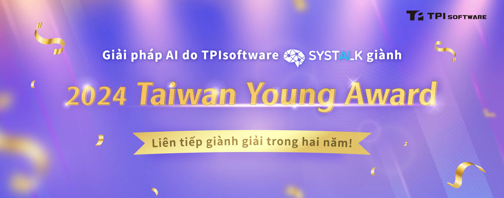

Sau chiến thắng vang dội vào năm ngoái, TPIsoftware một lần nữa tỏa sáng tại Lễ trao giải Taiwan Young Award 2024 ở hạng mục Ứng dụng thông minh với giải pháp xử lý yêu cầu bảo hiểm tích hợp AI [SysTalk.ai](/vi/solutions/smartclaim). Được tổ chức bởi Hiệp hội Công nghiệp Dịch vụ Thông tin, Taiwan Young Award là một trong những giải thưởng uy tín nhất nhằm khuyến khích các cá nhân và doanh nghiệp tích cực hơn trong việc thực hiện đổi mới công nghệ trên phạm vi cả nước. Được vinh danh tại sự kiện năm nay, giải pháp AI do TPIsoftware phát triển là một phần mềm tự động hóa quy trình chuyên biệt, có khả năng giải quyết các điểm yếu trong ngành bảo hiểm bằng cách áp dụng một mô hình AI thích ứng. Khả năng điều chỉnh linh hoạt theo các mẫu khác nhau trong suốt quy trình yêu cầu bảo hiểm giúp giải phóng người lao động khỏi các nhiệm vụ lặp đi lặp lại, giải tỏa áp lực cũng như giúp quy trình làm việc trở nên đơn giản hơn.

## Quy trình chuyển đổi yêu cầu bảo hiểm thích ứng với sự hỗ trợ của AI

TPIsoftware là công ty tiên phong trong việc áp dụng công nghệ Nhận dạng ký tự thông minh (ICR) với khả năng phân tích văn bản AI và Xử lý ngôn ngữ tự nhiên kết hợp với công nghệ cốt lõi là các thuật toán AI, hỗ trợ phân tích ngữ nghĩa và nhận dạng văn bản đồng thời vẫn đáp ứng các quy định công nghiệp. Với cơ chế tự học tập và phát triển của AI, công cụ này đảm bảo khả năng nhập dữ liệu chính xác và hiệu quả, giảm thiểu đáng kể các lỗi không đáng có từ yếu tố con người. Tích hợp tự động hóa quy trình bằng robot để tạo điều kiện tích hợp đa nền tảng. Quá trình tích hợp được thực hiện thông qua quy trình tự động kết nối công cụ yêu cầu bồi thường, giúp tối ưu hóa quy trình xem xét và xử lý yêu cầu bồi thường. Nền tảng AI thích ứng SysTalk.PUZZLE được ra mắt với khả năng thực hiện bảo trì tự động và đào tạo dữ liệu nhỏ, giúp cắt giảm đáng kể chi phí vận hành.

## Đơn xin xử lý yêu cầu bảo hiểm được đơn giản hóa

Bước sang năm thứ 10, Giải thưởng Taiwan Young Award đã trở thành một chuẩn mực trong lĩnh vực công nghệ, giúp truyền cảm hứng cho sự đổi mới và chuyển đổi. TPIsoftware đã liên tiếp đạt được những thành tựu đáng kể sau chiến thắng vang dội vào năm ngoái với SysTalk.Chat, một công cụ chatbot AI và DigiFusion, một nền tảng trung gian dành cho doanh nghiệp. Năm nay, SysTalk.ai do TPIsoftware phát triển lại một lần nữa được công nhận về khả năng cung cấp tính hiệu quả và chính xác trong việc hợp lý hóa quy trình yêu cầu bảo hiểm.

Ông Jeff Lin, Phó chủ tịch điều hành tại TPIsoftware nhận định: "SysTalk.ai đã được chứng minh là có khả năng xử lý dữ liệu tương đương với con người và thậm chí là vượt trội hơn. Sau khi đưa vào áp dụng trong thực tiễn, khả năng tự học và phát triển của AI cho phép thực hiện bảo trì tự động và liên tục tối ưu hóa hệ thống, đồng thời đơn giản hóa quy trình làm việc của con người. Đây là một khía cạnh quan trọng trong công cuộc thực hiện chuyển đổi kỹ thuật số."
