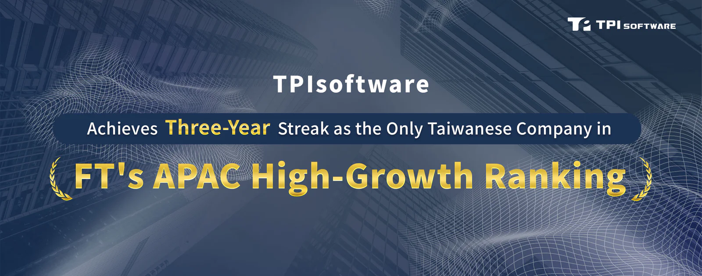

TPIsoftware, công ty phần mềm hàng đầu ở Đài Loan, đã ghi danh trên bảng xếp hạng thường niên của Financial Times gồm 500 công ty có tốc độ tăng trưởng cao ở khu vực Châu Á - Thái Bình Dương. Là doanh nghiệp Đài Loan duy nhất, TPIsoftware đã được lựa chọn vào bảng xếp hạng này năm thứ ba liên tiếp, đạt tốc độ CAGR đầy ấn tượng là 29,7% và giữ vững vị trí thứ 405 trong số tất cả các công ty. Tính toán dựa trên chuẩn đối sánh tốc độ tăng trưởng kép trong 3 năm, doanh thu của TPIsoftware đã duy trì được mức độ cạnh tranh cao trên thị trường trong 5 năm liên tiếp. Trong suốt giai đoạn này, bất chấp những thách thức của thời kỳ hậu đại dịch, TPIsoftware vẫn tích cực xây dựng thương hiệu doanh nghiệp và mở rộng kinh doanh sang khu vực Đông Nam Á. Đối với các nhà phát triển phần mềm nội địa, kết quả này cho thấy thành tựu mà họ phải vất vả mới đạt được.

Bảng xếp hạng FT về 500 công ty châu Á-Thái Bình Dương tăng trưởng cao, nằm trong ấn phẩm do Financial Times của Anh phối hợp với công ty nghiên cứu Statista của Đức tổng hợp, xướng danh 500 công ty hàng đầu khu vực APAC có tỷ lệ tăng trưởng doanh thu cao nhất từ năm 2019 đến năm 2022. Theo Financial Times, bất chấp bối cảnh chủ nghĩa bảo hộ toàn cầu đang gia tăng, khu vực châu Á - Thái Bình Dương vẫn là yếu tố thúc đẩy chính cho tăng trưởng kinh tế toàn cầu. Ngành CNTT và phần mềm chiếm khoảng 30% mức tăng trưởng này, tỷ lệ cao nhất, tiếp theo là ngành công nghệ tài chính, dịch vụ tài chính và bảo hiểm ở mức 8%.

Về hiệu quả hoạt động của các công ty Đài Loan, năm nay chỉ có 9 công ty Đài Loan lọt vào danh sách, so với con số 15 công ty của năm trước và 25 công ty của hai năm trước, đã cho thấy xu hướng giảm sút. Trong số chín doanh nghiệp này, chỉ có ba doanh nghiệp, bao gồm cả TPIsoftware, được niêm yết vào năm ngoái, qua đó cho thấy những thách thức trong việc đạt được hiệu quả kinh doanh tốt ở mức ổn định trong thời gian dài. TPIsoftware đã đạt được thành công nhờ những nỗ lực gần đây trong phát triển thương hiệu, mở rộng sang thị trường nước ngoài và liên tục đổi mới, giúp khách hàng giải quyết các điểm yếu trong kinh doanh, đẩy nhanh đổi mới và tạo ra giá trị thị trường lớn hơn với dịch vụ khách hàng cải thiện.

Yilan Yeh, Giám đốc điều hành của TPIsoftware, cho biết: 'Việc được Financial Times bình chọn là một trong 500 công ty tăng trưởng nhanh hàng đầu khu vực Châu Á – Thái Bình Dương trong 3 năm liên tiếp là minh chứng cho nỗ lực tập thể của đội ngũ TPIsoftware'.

Yilan Yeh phát biểu rằng: 'Ngoài ra, chúng tôi đã hợp tác với một số công ty có vị thế lớn về đám mây trên trường quốc tế để liên tục mở rộng các sản phẩm và dịch vụ trong môi trường đám mây. Ngoài AWS và GCP, chúng tôi đã tăng cường mối quan hệ với Azure. Đối với các doanh nghiệp đã sử dụng dịch vụ đám mây, các sản phẩm của chúng tôi có thể được triển khai đầy đủ chỉ trong vài phút, dễ dàng giải quyết các thách thức CNTT và nâng cao hiệu quả kinh doanh'.
