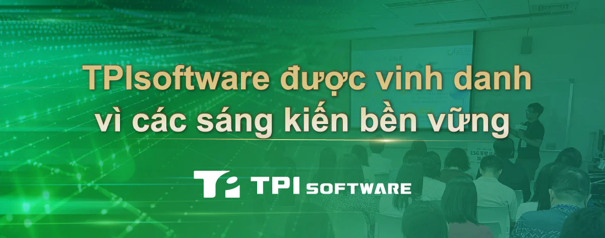

TPIsoftware đã vinh dự nhận Giải thưởng Phát triển Bền vững Doanh nghiệp Đài Loan (TCSA) do Viện Năng lượng Bền vững Đài Loan (TAISE) trao tặng. Giải thưởng nhằm ghi nhận những nỗ lực bền bỉ của công ty trong việc tuân thủ các nguyên tắc Môi trường, Xã hội và Quản trị (ESG) cũng như Mục tiêu Phát triển bền vững (SDG) của Liên Hợp Quốc.

Là một nhà phát triển phần mềm B2B có trụ sở tại Đài Loan, TPIsoftware tích cực thúc đẩy tương lai bền vững thông qua các sáng kiến về trách nhiệm xã hội. Một trong những nỗ lực nổi bật là thành lập Đại học TPI, một nền tảng trực tuyến để trao đổi những kiến thức giá trị và chuyên môn kỹ thuật. Thông qua tăng cường khả năng tiếp cận giáo dục toàn diện và công bằng, Đại học TPI hỗ trợ Mục tiêu Phát triển Bền vững số 4 (Giáo dục Chất lượng), tổ chức các hội thảo trực tuyến và mang lại cơ hội học tập do các nhóm chuyên gia dẫn dắt. Với mục tiêu thu hẹp khoảng cách giáo dục và thúc đẩy cạnh tranh lành mạnh, sáng kiến này đã giúp TPIsoftware giành được Giải Đồng TCSA ở hạng mục SDG 4.

Ngoài ra, TPIsoftware có quan hệ hợp tác với các ngành cùng các tổ chức giáo dục, tham gia vào Liên minh ESG Global Views, từ đó cho thấy vị thế dẫn đầu của công ty trong các chiến lược phát triển bền vững dựa trên công nghệ. Thông qua nền tảng quản lý carbon GreenSwift, TPIsoftware giúp các doanh nghiệp đẩy nhanh nỗ lực giảm phát thải carbon bằng cách sử dụng kiến thức và dữ liệu, đảm bảo rằng các sáng kiến ESG không chỉ có thể đo lường được mà còn có tác động tích cực. Gần đây, công ty đã chia sẻ những kiến thức thực tế khi được Hiệp hội Máy tính Đài Bắc mời làm diễn giả. Công ty đã giới thiệu về cách ElectriSwift - hệ thống tiết kiệm năng lượng do AI hỗ trợ - giúp các tòa nhà thông minh tối đa hóa hiệu quả năng lượng đồng thời giảm mức tiêu thụ năng lượng như thế nào.

Ông Yilan Yeh, Tổng giám đốc TPIsoftware cho biết: " Với sự hiện diện tại 15 khu vực trên toàn cầu, chúng tôi cam kết tiên phong trong việc hướng tới một tương lai xanh hơn thông qua các giải pháp phần mềm sáng tạo, trao quyền cho các doanh nghiệp đạt được mục tiêu phát triển bền vững". Ông nhấn mạnh rằng công ty đã được công nhận trong nhiều sáng kiến phát triển bền vững, bao gồm cả giải nhất trong Thử thách Ngày Trái đất của Custos, nơi mà TPIsoftware đã đạt được dấu tay carbon đáng kinh ngạc là 176,5kg. Khi tham gia chương trình ESG có tên "Sổ tay Giảm phát thải carbon của tôi" do chính quyền tổ chức, công ty cũng xếp thứ ba trong số 190 công ty tại các khu công nghệ ở miền Bắc Đài Loan, theo đó cắt giảm 10.546,7kg lượng khí thải CO2 trong quý 2 năm 2024.
