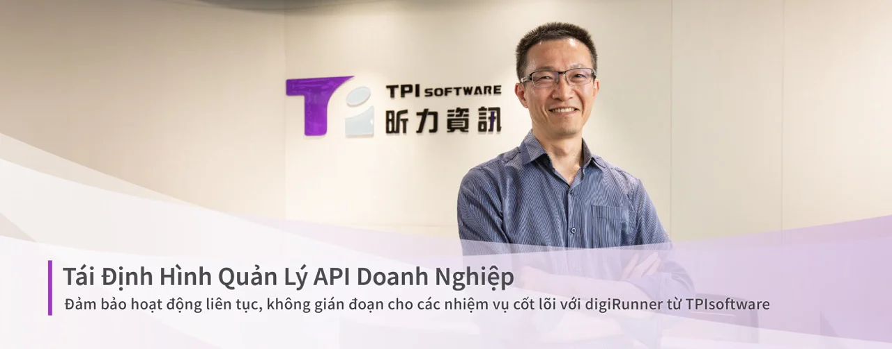
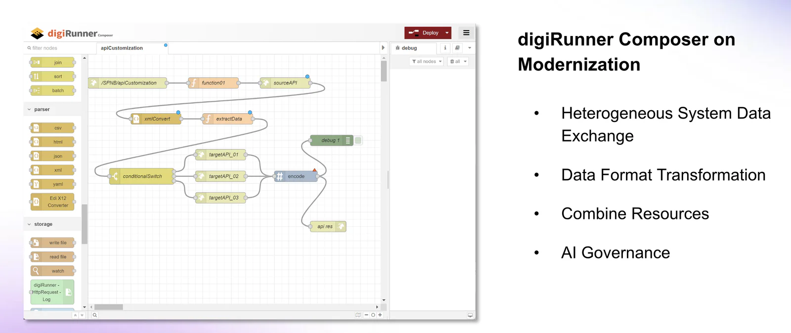

*Pierre Hsia, Phó Chủ Tịch Điều Hành, Bộ Phận Phát Triển Sản Phẩm Ứng Dụng Doanh Nghiệp tại TPIsoftware*

Các dịch vụ kỹ thuật số đang dần trở thành một phần không thể thiếu trong cuộc sống hàng ngày. Để đảm bảo trải nghiệm dịch vụ liền mạch, việc quản lý API toàn diện là yếu tố không thể thiếu trong việc xây dựng một hệ sinh thái kỹ thuật số phát triển mạnh mẽ. Khi mở API cho cộng đồng nhà phát triển, doanh nghiệp có thể thúc đẩy sự sáng tạo và tích hợp giữa các ứng dụng, tạo đà cho quá trình chuyển đổi số.

API được xem như “công thức” hoàn hảo cho thành công trong kinh doanh, nhưng cũng đặt ra không ít thách thức, đặc biệt là trong quản lý khối lượng dữ liệu lớn. Đó là lý do vì sao một chiến lược quản lý API mạnh mẽ lại đóng vai trò quan trọng, vừa giúp giám sát hiệu quả vừa đảm bảo truyền tải dữ liệu an toàn, tuân thủ và ổn định.

Hiểu rõ điều này, TPIsoftware đã phát triển digiRunner 4.0 – nền tảng quản lý API dành cho doanh nghiệp với nhiều tính năng vượt trội. Phiên bản mới đã chuyển đổi từ kiến trúc máy ảo (VM) sang kiến trúc container, áp dụng phương pháp tiếp cận API-first nhằm tăng cường tính linh hoạt trong triển khai. Với các tính năng sáng tạo cho phép mở rộng tự động và vận hành không gián đoạn, digiRunner 4.0 nổi bật như một giải pháp đáng tin cậy cho các hệ thống vận hành cốt lõi, tạo nên sự khác biệt so với các nền tảng quản lý API khác.

**digiRunner - Vinh Danh Trên Trường Quốc Tế**

Ở giai đoạn đầu, digiRunner được định vị là sản phẩm tập trung vào quản lý API, tương tự như các nhà cung cấp dịch vụ khác, khiến sản phẩm chưa có sự khác biệt rõ rệt trên thị trường, ông Pierre Hsia, Phó Chủ tịch Điều hành của TPIsoftware phụ trách Phát triển Sản phẩm Ứng dụng Doanh nghiệp chia sẻ. Ông cũng cho biết TPIsoftware đã tái định vị digiRunner thành nền tảng quản lý API (APIM) chuyên biệt cho các hệ thống cốt lõi, tạo nên sự khác biệt độc đáo và gia tăng giá trị của sản phẩm.

Nhờ vào sự đổi mới này, TPIsoftware đã được công nhận toàn cầu, lọt vào danh sách 500 Công ty Tăng trưởng Nhanh của Financial Times tại khu vực APAC trong ba năm liên tiếp – đồng thời là công ty phần mềm duy nhất từ Đài Loan đạt được thành tựu này. digiRunner hiện được áp dụng rộng rãi trong nhiều ngành công nghiệp, từ hệ thống ngân hàng lõi trong lĩnh vực tài chính, đến Hệ thống Thông tin Bệnh viện (HIS) trong ngành y tế, cũng như các ứng dụng khác trong lĩnh vực năng lượng, giao thông, và nhiều lĩnh vực khác. Với digiRunner, những dịch vụ cốt lõi này được đảm bảo hoạt động mượt mà và liên tục, tránh khỏi các gián đoạn có thể gây ra tổn thất tài chính lớn hoặc rủi ro an toàn.

digiRunner sử dụng kiến trúc microservices để triển khai trên Kubernetes (K8s), với các cơ chế giám sát hiệu suất dịch vụ liên tục. Trong các giai đoạn có lưu lượng truy cập lớn, tính năng mở rộng tự động (auto-scaling) sẽ kích hoạt để điều chỉnh tài nguyên động, giúp quản lý các đột biến lưu lượng một cách hiệu quả – tất cả là nhờ vào kiến trúc container và Kubernetes của digiRunner.

Khi được hỏi về cách digiRunner bảo vệ các hệ thống vận hành cốt lõi trong vai trò là một API Gateway, ông Pierre giải thích rằng digiRunner được trang bị khả năng cân bằng tải, phân phối lưu lượng truy cập đồng đều qua nhiều máy chủ backend, đảm bảo trải nghiệm người dùng mượt mà. Trong trường hợp gặp sự cố với máy chủ, digiRunner có thể điều hướng lưu lượng đến các máy chủ khả dụng khác dựa trên cấu hình do người dùng định sẵn, giữ cho hệ thống luôn ổn định và tin cậy.

*Khi một trong các máy chủ backend gặp sự cố, digiRunner tự động chuyển hướng lưu lượng truy cập đến các máy chủ đang hoạt động và sẽ chuyển lại lưu lượng khi máy chủ bị lỗi hoạt động trở lại.*

**Hướng Đến Cộng Đồng Nguồn Mở**

Khi nói đến hỗ trợ bảo mật, khả năng mở rộng và linh hoạt, digiRunner thể hiện những điểm khác biệt so với các nền tảng quản lý API (APIM) khác. Điểm nổi bật của digiRunner 4.0 là khả năng đạt được tính khả dụng cao, độ tin cậy và khả năng chịu lỗi, giúp phục hồi nhanh chóng và sao lưu dữ liệu, đảm bảo hoạt động liên tục và đáp ứng các yêu cầu của thỏa thuận mức dịch vụ (SLA).

Phiên bản mới nhất của digiRunner đã đạt những tiến bộ đáng kể về hiệu suất, đảm bảo hoạt động API không bị gián đoạn. Một trong những công nghệ cốt lõi đứng sau là Smart Caching, giúp tối ưu hóa hiệu suất hệ thống bằng cách quản lý lưu trữ và truy xuất dữ liệu một cách thông minh dựa trên trạng thái của hệ thống backend. Công nghệ còn lại là In-Memory Gateway, trong đó các thao tác dữ liệu được xử lý trực tiếp trên bộ nhớ với cơ chế quản lý, phối hợp và kiểm soát các node phụ từ node chính để đảm bảo tính nhất quán dữ liệu.

digiRunner còn nổi bật với API Composer, một công cụ dễ sử dụng giúp đẩy nhanh quá trình phát triển các dịch vụ giá trị gia tăng. Công cụ này hỗ trợ tạo nhanh các API, chuyển đổi định dạng dữ liệu và tuân theo phương pháp tiếp cận API-First. Người dùng có thể tạo luồng API và chuyển đổi dữ liệu thông qua giao diện kéo-thả đơn giản mà không cần thay đổi hệ thống hiện tại, giúp liên kết dễ dàng với các hệ thống bên ngoài.

*Thiết kế API của digiRunner dùng cho API Composition và chuyển đổi định dạng dữ liệu*

Đầu năm nay, digiRunner đã hoàn thành đánh giá kỹ thuật nền tảng của Amazon Web Services (AWS FTR) và hiện đã có mặt trên AWS Marketplace. Người dùng có thể triển khai trên môi trường đám mây dành cho container và Kubernetes (K8s) với bốn tùy chọn: **Lite Standalone, Lite High Availability, Enterprise Standalone và Enterprise High Availability. Trong đó, các phiên bản High Availability đều được tích hợp tính năng Auto Scaling và OpenSearch.** digiRunner cũng cung cấp bản dùng thử miễn phí 30 ngày với các tùy chọn thanh toán linh hoạt theo giờ hoặc đăng ký hàng năm.

TPIsoftware đã xây dựng lộ trình chiến lược cho digiRunner với trọng tâm là thúc đẩy mã nguồn mở. Để hỗ trợ mục tiêu này, TPIsoftware đã thành lập bộ phận mã nguồn mở chuyên biệt nhằm quản lý quy định, cấp phép và các yêu cầu tài liệu. Bằng cách tối ưu hóa các tài nguyên và kênh mã nguồn mở, công ty mong muốn digiRunner sẽ thâm nhập sâu hơn vào thị trường mã nguồn mở. Tầm nhìn của TPIsoftware là tiếp cận từ cấp cơ sở, nơi cộng đồng kỹ thuật như các kỹ sư và nhân viên kỹ thuật có thể đóng vai trò quan trọng hơn trong các quyết định liên quan đến APIM – những quyết định vốn thường do lãnh đạo cấp cao đưa ra.

TPIsoftware cũng đang mở rộng sang thị trường mã nguồn mở theo cả chiều ngang và chiều dọc. Theo chiều ngang: TPIsoftware tích cực hợp tác với cộng đồng phát triển, thúc đẩy đổi mới và đẩy nhanh quá trình cải tiến sản phẩm. Bằng cách áp dụng cách tiếp cận mã nguồn mở, công ty mong muốn sản phẩm của mình có thể tùy chỉnh và đáp ứng nhu cầu của doanh nghiệp.

Theo chiều dọc: TPIsoftware đã mở rộng hợp tác với SUSE, nhà cung cấp giải pháp chuyển đổi AI hàng đầu, bằng cách tích hợp digiRunner vào Rancher, nền tảng quản lý Kubernetes (K8s) mã nguồn mở phổ biến. Trong tương lai, TPIsoftware có kế hoạch tích hợp các công cụ mã nguồn mở khác như Quản lý Quy trình Kinh doanh (BPM) và Trí tuệ Kinh doanh (BI), nhằm xây dựng một cộng đồng phát triển sôi động và sáng tạo.

digiRunner đã chứng minh hiệu quả của mình qua các ứng dụng thực tế. Tại Đài Loan, digiRunner đã hỗ trợ chính quyền thành phố Đài Bắc thiết lập nền tảng APIM nhằm hợp nhất dữ liệu giữa các cơ quan. Nền tảng này, triển khai trên môi trường K8s và được tích hợp API Developer Portal, giúp cải thiện khả năng truy cập, phối hợp dữ liệu mở và dịch vụ công cộng. Trên thị trường quốc tế, digiRunner đã triển khai thành công cho Pharmacity, chuỗi nhà thuốc lớn nhất Việt Nam, giúp cập nhật hàng tồn kho theo thời gian thực trên hàng trăm chi nhánh, tối ưu hóa quy trình mua sắm, nhập liệu khách hàng và quản lý đơn hàng.

TPIsoftware hiện đang tìm kiếm cơ hội hợp tác với khách hàng để triển khai digiRunner như một AI Gateway, hỗ trợ quản lý các mô hình ngôn ngữ lớn (LLM), bảo mật token, quyền riêng tư dữ liệu và trao đổi dữ liệu. AI Gateway của digiRunner còn là cầu nối giữa LLM và cơ sở dữ liệu Truy xuất Tăng cường (RAG), cho phép các doanh nghiệp nhận được kết quả AI một cách an toàn và chính xác hơn.

**[Tải về digiRunner](https://aws.amazon.com/marketplace/seller-profile?id=seller-jnqhhvmszbeua)**
