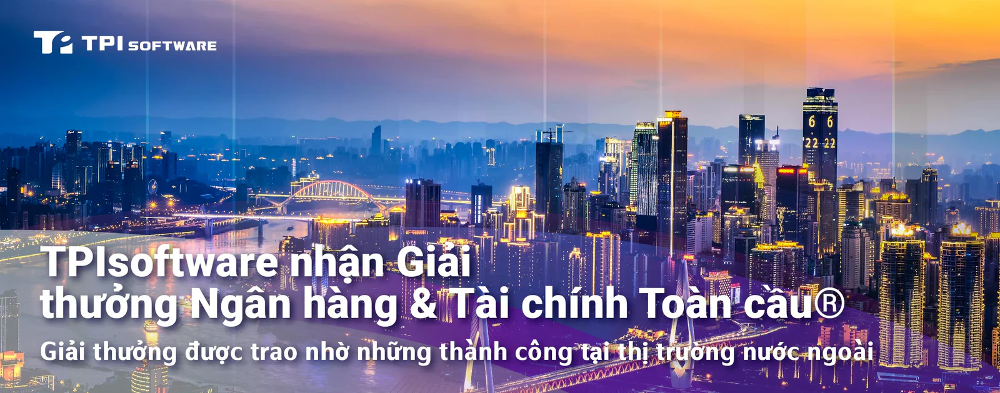

TPIsoftware (7781) đã vinh dự nhận giải thưởng API Ngân hàng Mở Tốt nhất khu vực Nam Á năm 2024 từ Giải thưởng Ngân hàng & Tài chính Toàn cầu® nhằm ghi nhận thành công của nền tảng quản lý API doanh nghiệp độc quyền digiRunner. Được thành lập vào năm 2011 bởi Global Banking and Finance Review, một nền tảng truyền thông tài chính hàng đầu có trụ sở tại Vương quốc Anh, giải thưởng danh giá này ghi nhận sự xuất sắc trong các lĩnh vực ngân hàng, bảo hiểm, đầu tư cũng như các lĩnh vực tài chính khác.

TPIsoftware là công ty phần mềm duy nhất trong số những công ty nhận giải tới từ Đài Loan năm nay, cùng với các tổ chức lớn như Mega Bank, Shin Kong Financial Holding và Yuanta Bank. Giải thưởng này là minh chứng cho năng lực của digiRunner trong nỗ lực đáp ứng nhu cầu quản trị CNTT tiên tiến của các doanh nghiệp vừa và lớn, khẳng định vị thế của công ty với tư cách là một doanh nghiệp vững mạnh trên thị trường quản lý API toàn cầu.

Với nhiều năm kinh nghiệm và kiến thức chuyên sâu trong ngành tài chính Đài Loan, TPIsoftware cung cấp các giải pháp phù hợp để đáp ứng nhu cầu ngày một đa dạng của các doanh nghiệp trên toàn thế giới. Chiến lược tập trung của công ty vào thị trường Đông Nam Á đã đạt được thành công đáng kể, thể hiện qua các dự án chuyển đổi cho các tổ chức tài chính ở nước ngoài. Một trong số đó là nền tảng kỹ thuật số được xây dựng cho Ngân hàng Cathay United (Việt Nam) nhằm tự động hóa đơn xin vay, giúp rút ngắn đáng kể thời gian xử lý từ nhiều ngày xuống chỉ còn 30 phút. Việc TPIsoftware triển khai nền tảng đám mây toàn diện cho Cathay Century Insurance (Việt Nam) cũng đảm bảo khả năng tích hợp liền mạch và cung cấp dịch vụ hiệu quả. Ngoài ra, TPIsoftware đã hỗ trợ Ngân hàng Cathay United (Campuchia) ra mắt ứng dụng ngân hàng di động mới, tích hợp với dịch vụ chuyển tiền do nhà nước hậu thuẫn cũng như dịch vụ thanh toán QR để cải thiện khả năng tiếp cận kỹ thuật số trên toàn quốc.

Ông Ben Yao, Chủ tịch TPIsoftware cho biết: "Việc nền tảng quản lý API doanh nghiệp digiRunner nhận được giải thưởng quốc tế này càng khẳng định vị thế của TPIsoftware với tư cahcs là công ty dẫn đầu toàn cầu trong lĩnh vực phát triển phần mềm. Cùng với việc được chứng nhận và niêm yết trên AWS Marketplace và Google Cloud Platform, digiRunner là minh chứng cho năng lực kỹ thuật tiên tiến của chúng tôi. Việc chính phủ Việt Nam đầu tư mạnh vào chuyển đổi số, TPIsoftware tận dụng chuyên môn về Fintech của mình như một mô hình thành công để hiện đại hóa các dịch vụ tài chính và bảo hiểm, cũng như tạo điều kiện cho các sáng kiến ESG của các công ty trong nước".

Ông Marcus Yao, Phó chủ tịch điều hành cấp cao của Cathay Financial Holdings, đồng tình với quan điểm này khi phát biểu: "Chuyên môn sâu rộng của TPIsoftware đóng vai trò then chốt trong chiến lược mở rộng hoạt động tại Đông Nam Á của Cathay Financial Holdings, thúc đẩy chuyển đổi số và tạo ra các ứng dụng tài chính sáng tạo. Trong lúc Việt Nam đang ở trên chặng đường trở thành một trung tâm chiến lược, chúng tôi đặt niềm tin vào sự tận tâm của TPIsoftware trong việc đổi mới phần mềm và những đóng góp của công ty cho Cathay Financial Holdings trong khu vực".
