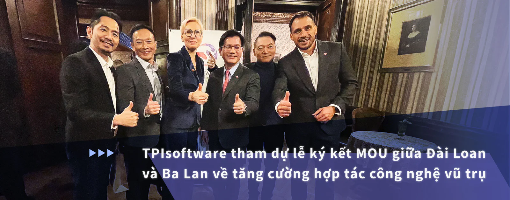

Phòng Thương mại Đài Loan-Ba Lan (TAIPO) và cụm IoT & AI SINOTAIC của Ba Lan đã ký Biên bản ghi nhớ (MOU) để tăng cường hợp tác trong các ứng dụng vệ tinh và công nghệ không gian giữa hai quốc gia. Lễ ký kết diễn ra tại Hội nghị Quốc tế về Khoa học, Công nghệ và Công nghiệp Vũ trụ Đài Loan (TASTI2024) do Cơ quan Vũ trụ Đài Loan (TASA) tổ chức vào ngày 2 tháng 12. Thứ trưởng Bộ Ngoại giao Đài Loan, Wu Chih-chung, đã chứng kiến sự kiện này, tại đây TPIsoftware do Chủ tịch Ben Yao đại diện, được mời tham dự cùng với một phái đoàn Đài Loan gồm các nhà lãnh đạo công nghệ và các tổ chức thương mại.

Trước đó vào ngày 22 tháng 11, một nhóm các doanh nghiệp do Bộ trưởng Ngoại giao Đài Loan Lin Chia-lung dẫn đầu đã tham gia Diễn đàn Hợp tác Kinh tế Ba Lan - Đài Loan được tổ chức tại Łódź để thắt chặt hợp tác thương mại. Thị trưởng Łódź Hanna Zdanowska đã chứng kiến lễ ký kết MOU giữa Chủ tịch Phòng Công nghiệp và Thương mại Ba Lan - Đài Loan Agnieszka Sygitowicz và Chủ tịch TAIPO Chung-Chieh Chao, đánh dấu một bước tiến quan trọng trong việc mở rộng hợp tác giữa Đài Loan và Ba Lan trong các ngành công nghệ cao.

TPIsoftware, được biết đến với các giải pháp quản lý API mạnh mẽ trong các lĩnh vực chính như tài chính, chăm sóc sức khỏe, sản xuất và dịch vụ công, hiện đã sẵn sàng sử dụng chuyên môn của mình trong lĩnh vực hàng không vũ trụ. Công ty sẽ tận dụng nền tảng quản lý API độc quyền digiRunner của mình để hỗ trợ nhu cầu ngày càng tăng về các nhóm vệ tinh trên quỹ đạo trái đất ở tầng thấp (LEO), trung bình (MEO) và địa tĩnh (GEO). Bằng cách cho phép phân phối dữ liệu động và tăng cường hiệu suất vệ tinh, digiRunner sẽ đóng một vai trò quan trọng trong việc hỗ trợ giao tiếp giữa mặt đất-không trung-không gian, điều này rất quan trọng để thúc đẩy các công nghệ như thành phố thông minh, xe tự lái, Internet vạn vật (IoT) và các dịch vụ y khoa từ xa.

"Chúng tôi rất vinh dự được tham gia vào nỗ lực hợp tác xuyên quốc gia này và đóng góp chuyên môn của mình vào chương trình mạng lưới vệ tinh giữa Đài Loan và Ba Lan", Ben Yao nhận xét, nhấn mạnh tầm quan trọng của sự hợp tác khi TPIsoftware tiến vào ngành công nghiệp vũ trụ và tiếp tục nỗ lực trong lĩnh vực chuyển đổi kỹ thuật số toàn cầu. "Nền tảng quản lý API digiRunner của chúng tôi được định hướng để thúc đẩy sự tiến bộ của truyền thông vệ tinh và chúng tôi mong muốn mở rộng phạm vi ra toàn cầu và thúc đẩy đổi mới trong lĩnh vực hàng không vũ trụ".
