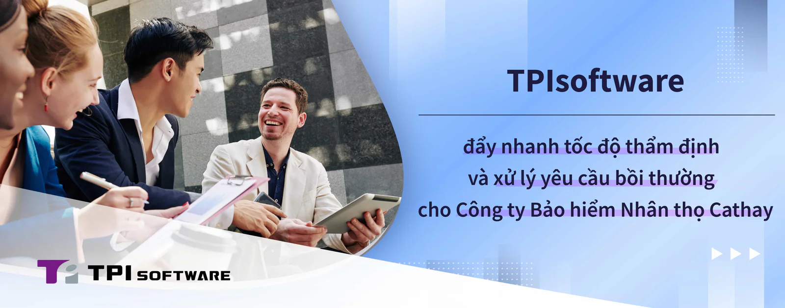

Là một chuyên gia hàng đầu lĩnh vực Fintech (công nghệ tài chính) và Insurtech (công nghệ bảo hiểm), TPIsoftware một lần nữa thể hiện chuyên môn kỹ thuật số của mình trong việc cung cấp các giải pháp công nghệ cho Công ty Bảo hiểm Nhân thọ Cathay. Với việc Cathay sử dụng nền tảng Quản lý quy trình kinh doanh (BPM) digiFlexis và digiMars của TPIsoftware, một nền tảng quản lý dữ liệu lớn được thiết kế để nâng cấp phiên bản cộng đồng MongoDB cho mục đích thương mại, hiệu suất thẩm định bảo hiểm và xử lý yêu cầu bồi thường của công ty bảo hiểm này đã tăng 86 lần.

TPIsoftware đã phát triển một nền tảng xử lý hình ảnh để giải quyết vấn đề không nhất quán trong dữ liệu hiện tại của Cathay, cải thiện việc nhập dữ liệu và quét tài liệu để hợp lý hóa hoạt động thẩm định và xử lý các yêu cầu bồi thường bảo hiểm. Để giải quyết các thách thức liên quan đến mở rộng quy mô hạ tầng cho quản lý khối dữ liệu lớn, digiFlexis và digiMars đã được tích hợp để cho phép giám sát quy mô rộng đối với hơn 60 máy chủ. TPIsoftware cũng sử dụng các kỹ thuật nén tiên tiến để giải phóng 40% không gian lưu trữ nhằm tăng khả năng mở rộng và tiết kiệm chi phí.

Nhận thức được tầm quan trọng của văn hóa tổ chức, khả năng thích ứng của nhân viên và tích hợp quy trình làm việc, TPIsoftware có cách tiếp cận toàn diện để chuyển đổi kỹ thuật số, không chỉ đơn thuần là nâng cấp phần cứng hoặc triển khai phần mềm mới. Điều này đảm bảo quá trình chuyển đổi liền mạch sang cách thức vận hành hiện đại đồng thời thúc đẩy tăng trưởng và đổi mới liên tục. TPIsoftware cung cấp các dịch vụ tư vấn đầu cuối và các giải pháp phần mềm, hướng dẫn doanh nghiệp qua từng bước của quá trình chuyển đổi. Việc tích hợp digiFlexis đã cho phép Công ty Bảo hiểm Nhân thọ Cathay hiện đại hóa các quy trình của mình, trong khi digiMars cung cấp khả năng quản lý MongoDB mạnh mẽ, bao gồm giám sát, cảnh báo, sao lưu và khắc phục sự cố. Các tính năng này hoạt động song song để bổ sung cho các hệ thống hiện có bằng cách giải quyết những chỗ còn thiếu trong khả năng của nhà cung cấp, đảm bảo hoạt động kinh doanh hiệu quả và lâu dài hơn.

"Đối với các doanh nghiệp - đặc biệt là các tổ chức tài chính và công ty bảo hiểm - tìm kiếm một đối tác công nghệ đáng tin cậy để hỗ trợ họ trong hành trình chuyển đổi kỹ thuật số, chuyên môn nghề nghiệp và kiến thức sâu rộng trong ngành là chìa khóa để triển khai thành công", Yilan Yeh, tổng giám đốc của TPIsoftware cho biết. "Với TPIsoftware cung cấp hỗ trợ tư vấn đầy đủ từ giai đoạn lập kế hoạch đến khi nền tảng đi vào hoạt động, chúng tôi cam kết giúp khách hàng của mình định hướng trong bối cảnh kỹ thuật số và đạt được thành công lâu dài".
