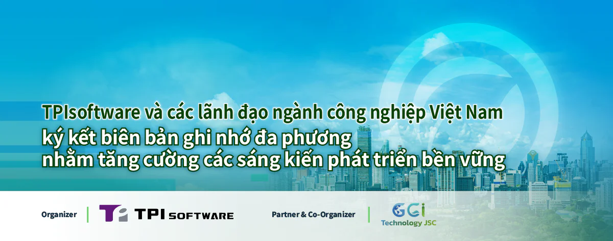

Công ty phần mềm TPIsoftware (TWSE: 7781) của Đài Loan và các đối tác sẽ ký Biên bản ghi nhớ (MOU) đa phương để chính thức hóa mối quan hệ hợp tác xuyên biên giới về phương diện tạo điều kiện kiểm kê khí nhà kính (GHG) bằng các giải pháp ứng dụng công nghệ. Lễ ký kết biên bản ghi nhớ sẽ diễn ra vào ngày 26/12 tại Hà Nội, Việt Nam, cùng với lễ ra mắt sản phẩm GreenSwift — nền tảng quản lý carbon do AI điều khiển của TPIsoftware.

Biên bản ghi nhớ này đưa ra một khung nhằm tăng cường cam kết về Môi trường, Xã hội và Quản trị (ESG) của các bên thông qua việc tăng cường tuân thủ quy định và minh bạch, cho phép doanh nghiệp công bố lượng phát thải carbon vì một tương lai bền vững, không phát thải carbon. Dưới sự dẫn dắt của TPIsoftware và Global Green Innovation Technology (GGI., Technology), lễ ký kết biên bản ghi nhớ quy tụ các quan chức chính phủ, khu vực tư nhân và các chuyên gia ESG tại Việt Nam và sẽ có sự chứng kiến của Tiến sĩ Nguyễn Kim Anh - Chuyên gia tư vấn ESG và Nhà khoa học cao cấp tại Viện Địa lý thuộc Viện Hàn lâm Khoa học và Công nghệ Việt Nam, Tony Kuo - Nhà sáng lập kiêm CEO của Katina Capital Partners, Mai Hoài An - Chủ tịch ITD Group, Phan Quốc Dũng - Phó Chủ tịch kiêm Tổng giám đốc Bảo hiểm Bảo Long và Thomas Cheng - Tổng giám đốc ThinkTron Ltd.

Sau khi ký kết Biên bản ghi nhớ, việc ra mắt sản phẩm GreenSwift sẽ tập trung vào phương pháp tiếp cận toàn diện và thiết thực để đạt được mức phát thải ròng bằng 0 thông qua quản lý và kiểm kê carbon nhờ công nghệ AI tiên tiến. Diễn giả chính là đại diện của Bộ Giao thông vận tải và Bộ Khoa học và Công nghệ Việt Nam, những người sẽ đi sâu vào những cơ hội cũng như thách thức đang diễn ra trong hoạt động ứng phó với biến đổi khí hậu và tính bền vững của môi trường tại quốc gia này. Ngoài ra, Tiến sĩ Nguyễn Kim Anh sẽ chia sẻ phân tích chuyên sâu về cách thức triển khai hiệu quả các tiêu chuẩn ESG trên khắp các ngành tại Việt Nam. Sự kiện sẽ tiếp nối bằng buổi giới thiệu sản phẩm do ông Đỗ Vương Phong, Tổng giám đốc TPIsoftware Việt Nam, trình bày để giới thiệu các tính năng chính của GreenSwift. Nền tảng quản lý carbon áp dụng AI tạo sinh để cho phép kiểm kê GHG hiệu quả, tinh gọn báo cáo và đảm bảo tuân thủ các tiêu chuẩn quốc tế.

Ông Đỗ Vương Phong, Tổng giám đốc TPIsoftware Việt Nam, cho biết: "GreenSwift là nền tảng quản lý carbon dựa trên SaaS được thiết kế để đo lường mức giảm phát thải carbon và tối đa hóa các nỗ lực ESG của họ. GreenSwift cho phép các doanh nghiệp củng cố chiến lược ESG của họ thông qua việc tinh gọn hoạt động hạch toán GHG, giúp các sáng kiến phát triển bền vững của họ được rõ ràng và mang lại tác động tích cực. Chúng tôi mong muốn xây dựng mối quan hệ hợp tác lâu dài với chính quyền địa phương, khu vực tư nhân và người dân để hiện thực hóa cam kết của họ đối với các mục tiêu ESG".
