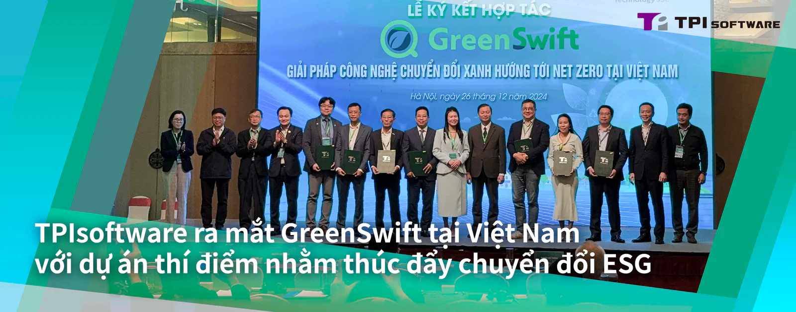

TPIsoftware (TWSE: 7781) và các đối tác chủ chốt của Việt Nam đã ký kết Biên bản ghi nhớ (MOU) để tăng cường hợp tác trong việc thúc đẩy một tương lai bền vững hơn, giảm phát thải carbon. Lễ ký kết diễn ra tại Hà Nội, Việt Nam, vào ngày 26 tháng 12, cùng với đó là sự kiện ra mắt sản phẩm GreenSwift, một nền tảng quản lý carbon dựa trên AI của TPIsoftware.

Sự kiện được dẫn dắt bởi TPIsoftware và Global Green Innovation Technology (GGI., Technology), một công ty tư vấn môi trường hàng đầu chuyên cung cấp dịch vụ tư vấn cho các dự án GHG (giảm phát thải khí nhà kín) và ESG (môi trường, xã hội và quản trị), sự kiện đã quy tụ các quan chức chính phủ, khu vực tư nhân và các chuyên gia ESG tại Việt Nam, với sự tham gia ký kết MOU của Tiến sĩ Nguyễn Kim Anh, Katina Capital Partners, ITD Group, Bao Long Insurance và ThinkTron Ltd.

Sự kiện khép lại với màn trình diễn trực tiếp về GreenSwift, trong đó các khách mời được giới thiệu về các tính năng chính của nền tảng như tự động thu thập dữ liệu carbon, theo dõi bảy khí nhà kính thuộc Phạm vi 1, 2 và 3 thông qua một nền tảng tập trung và liên kết nhiều chỉ số bằng cách sử dụng phương pháp tiếp cận dựa trên đám mây để cải thiện hiệu suất kiểm toán carbon.

GreenSwift là một nền tảng quản lý carbon dựa trên SaaS với dịch vụ tư vấn ESG chuyên nghiệp và sự hỗ trợ tại địa phương, giúp các doanh nghiệp thực hiện báo cáo carbon và lý tưởng cho các doanh nghiệp vừa và nhỏ (SMB) muốn ưu tiên các sáng kiến ESG. Nền tảng này có tính năng báo cáo GHG tuân thủ các tiêu chuẩn quốc tế (ISO 14064-1:2018 và IPCC) và đáp ứng tuân thủ các quy định. GreenSwift cho phép các doanh nghiệp có ý thức bảo vệ môi trường hướng tới mục tiêu không phát thải bằng cách tự điều chỉnh theo các giá trị và cách làm tốt nhất của ESG, nâng cao hình ảnh thương hiệu của họ thông qua đầu tư bền vững dài hạn và các sáng kiến chiến lược ESG.

Ông Đỗ Vương Phong, Tổng giám đốc TPIsoftware Việt Nam, cho biết: "Chúng tôi luôn cam kết giúp các doanh nghiệp vượt qua những thách thức trong hành trình chuyển đổi xanh của họ. Với việc chính phủ Việt Nam thúc đẩy các tiêu chuẩn ESG và cách thức kinh doanh bền vững, việc ra mắt GreenSwift không chỉ cho phép các doanh nghiệp ở Việt Nam quản lý và đo lường tác động môi trường của họ, mà còn tái khẳng định cam kết của chúng tôi trong việc hợp tác với các đối tác tập trung vào ESG để xây dựng một tương lai xanh hơn cho Việt Nam".

Việc ký kết MOU diễn ra sau công bố gần đây của TPIsoftware về một dự án thí điểm triển khai GreenSwift và ElectriSwift (Hệ thống bảo tồn năng lượng tòa nhà được AI hỗ trợ) tại Khu công nghiệp sinh thái Nam Cầu Kiền. Ông Phạm Hồng Điệp, Chủ tịch khu công nghiệp, nhận xét: "Xây dựng quan hệ đối tác với TPIsoftware thể hiện cam kết của chúng tôi trong việc hợp tác phát triển và thúc đẩy các sáng kiến bền vững trong hành động khí hậu thông qua các phương pháp và giải pháp dựa trên công nghệ. Nỗ lực chung này cho thấy tầm nhìn chung của cả hai bên trong việc tận dụng công nghệ tiên tiến để nâng cao hiệu quả năng lượng và thúc đẩy các hoạt động công nghiệp thân thiện với môi trường tại Việt Nam".
