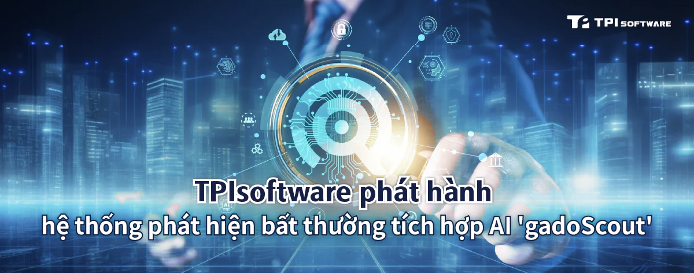

TPIsoftware (TWSE: 7781), công ty phần mềm hàng đầu của Đài Loan chuyên về chuyển đổi số, đã ra mắt Hệ thống phát hiện điểm cuối bất thường tích hợp AI mới nhất ***gadoScout***. Hệ thống tận dụng công nghệ AI tiên tiến để phân tích các mối đe dọa tiềm ẩn và tự động hóa cảnh báo, giảm hiệu quả khối lượng công việc CNTT và nâng cao hiệu quả hoạt động thông qua các biện pháp bảo vệ trước.

***gadoScout*** sử dụng máy học để phát hiện sự bất thường bằng cách xác định các mô thức, hành vi và sự kiện khác với các trường hợp dự kiến một cách chủ động. Không giống như các phương pháp dựa trên quy tắc, phụ thuộc vào các tham số được xác định trước để gắn cờ khác biệt dựa trên các mô hình dự đoán, ***gadoScout*** nhận ra các mô thức đe dọa trong thời gian thực với độ chính xác được cải thiện và phòng ngừa cảnh báo sai hiệu quả. Điều này cho phép nhóm Kỹ thuật độ tin cậy của trang web (SRE) tiến hành chẩn đoán sớm và phản ứng nhanh chóng để giải quyết các vấn đề hệ thống.

Với kiến trúc linh hoạt và cơ chế học liên tục, ***gadoScout*** được thiết kế để đáp ứng nhu cầu giám sát và cảnh báo của doanh nghiệp đối với các kịch bản ứng dụng đa dạng. ***gadoScout*** tăng cường độ tin cậy của hệ thống thông qua việc phát hiện bất thường trước, cho phép nhóm SRE tập trung vào giải quyết các vấn đề thực sự có thể gây nguy hiểm cho hoạt động của công ty thay vì đối phó với các vấn đề được gắn cờ sai. Điều này sẽ rút ngắn đáng kể thời gian phát hiện và giải quyết vấn đề, giảm thiểu rủi ro thời gian ngừng hoạt động và tổn thất tài chính đồng thời tăng cường an ninh hoạt động. Ngoài ra, ***gadoScout*** có một nền tảng thống nhất cung cấp thông tin chi tiết theo ngữ cảnh tích hợp để cộng tác liền mạch trong việc xử lý xâm nhập và giao tiếp hiệu quả giữa các nhóm.

Tổng giám đốc của TPIsoftware Yilan Yeh cho biết: "Khả năng mang lại thành công cho doanh nghiệp của chúng tôi bắt nguồn từ kinh nghiệm sâu rộng và hiểu biết sâu sắc về nhu cầu của khách hàng. Sau khi triển khai ***gadoScout*** và ra mắt sản phẩm GreenSwift (một nền tảng quản lý carbon dựa trên AI) tại Hà Nội, Việt Nam, TPIsoftware đã hoàn thiện danh mục sản phẩm của mình, bao gồm nền tảng iPaaS trung gian ***DigiFusion***, loạt AI đàm thoại ***SysTalk.ai***, nền tảng quản lý bền vững ***ESGswift*** và nền tảng bảo mật doanh nghiệp ***GadoSecurity***. Điều này thể hiện tham vọng của chúng tôi trong việc mở rộng sự hiện diện trên toàn cầu của các giải pháp phần mềm do Đài Loan phát triển thông qua quan hệ đối tác chiến lược với các đơn vị đầu ngành vẫn không lay chuyển".
