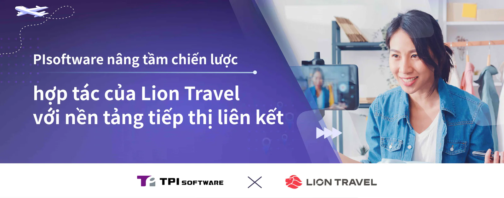

TPIsoftware đã nâng tầm chiến lược hợp tác của Lion Travel bằng cách phát triển một nền tảng tiếp thị liên kết mới kết nối những người có ảnh hưởng và người sáng tạo nội dung. Nền tảng này cho phép công ty du lịch hàng đầu mở rộng phạm vi tiếp cận bằng cách tận dụng các mối quan hệ uy tín mà các đối tác liên kết có với khán giả của họ, cho phép công ty nhắm mục tiêu hiệu quả vào nhóm khách hàng thích hợp và khuếch đại tác động của các nỗ lực tiếp thị.

Nền tảng cung cấp cho mỗi đối tác liên kết một liên kết tiếp thị duy nhất mà họ có thể chia sẻ trên trang web, kênh truyền thông xã hội và các nền tảng khác để quảng bá dịch vụ cho những người theo dõi của họ đồng thời theo dõi các đơn đặt hàng và thanh toán hoa hồng ở một nơi. Toàn bộ quá trình - từ đặt hàng đến hoàn thành giao dịch - được theo dõi với nỗ lực tối thiểu của con người. Điều này cho phép đại lý du lịch phân bổ doanh thu cho những người có ảnh hưởng cụ thể và trả thù lao chính xác cho họ. Nền tảng này cũng có các công cụ báo cáo trực quan cung cấp thông tin chi tiết về hiệu suất chiến dịch, bao gồm lượt xem nội dung trên các nền tảng, chi tiết đơn hàng và hoa hồng bán hàng. Tỷ lệ hoa hồng có thể tùy chỉnh và tự động tính toán dựa trên các kênh tiếp thị và loại tour du lịch đã chọn, hợp lý hóa việc xem xét và phê duyệt rút tiền của các đối tác liên kết cũng như ghi có các khoản thanh toán.

"Báo cáo năm 2024 của Hiệp hội Tiếp thị Kỹ thuật số cho thấy hơn 40% người tiêu dùng có nhiều khả năng mua sản phẩm hoặc dịch vụ hơn nếu một người có ảnh hưởng giới thiệu sản phẩm hoặc dịch vụ đó. Người mua tiềm năng có xu hướng tham khảo nội dung trực tuyến từ người có ảnh hưởng trước khi quyết định mua", Ben Chang, Giám đốc Tiếp thị của Lion Travel cho biết, và bổ sung thêm rằng "Việc ra mắt nền tảng tiếp thị liên kết giúp thúc đẩy quan hệ đối tác đôi bên cùng có lợi với người ảnh hưởng và người sáng tạo nội dung. Các blogger và vlogger du lịch có thể sử dụng nền tảng này để chia sẻ kinh nghiệm du lịch của họ và cung cấp hướng dẫn cho các loại tour du lịch khác nhau. Chúng tôi tin rằng điều này tạo ra cơ hội đa dạng cho người tiêu dùng, người có ảnh hưởng và các công ty du lịch".

Yilan Yeh, Tổng giám đốc TPIsoftware, nhấn mạnh thành công của dự án, nói rằng "Nhóm của chúng tôi đã sử dụng phương pháp quản lý dự án Water-Scrum-Fall để giúp khách hàng biến một ý tưởng sáng tạo thành một giải pháp thiết thực trong thời gian kỷ lục. Nền tảng đã được ra mắt trước thời hạn 1,5 tháng, thể hiện khả năng của chúng tôi trong việc cung cấp các giải pháp nhanh chóng và hiệu quả. Thành công mà chúng tôi đạt được với Lion Travel mở ra một con đường để các công ty du lịch có thể tận dụng quan hệ đối tác liên kết trong thế giới kỹ thuật số ngày nay. Đó là một minh chứng cho cách chúng tôi tạo ra giá trị và giúp khách hàng liên tục tăng trưởng".
