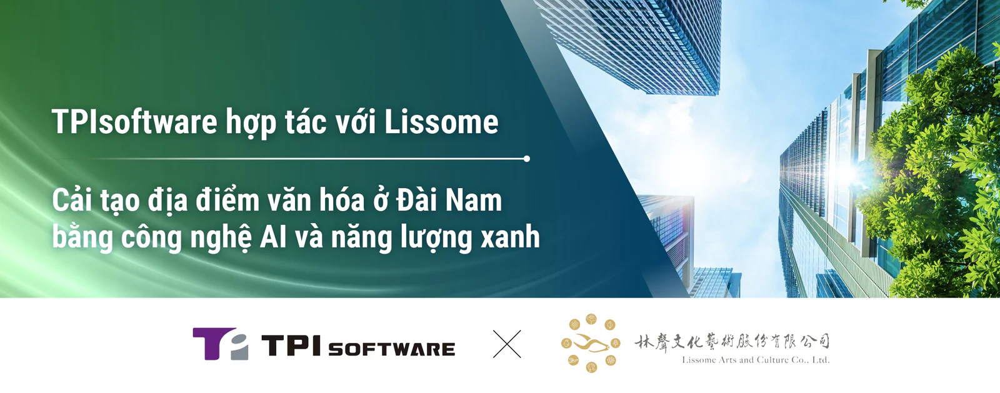

TPIsoftware (TWSE: 7781) và Công ty TNHH Lissome Arts and Culture đã công bố hợp tác để phục hồi một địa điểm văn hóa lịch sử ở quận Bắc của Đài Nam, một khu vực được chỉ định gần công viên văn hóa 321 Art Alley Settlement. Trong khuôn khổ của dự án, TPIsoftware sẽ hỗ trợ phát triển di tích văn hóa đầu tiên của Đài Loan tích hợp các công nghệ AI và năng lượng xanh cũng như cung cấp một loạt các giải pháp phần mềm để số hóa di tích này. Hợp đồng do Lissome và TPIsoftware ký kết trị giá 500 triệu Đài tệ, đánh dấu nỗ lực chung nhằm khai thác công nghệ AI giúp nâng cao trải nghiệm của du khách trong lĩnh vực văn hóa nghệ thuật.

Với chuyên môn sâu rộng trong lĩnh vực AI, phân tích dữ liệu lớn và quản lý năng lượng, TPIsoftware sẽ giới thiệu một nền tảng quản lý bền vững tự động để giám sát và giảm phát thải khí nhà kính (GHG) để tối ưu hóa hiệu quả năng lượng tại di tích này. Bằng cách tận dụng các chiến lược giảm carbon dựa trên dữ liệu, dự án này nhằm đạt được mục tiêu không phát thải và chứng minh khả năng thực hiện hiệu quả các sáng kiến ESG thông qua các giải pháp công nghệ.

"Với tổng vốn đầu tư 7,5 tỷ Đài tệ, chúng tôi đang cải tạo khu đất rộng 2,25ha thành một trung tâm văn hóa phương Đông cho thành phố Đài Nam, với hơn 2.500 tác phẩm nghệ thuật. Một triển lãm thường trực sẽ trưng bày bộ sưu tập tranh của hoạ sĩ nổi tiếng Xia Jing-Shan", Chủ tịch của Lissome Arts and Culture, Chao Chung-Chieh phát biểu tại lễ ký kết. "Giai đoạn đầu tiên của dự án dự kiến sẽ hoàn thành trong vòng bốn năm, với một trung tâm triển lãm rộng 10.000 mét vuông phục vụ làm không gian giải trí cho người dân. Lissome cũng mong muốn hỗ trợ các nghệ sĩ địa phương bằng cách trưng bày tác phẩm của họ, làm phong phú thêm sức sống đô thị của Đài Nam".

Chủ tịch TPIsoftware Ben Yao cho biết: "Sự hợp tác của chúng tôi với Lissome nhằm tái thiết và cải tạo di tích văn hóa lịch sử này cho thấy chuyên môn của chúng tôi trong chuyển đổi số trên nhiều lĩnh vực, bao gồm cả văn hoá nghệ thuật. Chúng tôi sẽ giới thiệu các giải pháp kỹ thuật số quan trọng như nền tảng trung gian, hệ thống thanh toán di động, nền tảng tiết kiệm năng lượng và các công cụ quản lý carbon để đảm bảo hoạt động hiệu quả, thân thiện với môi trường và liền mạch. Sáng kiến này đại diện cho cách các công nghệ tiên tiến và nghệ thuật có thể kết hợp với nhau trong tương lai. Cùng với Lissome, chúng tôi đang kiến tạo một tương lai bền vững, nơi di sản văn hóa và đổi mới kết nối với nhau".
