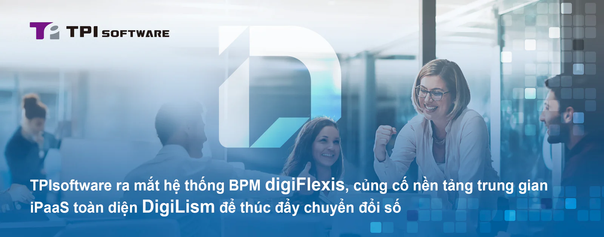

TPIsoftware (TWSE: 7781) đã ra mắt digiFlexis, Hệ thống quản lý quy trình nghiệp vụ (BPM) được thiết kế để tối ưu hóa quy trình làm việc của doanh nghiệp và nâng cao hiệu quả hoạt động. Nền tảng này cho phép phát triển và cải tiến nhanh chóng thông qua thiết kế không cần viết mã, với các tính năng chính như báo cáo phân tích, trình tạo biểu mẫu và khả năng tích hợp API nhằm xây dựng một môi trường làm việc năng động, linh hoạt trong kỷ nguyên số.

**digiFlexis: Tái định nghĩa quản lý quy trình nghiệp vụ cho các ngành**

digiFlexis tái định nghĩa quản lý quy trình ngiệp vụ với khả năng tích hợp vào các hệ thống hiện có như ERP và CRM. Được thiết kế như một nền tảng linh hoạt phù hợp với mọi quy mô doanh nghiệp, digiFlexis có các tính năng chính như trang chủ trực quan, dựa trên widget cho phép người dùng tùy chỉnh không gian làm việc của mình thông qua giao diện kéo và thả, với bảng điều khiển quản trị cung cấp thông tin chi tiết trực quan, theo thời gian thực về hoạt động kinh doanh.

digiFlexis tối ưu hóa quy trình làm việc bằng cách kết hợp phân công vai trò trong suốt quá trình xem xét và phê duyệt, thúc đẩy hợp tác và chia sẻ thông tin giữa các phòng ban. Một trình tạo biểu mẫu và quy trình làm việc mang đến sự linh hoạt để tùy chỉnh các quy trình nội bộ và cài đặt thông báo. Hoàn toàn tương thích với AWS, GCP và Azure, digiFlexis tạo điều kiện thuận lợi chuyển đổi số, trao quyền cho các doanh nghiệp để duy trì sự linh hoạt, an toàn và cạnh tranh trong bối cảnh số ngày nay.

**DigiLism: Nền tảng trung gian nâng cao hỗ trợ chuyển đổi số**

Sau khi phát hành digiFlexis, TPIsoftware đã công bố việc thay đổi thương hiệu quan trọng cho dòng sản phẩm cốt lõi của mình là nền tảng trung gian iPaaS - trước đây có tên là DigiFusion - nay là DigiLism, là sự kết hợp của từ "Digital" và "Realism," phản ánh sự hỗ trợ các doanh nghiệp hiện thực hóa các mục tiêu chuyển đổi số.

Việc thay đổi thương hiệu này đánh dấu cho sự kết hợp của các giải pháp đã được hoàn thiện của công ty, bao gồm nền tảng quản lý API digiRunner, nền tảng quản lý nhật ký digiLogs và nền tảng quản lý dữ liệu lớn digiMars cùng với digiFlexis.

TPIsoftware đã giới thiệu một bộ nhận diện hình ảnh mới với các mẫu hình học xen kẽ kết hợp chữ "D" và "L" cách điệu. Màu cam rực rỡ tượng trưng cho năng lượng và sự sáng tạo, trong khi màu xám đen thể hiện sự ổn định và chuyên nghiệp. Bong bóng thoại xoay phản ánh bản chất của DigiLism - một trung gian kết nối thông tin để hỗ trợ giao tiếp giữa các hệ thống, nhấn mạnh vai trò của nó trong việc kết nối thành công của khách hàng với các giải pháp kỹ thuật số.

Tổng Giám đốc TPIsoftware Yilan Yeh nhận xét: "Việc triển khai digiFlexis thể hiện tầm nhìn và cam kết của chúng tôi trong việc cung cấp trải nghiệm kỹ thuật số thống nhất, liền mạch cho các doanh nghiệp. DigiFlexis không chỉ là một giải pháp BPM giải quyết các vấn đề về dữ liệu rời rạc và các vấn đề liên phòng ban; nó thể hiện kinh nghiệm lâu năm của TPIsoftware trong việc giúp khách hàng vượt qua những thách thức phức tạp mà họ phải đối mặt trong bối cảnh không ngừng thay đổi. Bằng các giải pháp của mình, chúng tôi hướng đến việc trao quyền cho các đối tác để đổi mới và luôn dẫn đầu".
