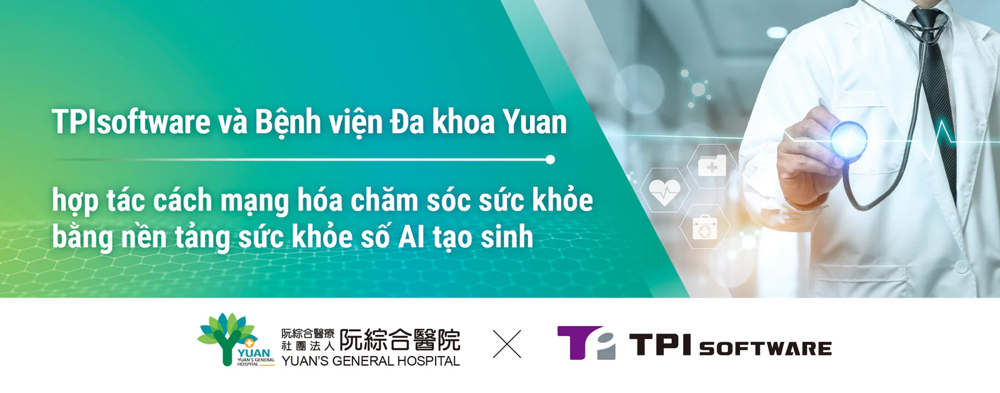

[TPIsoftware](/vi) (TWSE: 7781) và Bệnh viện Đa khoa Yuan, một cơ sở y tế hàng đầu ở miền Nam Đài Loan, đã hợp tác ra mắt nền tảng sức khoẻ số ứng dụng công nghệ AI tạo sinh để hỗ trợ chuyển đổi dữ liệu và tối ưu hóa trao đổi dữ liệu trong các hệ thống thông tin bệnh viện (HIS), nâng cao hiệu quả hoạt động thông qua các quy trình y tế tự động. Nền tảng này sẽ được ra mắt tại Hội nghị thượng đỉnh và Triển lãm Thành phố Thông minh Cao Hùng năm 2025, do chính quyền thành phố Cao Hùng, Liên minh Giải pháp Thành phố Thông minh Đài Loan và Hiệp hội Máy tính Đài Bắc đồng tổ chức, từ ngày 20 đến 22 tháng 3 tại Trung tâm Triển lãm Cao Hùng.

Nền tảng sức khỏe số này được xây dựng trên nền tảng quản lý API độc quyền [digiRunner](/vi/products/digirunner)r của TPIsoftware, được thiết kế để tối ưu hóa quy trình công việc lâm sàng bằng cách đơn giản hóa việc trích xuất dữ liệu, xử lý tài liệu và hỗ trợ ra quyết định y tế. Một trong những tính năng là tìm kiếm thông minh, cho phép truy xuất hồ sơ y tế hiệu quả từ hệ thống thông tin bệnh viện và tóm tắt thông tin bệnh nhân nhanh chóng bằng AI tạo sinh. Một tính năng quan trọng khác là nền tảng có khả năng tự động chuyển đổi các định dạng dữ liệu để phù hợp với tiêu chuẩn Fast Healthcare Interoperability Resources (Tài nguyên trao đổi thông tin chăm sóc sức khỏe nhanh, FHIR) và TWPAS IG (Hướng dẫn triển khai hỗ trợ ủy quyền trước cho bệnh nhân ung thư của Bảo hiểm Y tế Quốc gia Đài Loan), đảm bảo tuân thủ và tạo điều kiện trao đổi dữ liệu liền mạch giữa các cơ sở chăm sóc sức khỏe. Bằng cách tự động hóa các tác vụ hành chính như truy vấn và đối chiếu dữ liệu, nền tảng mới ra mắt giúp giảm thời gian xử lý, tăng cường độ chính xác và tính nhất quán của dữ liệu, đồng thời cải thiện hiệu quả quy trình làm việc, cho phép các chuyên gia chăm sóc sức khỏe tập trung nhiều hơn vào việc cung cấp dịch vụ chăm sóc bệnh nhân chất lượng cao.

"Với việc chuyển đổi số đặt ra những thách thức đối với các cơ sở chăm sóc sức khỏe, TPIsoftware không ngừng nỗ lực cung cấp các giải pháp tiên tiến giúp ngành y tế thích ứng với bối cảnh công nghệ ngày càng phát triển. Khả năng mạnh mẽ và linh hoạt của digiRunner cho phép trao đổi dữ liệu liền mạch giữa các hệ thống không đồng nhất trong khi vẫn duy trì sự tuân thủ tiêu chuẩn FHIR mà không cần chỉnh sửa các hệ thống hiện có. Điều này giúp chuẩn hóa các định dạng dữ liệu và cải thiện khả năng tương tác của dữ liệu quan trọng giữa các hệ thống", Tổng Giám đốc TPIsoftware, bà Yilan Yeh cho biết. "Sự hợp tác của chúng tôi với Bệnh viện Đa khoa Yuan đang định nghĩa lại công nghệ y tế thông minh với các giải pháp đổi mới. Như phương châm 'Tech for Change' của chúng tôi, chúng tôi tin rằng công nghệ có sức mạnh thay đổi thế giới, thúc đẩy hệ thống y tế phát triển thông minh hơn và tốt hơn".
