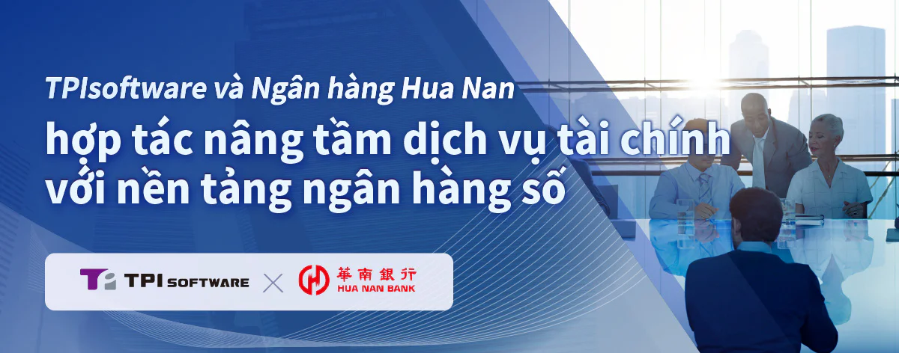

[TPIsoftware](/vi) (TWSE: 7781), công ty phần mềm B2B hàng đầu chuyên cung cấp các giải pháp chuyển đổi số, đã hợp tác với Ngân hàng Hua Nan của Đài Loan để ra mắt một nền tảng số mới cho khách hàng cá nhân. Bằng cách tận dụng chuyên môn của TPIsoftware về công nghệ tài chính và phát triển phần mềm, nền tảng này tích hợp các dịch vụ tài chính cốt lõi của ngân hàng, chẳng hạn như mở tài khoản, ngân hàng cá nhân, đăng ký thẻ tín dụng và vay vốn vào một giải pháp thống nhất, mang lại kết nối liền mạch, hiệu quả giữa các ứng dụng giúp nâng cao trải nghiệm người dùng.

Nền tảng kỹ thuật số mới sử dụng kiến trúc microservices và container hóa cho phép cập nhật phiên bản dễ dàng, giúp khắc phục các hạn chế của hệ thống cũ và đạt được khả năng mở rộng linh hoạt để thích ứng với nhu cầu thị trường ngày càng tăng. Các dịch vụ hiện có của ngân hàng như các ứng dụng ngân hàng trực tuyến, thẻ tín dụng và khoản vay cá nhân được tích hợp vào nền tảng để tối ưu hóa trải nghiệm người dùng. Với việc tích hợp Nhận dạng ký tự quang học (OCR), quy trình đăng ký được đơn giản hóa thông qua việc trích xuất thông tin cá nhân từ giấy tờ tùy thân do người dùng tải lên, cho phép tự động điền thông tin vào các trường tương ứng. Các thông tin đã điền sẽ được lưu trữ và lưu giữ trong 24 giờ trong trường hợp dịch vụ bị gián đoạn, đảm bảo tính linh hoạt để tiếp tục quy trình mà không cần nhập lại và tải lên lại các tệp.

Nền tảng số tất cả trong một này có giao diện thân thiện với người dùng, tự động điều chỉnh để tương thích với nhiều màn hình thiết bị có kích thước khác nhau, đặc biệt tối ưu hóa cho trải nghiệm ngân hàng di động. Thiết kế hiện đại, mới mẻ của nền tảng truyền tải tinh thần năng động và trẻ trung, phản ánh cam kết của ngân hàng trong việc cung cấp dịch vụ sáng tạo, liền mạch và lấy khách hàng làm trung tâm.

"Sự phát triển của điện toán đám mây và tiến bộ công nghệ di động thúc đẩy sự phát triển của ngân hàng mở, lĩnh vực dịch vụ tài chính đang trải qua một sự chuyển đổi mạnh mẽ", Yilan Yeh, Tổng Giám đốc của TPIsoftware cho biết. "Kinh nghiệm sâu rộng về công nghệ tài chính và kiến thức chuyên sâu trong ngành giúp chúng tôi trở thành đối tác đáng tin cậy, hỗ trợ các doanh nghiệp đổi mới, thích ứng và phát triển trong một thị trường đang phát triển nhanh chóng. Sự hợp tác với Ngân hàng Hua Nan phản ánh cam kết của chúng tôi trong việc hỗ trợ khách hàng tối ưu hóa dịch vụ của họ và vượt qua các thách thức phức tạp - thúc đẩy đổi mới số với các giải pháp doanh nghiệp hiện đại".
