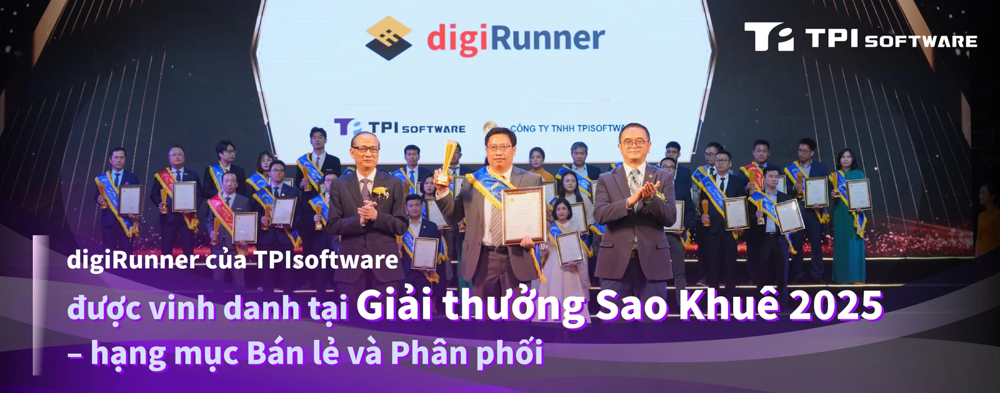

TPIsoftware (TWSE: 7781), công ty phần mềm hàng đầu Đài Loan chuyên về chuyển đổi số, vừa được vinh danh tại Giải thưởng Sao Khuê 2025. Giải thưởng ghi nhận những năng lực vượt trội đã được kiểm chứng của nền tảng quản lý API digiRunner trong việc tích hợp đa nền tảng (heterogeneous integration) cho các hệ sinh thái bán lẻ. Với chiến thắng ở hạng mục Bán lẻ và Phân phối, digiRunner được công nhận vì sự xuất sắc trong việc nâng cao hiệu quả và khả năng mở rộng thông qua kiến trúc microservices, khả năng kết nối liền mạch với bên thứ ba, cùng với việc chuẩn hóa API giúp cải thiện khả năng tương tác giữa các hệ thống và ứng dụng khác biệt, mang lại trải nghiệm phong phú hơn và đẩy nhanh tốc độ phát triển, cập nhật.

*Ông Đỗ Vương Phong, Tổng giám đốc TPIsoftware Việt Nam, nhận giải thưởng Sao Khuê.*

Giải thưởng Sao Khuê, do Hiệp hội Phần mềm và Dịch vụ CNTT Việt Nam (VINASA) tổ chức thường niên từ năm 2003, là một trong những giải thưởng danh giá nhất của ngành phần mềm và dịch vụ CNTT Việt Nam. Giải thưởng năm nay thu hút sự tham gia của 165 doanh nghiệp và tổ chức với hơn 500 đề cử tranh tài ở 9 hạng mục. Quy trình đánh giá nghiêm ngặt gồm ba vòng được thực hiện bởi hội đồng giám khảo là các chuyên gia đầu ngành, do ông Nguyễn Quân, nguyên Bộ trưởng Bộ Khoa học và Công nghệ, làm chủ tịch. Các tiêu chí đánh giá bao gồm hiệu quả thị trường, công nghệ và chất lượng, tác động và hiệu quả, cùng lợi điểm bán hàng độc nhất (USP). digiRunner đã xuất sắc giành chiến thắng ở hạng mục Giải pháp Xuất sắc nhất cho ngành Bán lẻ và Phân phối, bên cạnh 198 sản phẩm, dịch vụ và giải pháp số khác đến từ các công ty công nghệ hàng đầu tại Việt Nam.

Tiếp nối giải thưởng API Ngân hàng Mở Tốt nhất Nam Á 2024 (Best Open Banking APIs Southern Asia 2024) từ Global Banking & Finance Awards®, chiến thắng gần đây của TPIsoftware tại giải thưởng danh giá này phản ánh kinh nghiệm công nghệ sâu sắc của công ty trong hơn hai thập kỷ qua. Nền tảng quản lý API độc quyền digiRunner của công ty không chỉ đáp ứng những thách thức số đặc thù trong ngành bán lẻ, mà còn là một giải pháp API tích hợp cho các lĩnh vực trọng yếu khác như tài chính, bảo hiểm, y tế, viễn thông, dịch vụ công, sản xuất và thương mại điện tử. Nền tảng này giúp các tổ chức đáp ứng các yêu cầu ngành thông qua việc hỗ trợ các khung xác thực như OAuth 2.0 và OpenID Connect, đồng thời đảm bảo tuân thủ Quy định Bảo vệ Dữ liệu Chung (GDPR). Được thiết kế đặc biệt cho các dịch vụ quan trọng (mission-critical), digiRunner tích hợp tính năng cân bằng tải (load balancing) và điều tiết lưu lượng (traffic throttling) để tối ưu hóa việc phân phối lưu lượng truy cập, đảm bảo sự ổn định của hệ thống và ngăn chặn sự cố khi tải nặng hoặc lưu lượng truy cập tăng đột biến.

Ông Đỗ Vương Phong, Tổng Giám đốc TPIsoftware Việt Nam, chia sẻ: "Sự công nhận này không chỉ khẳng định sự mạnh mẽ của digiRunner trong việc giúp các nhà bán lẻ tự tin điều hướng bối cảnh API phức tạp, mà còn là minh chứng cho năng lực của TPIsoftware trong việc hỗ trợ doanh nghiệp đạt được mục tiêu kinh doanh, tối đa hóa giá trị và thúc đẩy đổi mới sáng tạo. Giải thưởng này tạo động lực để chúng tôi tiếp tục mang đến những giải pháp công nghệ vượt trội, hỗ trợ hành trình chuyển đổi số của khách hàng với cam kết không ngừng."
