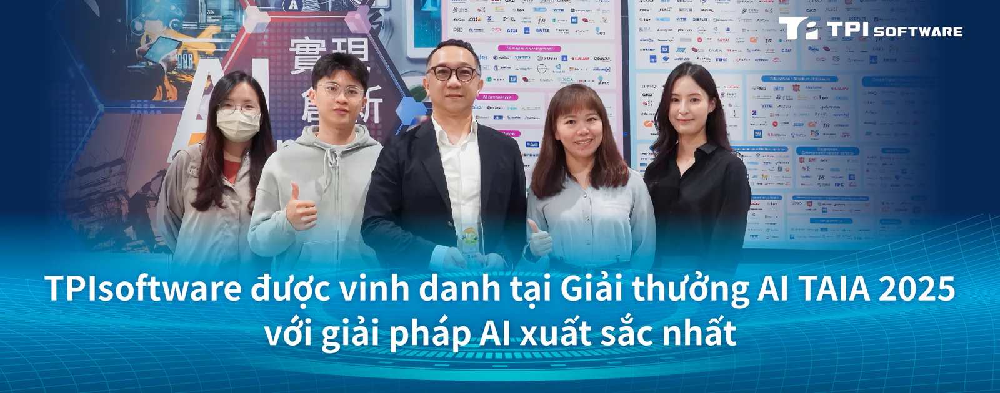

Sản phẩm trí tuệ nhân tạo hội thoại SysTalk.ai của TPIsoftware vừa được trao danh hiệu Giải pháp xuất sắc nhất tại Giải thưởng AI 2025 do Hiệp hội Trí tuệ Nhân tạo Đài Loan (TAIA) tổ chức. Ra mắt từ năm 2023, Giải thưởng AI TAIA là một trong những giải thưởng danh giá nhất trong lĩnh vực AI, nhằm tôn vinh những sáng tạo đột phá và đóng góp nổi bật cho cộng đồng công nghệ. Các ứng viên được tuyển chọn kỹ lưỡng qua ba vòng đánh giá gắt gao bởi hội đồng chuyên gia hàng đầu trong ngành.

Năm nay, giải thưởng ghi nhận số lượng hồ sơ kỷ lục, với 18 doanh nghiệp công nghệ tiên phong cùng 11 chuyên gia, học giả và bác sĩ có đóng góp nổi bật trong việc ứng dụng AI vào thực tiễn. SysTalk.ai của TPIsoftware đã được xếp hạng "Distinction" (Ưu tú) nhờ khả năng chứng minh hiệu quả trong việc cung cấp các giải pháp tích hợp và nâng cao AI. Sản phẩm kết hợp cả AI sinh ngữ (Generative AI) và AI phân biệt (Discriminative AI) nhằm phân loại và dự đoán dữ liệu, từ đó hỗ trợ ra quyết định chính xác hơn. Với hơn 120 triệu người dùng tại Đài Loan, SysTalk.ai đã chứng minh hiệu quả rõ rệt khi được triển khai trên nhiều lĩnh vực trọng yếu, đặc biệt trong bối cảnh thiếu hụt nguồn lực lao động. Giải pháp này không chỉ giúp doanh nghiệp tối ưu hiệu suất mà còn đóng vai trò quan trọng trong chiến lược chuyển đổi số và ứng dụng AI dài hạn.

"Trong môi trường công nghệ biến động liên tục, doanh nghiệp thường gặp rào cản kỹ thuật khiến việc áp dụng AI chưa mang lại hiệu quả như kỳ vọng. Trong 5 năm qua, chúng tôi đã thực hiện 38 dự án AI, mang lại giá trị thực tế và giải pháp cụ thể, giúp doanh nghiệp nâng cao năng lực phục vụ khách hàng. Với giải pháp GenAI trọn gói, chúng tôi tin rằng việc lựa chọn đúng công nghệ sẽ giúp doanh nghiệp ra quyết định tốt hơn, tăng hiệu quả vận hành và đẩy nhanh quá trình đổi mới.", Ông Jeff Lin, Phó Tổng Giám đốc Khối Sáng tạo và Sản phẩm AI tại TPIsoftware cho biết.

Bà Yilan Yeh, Tổng Giám đốc TPIsoftware phát biểu: "Giải thưởng là sự ghi nhận cho nỗ lực của chúng tôi trong việc đồng hành cùng doanh nghiệp vượt qua những thách thức AI trong hành trình chuyển đổi số. Việc tích hợp GenAI vào một giải pháp thống nhất giúp doanh nghiệp cải tiến quy trình, nâng cao năng lực ra quyết định và tạo ra giá trị bền vững. TPIsoftware không chỉ là nhà cung cấp phần mềm B2B, mà còn là đơn vị tiên phong công nghệ – luôn hướng đến việc xây dựng trải nghiệm số toàn diện, đón đầu xu hướng và định hình tương lai bằng sức mạnh của AI".
