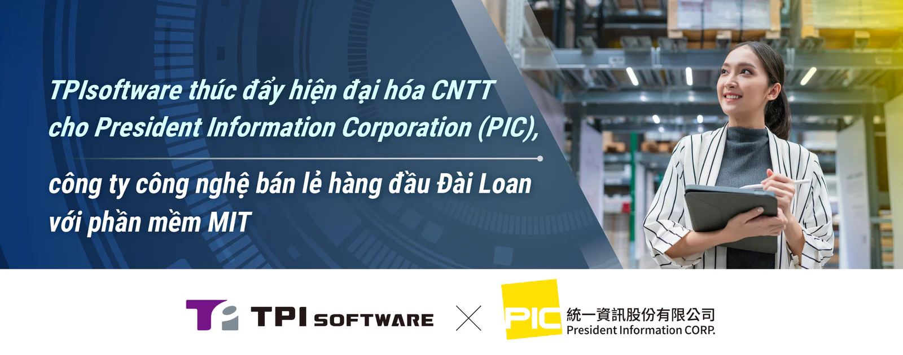

TPIsoftware (TWSE: 7781) và President Information Corporation (PIC), nhà cung cấp giải pháp CNTT trực thuộc Uni-President Group, tập đoàn bán lẻ và chuỗi cửa hàng tiện lợi lớn nhất Đài Loan, đã hợp tác nhằm thúc đẩy các dịch vụ bán lẻ đổi mới và đáng tin cậy. Là doanh nghiệp chuyên cung cấp Dịch vụ Chuyển đổi Số (DXaaS), TPIsoftware cung cấp một loạt các sản phẩm và giải pháp đa dạng hỗ trợ các doanh nghiệp thuộc nhiều ngành nghề thích ứng trong bối cảnh kỹ thuật số ngày càng phát triển. Nền tảng quản lý API digiRunner của công ty đã chứng minh khả năng kết nối mạnh mẽ giữa các API xuyên suốt hệ thống, ứng dụng và dịch vụ của bên thứ ba giúp đảm bảo tính liên thông, hiệu quả vận hành và trải nghiệm tích hợp.

digiRunner giúp PIC triển khai các tính năng và bản cập nhật mới đến người dùng nhanh hơn nhờ sử dụng thiết kế dựa trên công nghệ container, có thể mở rộng, cho phép lặp lại quy trình và rút ngắn thời gian ra mắt dịch vụ. Thông tin nhạy cảm được bảo mật trước các mối đe dọa tấn công mạng nhờ cơ chế kiểm soát quyền truy cập, mã hóa dữ liệu và khóa API để nâng cao xác thực và phân quyền truy cập. Các tính năng này trong digiRunner đảm bảo trải nghiệm người dùng mượt mà, tăng cường bảo mật và giảm nguy cơ rò rỉ thông tin. Nền tảng này hỗ trợ tuân thủ các tiêu chuẩn như OAuth 2.0 khi kết nối các dịch vụ và ứng dụng bên thứ ba.

Trong trường hợp lưu lượng truy cập tăng đột biến như vào mùa lễ hội, các trang web và ứng dụng có thể bị chậm hoặc sập do quá tải. Khả năng phân phối yêu cầu API một cách linh hoạt của digiRunner giúp ngăn chặn tình trạng gián đoạn và quá tải hệ thống, đồng thời giảm độ trễ trong quá trình cung cấp dịch vụ. Với bộ nhớ đệm thông minh của digiRunner, cho phép lưu trữ dữ liệu truy cập thường xuyên, cam kết mang lại trải nghiệm người dùng nhanh hơn, mượt mà hơn - đặc biệt với dịch vụ mua sắm trực tuyến và bán lẻ.

"Các hệ sinh thái bán lẻ phải đối mặt với những thách thức trong trao đổi dữ liệu thời gian thực, tích hợp thanh toán, xử lý giao dịch cũng như quản lý dữ liệu khách hàng và hệ thống thành viên", đại diện PIC chia sẻ. "Việc tích hợp digiRunner vào chiến lược API giúp chúng tôi kết nối các API phân tán trên nhiều hệ thống, từ đó mang lại khả năng tương tác dữ liệu một cách liền mạch, hiệu quả. Đồng thời, các biện pháp bảo mật cũng được triển khai để bảo vệ dữ liệu khỏi việc truy cập trái phép và lạm dụng. TPIsoftware đã hiện thực hoá quá trình hiện đại hóa của chúng tôi, giúp cung cấp dịch vụ ổn định, đáng tin cậy cũng như nâng cao trải nghiệm cho khách hàng của chúng tôi".

"Với bề dày kinh nghiệm triển khai thành công trong lĩnh vực dịch vụ tài chính, chúng tôi tự hào hợp tác cùng PIC - đơn vị dẫn đầu công nghệ bán lẻ tại Đài Loan để tạo ra một giải pháp hệ thống tích hợp toàn diện - đặc biệt là trong bối cảnh thiếu hụt lao động và bất cập vận hành đang cản trở quá trình chuyển đổi của các nhà bán lẻ", bà Yilan Yeh, Tổng Giám đốc TPIsoftware cho biết. "Bằng cách giải quyết các điểm nghẽn CNTT bằng các giải pháp kỹ thuật số tuân thủ, có thể mở rộng và đã được thị trường kiểm chứng như digiRunner, chúng tôi giúp khách hàng đạt được kết quả thực tế và tối đa hóa giá trị kinh doanh, hỗ trợ họ nhằm thúc đẩy quá trình chuyển đổi số".
