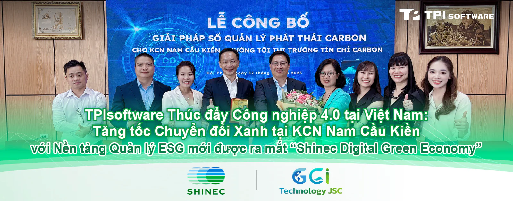

Hôm nay, Công ty Cổ phần Shinec, chủ đầu tư Khu công nghiệp (KCN) Nam Cầu Kiền, đã chính thức ra mắt nền tảng ứng dụng ESG mang tên "Shinec Digital Green Economy", đánh dấu một cột mốc quan trọng trên hành trình phát triển bền vững. Sự kiện này không chỉ là bước tiến lớn trong việc số hóa toàn diện công tác quản lý vận hành KCN, mà còn khẳng định vai trò tiên phong của Nam Cầu Kiền trong việc xây dựng mô hình khu công nghiệp sinh thái, hướng tới mục tiêu Net-Zero và mở ra tiềm năng tạo lập tín chỉ carbon.

TPIsoftware đồng hành cùng sáng kiến phát triển bền vững của khu công nghiệp với nền tảng "Shinec Digital Green Economy". Đây là một giải pháp toàn diện được phát triển dựa trên các công nghệ GreenSwift (nền tảng quản lý carbon thông minh) và ElectriSwift (hệ thống quản lý năng lượng thông minh) của công ty, với sự tư vấn về ESG từ GGI Technology. Nền tảng này hoạt động như một hệ thống quản lý KCN thông minh, tập trung vào việc số hóa công tác quản lý môi trường, kiểm soát phát thải và an ninh. Thông qua nền tảng này, giải pháp cung cấp một hệ thống quản lý tổng thể, từ việc thu thập và phân tích dữ liệu phát thải carbon theo thời gian thực, xác định các điểm nóng về phát thải và tiêu thụ năng lượng, cho đến việc đề xuất và giám sát các chiến lược cải tiến.

*Nền tảng này theo dõi các chỉ số hiệu suất chính, bao gồm lượng phát thải khí nhà kính (GHG), mức tiêu thụ năng lượng (điện lưới so với năng lượng mặt trời) và hiệu quả xử lý nước thải. Nhờ đó, mọi nỗ lực hướng tới phát triển bền vững đều được chuyển đổi thành dữ liệu có thể đo lường một cách rõ ràng.*

Sự ưu việt của giải pháp "Shinec Digital Green Economy" được minh chứng qua những tính năng tích hợp đa dạng và toàn diện:

• **Quản lý phát thải Khí nhà kính (KNK) (với công nghệ từ GreenSwift)**: Tối ưu hóa quy trình thu thập, phân tích và báo cáo dữ liệu carbon. Nền tảng tích hợp này đảm bảo hiệu quả trong công tác kiểm kê và kiểm toán, đồng thời tuân thủ chặt chẽ các tiêu chuẩn quốc tế như ISO 14064-1.

<strong>•</strong> **Quản lý Năng lượng Thông minh (với công nghệ từ ElectriSwift)**: Giám sát và phát hiện các điểm thiếu hiệu quả trong sử dụng năng lượng dựa trên phân tích mô hình tiêu thụ điện. Giải pháp cung cấp thông tin chi tiết và cảnh báo theo thời gian thực, giúp doanh nghiệp xây dựng các chiến lược tiết kiệm năng lượng tối ưu.

<strong>•</strong> **Giám sát và Xử lý Nước thải**: Theo dõi các chỉ số quan trọng về chất lượng nước (pH, TSS, COD, BOD, Amoni) ở cả đầu vào và đầu ra của hệ thống xử lý, đồng thời tự động tính toán lượng phát thải KNK tương ứng.

• **Giám sát An ninh Thông minh**: Tích hợp Trí tuệ Nhân tạo Vạn vật (AIoT) vào hệ thống camera an ninh để đưa ra cảnh báo tức thì đối với các sự cố như tụ tập đông người, leo rào, tai nạn, và hỏa hoạn.

• **Báo cáo Trực quan**: Cung cấp bảng điều khiển (dashboard) trực quan trên cả nền tảng web và di động, cho phép ban lãnh đạo truy cập báo cáo mọi lúc, mọi nơi, từ đó đưa ra quyết định kịp thời và hiệu quả.

Trước áp lực ngày càng gia tăng từ biến đổi khí hậu toàn cầu, Hệ thống Quản lý Carbon (CMS) đang trở thành một xu hướng tất yếu, phù hợp với các cam kết quốc tế như Thỏa thuận Paris (2015), mục tiêu Net Zero 2050 và các kỳ Hội nghị Thượng đỉnh về Biến đổi Khí hậu (COP26/COP28). Các khuôn khổ pháp lý này yêu cầu doanh nghiệp phải có trách nhiệm giảm thiểu phát thải carbon. Đặc biệt, các quy định như Cơ chế Điều chỉnh Biên giới Carbon (CBAM) của Liên minh châu Âu (EU) áp thuế carbon lên hàng hóa nhập khẩu, buộc các doanh nghiệp xuất khẩu phải thực hiện đo lường và quản lý dấu chân carbon một cách nghiêm ngặt. Trên thế giới, việc áp dụng CMS đang trở thành yêu cầu bắt buộc đối với các công ty niêm yết (theo tiêu chuẩn IFRS S2, CSRD), trong khi các công cụ định giá carbon (thuế carbon, Hệ thống Giao dịch Khí thải - ETS) ngày càng được đẩy mạnh tại các quốc gia đang phát triển.

Nhật Bản và Hàn Quốc là những quốc gia tiên phong với các chính sách định giá carbon mạnh mẽ, nơi các tập đoàn hàng đầu như Toyota và Samsung đã sớm triển khai CMS để hiện thực hóa mục tiêu Net Zero 2050. Tại Đông Nam Á, Indonesia và Malaysia đang tập trung áp dụng CMS trong các ngành công nghiệp chủ lực như dầu khí và nông nghiệp. Chính phủ Ấn Độ cũng đã triển khai Chương trình Giao dịch Tín chỉ Carbon (CCTS) từ năm 2023. Trung Quốc hiện đang dẫn đầu trong việc ban hành các chính sách quyết liệt, hỗ trợ doanh nghiệp chuyển đổi sang kinh tế trung hòa carbon vào năm 2060 và là một trong những quốc gia đi đầu về quản lý carbon ở cấp độ sở hữu trí tuệ, đồng thời tích cực đầu tư vào các dự án bù trừ carbon tại khu vực ASEAN và châu Phi.

Việt Nam đã đưa ra cam kết mạnh mẽ về việc đạt mục tiêu phát thải ròng bằng không (Net Zero) vào năm 2050. Theo lộ trình, Việt Nam sẽ thí điểm vận hành sàn giao dịch tín chỉ carbon, bao gồm các cơ chế mua bán và bù trừ tín chỉ, tiến tới ra mắt sàn giao dịch chính thức kết nối với thị trường khu vực và thế giới vào năm 2028. Việc áp dụng CMS tại Việt Nam được dự báo sẽ tăng trưởng mạnh mẽ, chủ yếu do yêu cầu từ các doanh nghiệp có vốn đầu tư trực tiếp nước ngoài (FDI) và các thị trường xuất khẩu. Chính phủ cũng sẽ ban hành các chính sách hỗ trợ doanh nghiệp vừa và nhỏ (SMEs) thông qua ưu đãi thuế và các chương trình đào tạo. Do đó, các doanh nghiệp Việt Nam được khuyến khích đầu tư sớm vào CMS để giảm thiểu rủi ro từ thuế carbon và nâng cao năng lực cạnh tranh trên thị trường toàn cầu.

Việc đầu tư vào giải pháp số và xanh này không chỉ giúp Khu công nghiệp Nam Cầu Kiền tối ưu hóa vận hành, cắt giảm chi phí thông qua việc sử dụng năng lượng và tài nguyên hiệu quả, mà còn là một bước đi chiến lược nhằm nâng cao uy tín thương hiệu thông qua trách nhiệm với môi trường. Sáng kiến này sẽ là nền tảng vững chắc để Khu công nghiệp Nam Cầu Kiền đạt được các chứng nhận quốc tế quan trọng như ISO 50001 về quản lý năng lượng và ISO 14068 về trung hòa carbon.

Trong giai đoạn tiếp theo, dự án dự kiến sẽ số hóa toàn bộ không gian xanh - chiếm 31% tổng diện tích khu công nghiệp, bao gồm cây cối, cây bụi, thảm cỏ và mặt nước - cùng các nguồn năng lượng tái tạo. Điều này sẽ tạo cơ sở dữ liệu vững chắc để tính toán khả năng hấp thụ carbon, mở ra cơ hội khai thác thị trường tín chỉ carbon trong tương lai cho nhà phát triển.

Khu công nghiệp Nam Cầu Kiền, dưới sự đầu tư chiến lược của Shinec, là minh chứng cho cam kết của tập đoàn trong việc kiến tạo mô hình khu công nghiệp sinh thái hướng tới mục tiêu trung hòa carbon. Sự cộng hưởng giữa tầm nhìn tiên phong của Shinec, năng lực tư vấn chuyên sâu của GGI Technology và điểm mạnh của TPIsoftware trong việc triển khai các giải pháp bền vững có tác động lớn, hứa hẹn sẽ được nhân rộng ra các khu công nghiệp sinh thái khác thuộc hệ thống Shinec cũng như các khu công nghiệp khác trên cả nước.

Sự ra mắt của giải pháp "Shinec Digital Green Economy" không chỉ nâng tầm vị thế của Shinec và Khu công nghiệp Nam Cầu Kiền trên bản đồ các khu công nghiệp tại Việt Nam và khu vực, mà còn khẳng định uy tín và năng lực của các đối tác triển khai là GGI Technology và TPIsoftware. Đây là sự chứng thực cho khả năng tư vấn và cung cấp các giải pháp công nghệ xanh tiên tiến, đóng góp thiết thực vào các mục tiêu phát triển bền vững của quốc gia.
