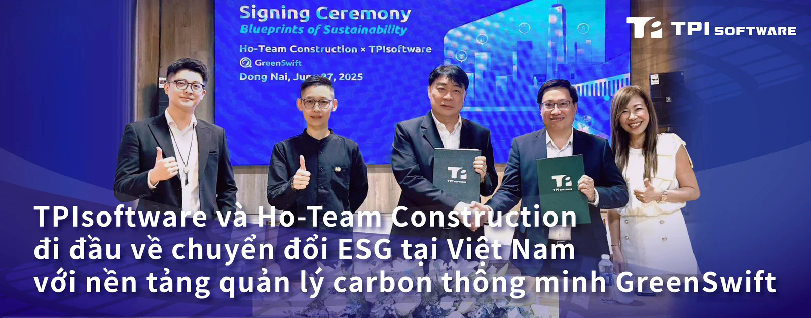

Công ty DXaaS của Đài Loan TPIsoftware (TWSE: 7781) và Công ty TNHH Ho-Team Construction, công ty xây dựng của Đài Loan hoạt động tại Việt Nam từ năm 2007, đã công bố hợp tác chiến lược để hỗ trợ lộ trình hướng tới mức phát thải ròng bằng 0 của Việt Nam với GreenSwift, nền tảng quản lý carbon dựa trên AI.

*Ông Chien Chih Ming (Chủ tịch Ho-Team Construction) và ông Đỗ Vương Phong (Tổng giám đốc TPIsoftware Việt Nam) bắt tay ký thỏa thuận đối tác với sự chứng kiến của ông Harry Lu (Trưởng Ban giám sát của Hiệp hội Doanh nghiệp Dịch vụ ESG) đứng ngoài cùng bên trái, bà Chien Tzu-Yun (Phó chủ tịch Ho-Team Construction) và bà Yvonne Chien (Phó chủ tịch điều hành TPIsoftware) tại lễ ký kết diễn ra tại Đồng Nai, Việt Nam.*

Được ký kết vào ngày 27 tháng 6, quan hệ đối tác này nhấn mạnh vai trò lãnh đạo của Ho-Team Construction về tính bền vững và sự chuẩn bị chủ động cho các quy định kinh doanh carbon của Việt Nam, dự kiến sẽ có hiệu lực đầy đủ vào năm 2029. Lễ ký kết diễn ra tại trụ sở Ho-Team Construction đặt tại Đồng Nai, Việt Nam, và có sự tham dự của đại diện từ Hiệp hội Doanh nghiệp Dịch vụ ESG, TÜV Rheinland Việt Nam, Công ty Cổ phần CSGT Metals Việt Nam (CSMV), Công ty Cổ phần Dây & Cáp điện TAYA (Việt Nam), Công ty TNHH Yung Chi Paint & Varnish MFG (VN), TAISHIBA Electric, Taiwan Fluoro và Pro-Chain International Ltd.

Với sự hiện diện lâu dài tại Việt Nam, Ho-Team Construction đã xây dựng hơn 600 cơ sở công nghiệp và hoàn thành hơn 240 dự án cơ sở hạ tầng công nghiệp và thương mại quy mô lớn trên toàn quốc trong khi hiện đang làm việc tại 13 dự án ở cả khu vực phía Bắc và phía Nam.

Vào tháng 6 năm nay, Việt Nam chính thức khởi động giai đoạn thí điểm của kế hoạch kinh doanh khí thải, nhắm vào ba ngành công nghiệp chính - thép, xi măng và nhiệt điện - để giảm lượng khí thải carbon dioxide. Theo chương trình, các công ty trong các lĩnh vực này sẽ được yêu cầu mua hạn mức phát thải dựa trên mức độ phát thải carbon của họ như được nêu trong một nghị định của chính phủ.

Với việc thực hiện đầy đủ đề án dự kiến vào năm 2029, Ho-Team Construction đang chủ động áp dụng các giải pháp quản lý carbon để đảm bảo tuân thủ trong tương lai và duy trì lợi thế cạnh tranh. Bằng cách triển khai một nền tảng tích hợp như GreenSwift, công ty đang điều chỉnh hoạt động cho phù hợp với chương trình giao dịch khí thải của Việt Nam trong khi thúc đẩy chiến lược ESG của mình.

Nền tảng quản lý carbon đạt chứng nhận AUP, hỗ trợ tối ưu hóa quy trình thu thập, phân tích dữ liệu carbon và tạo báo cáo tuân thủ tiêu chuẩn ISO 14064. Khả năng tích hợp các hệ số phát thải IPCC mới nhất giúp đảm bảo độ chính xác và phù hợp với các tiêu chuẩn quốc tế. Từ việc lập kế hoạch kiểm kê và xác định ranh giới tổ chức đến việc xác định các nguồn phát thải, tính toán phát thải và tạo báo cáo kiểm toán, GreenSwift cung cấp thông tin chi tiết có thể hành động, dựa trên dữ liệu cho việc lập chiến lược giảm phát thải. Nền tảng này cũng hỗ trợ cộng tác dựa trên đám mây giữa các nhóm và địa điểm, giúp các doanh nghiệp đơn giản hóa việc báo cáo và cải thiện tính nhất quán, minh bạch và sẵn sàng tuân thủ quy định.

Ông Chien Chih Ming, Chủ tịch Ho-Team Construction, cho biết: "Lượng phát thải KNK từ ngành xây dựng tiếp tục tăng do sự bùng nổ kinh tế của Việt Nam, với lượng phát thải dự kiến là 148 triệu tấn vào năm 2050. Trong khi các mục tiêu phát thải ròng bằng 0 đã được đặt ra, tiến độ trong các lĩnh vực phát thải cao như xây dựng vẫn còn chậm. Là một nhà xây dựng hàng đầu, chúng tôi coi đó là trách nhiệm của mình để đi đầu bằng cách làm gương trong việc thúc đẩy phát triển bền vững".

"Việc đạt được trung hòa carbon trở thành một điều bắt buộc toàn cầu khi biến đổi khí hậu gây ra những tác động mạnh mẽ đến hành tinh của chúng ta", ông Chien Tzu-Yun, Phó Chủ tịch Ho-Team Construction và Chủ tịch Hiệp hội Doanh nghiệp Dịch vụ ESG cho biết. "Bằng cách hợp tác với TPIsoftware, chúng tôi đang tăng cường cam kết hành động về khí hậu có thể đo lường được thông qua chuyển đổi kỹ thuật số. Chuyên môn tư vấn và hỗ trợ địa phương của họ giúp chúng tôi định hướng giữa những quy định phức tạp và nâng cao khả năng cách cạnh tranh của chúng tôi trong thị trường carbon đang phát triển của Việt Nam".

Yilan Yeh, Tổng Giám đốc của TPIsoftware, chia sẻ: "Thỏa thuận này nhấn mạnh khả năng thích ứng và sẵn sàng của GreenSwift đối với các chính sách khí hậu của Đông Nam Á. Khi Việt Nam tăng tốc sáng kiến kinh doanh các-bon, chúng tôi tự hào giúp các doanh nghiệp trong nước số hóa việc quản lý phát thải khí nhà kính, thúc đẩy các mục tiêu ESG của họ với sự tự tin và tuân thủ cấp độ khu vực tốt hơn".
