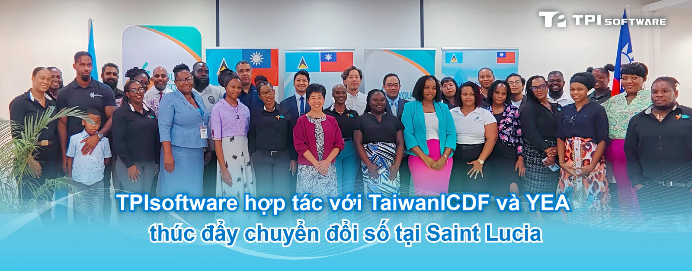

TPIsoftware (TPEx: 7781) đã hợp tác với Quỹ Hợp tác và Phát triển Quốc tế Đài Loan (TaiwanICDF) và Cơ quan Kinh tế Thanh niên (YEA) của Saint Lucia để ra mắt nền tảng thương mại điện tử nhằm hỗ trợ thanh niên và phụ nữ tại Saint Lucia khởi nghiệp thông qua việc thúc đẩy chuyển đổi số quốc gia. Công ty hướng tới việc mở rộng quan hệ đối tác toàn cầu và củng cố vị thế dẫn đầu thị trường, với việc ứng dụng tác nhân AI (AI agent) nhằm đảm bảo an ninh và tiếp tục thành công trong kinh doanh.

Việc ra mắt nền tảng thương mại điện tử đánh dấu một cột mốc quan trọng đối với TPIsoftware trong bối cảnh mở rộng toàn cầu những năm gần đây. Lễ công bố chính thức có sự tham dự của Đại sứ Cộng hòa Trung Hoa Dân Quốc (Đài Loan) tại Saint Lucia bà Nicole Su, CEO YEA Bryan Vidal, Chủ tịch YEA Thomas Leonce, Trưởng Phái bộ Kỹ thuật Đài Loan (TTM) Daniel Lee, và Phó Chủ tịch TPIsoftware Alvin Wu.

Trong khuôn khổ hợp tác với Dự án Hỗ trợ Trao quyền Kinh tế cho Thanh niên và Phụ nữ của TaiwanICDF, 525 thanh niên và phụ nữ khởi nghiệp tại Saint Lucia đã được hỗ trợ thông qua các chương trình đào tạo cần thiết để khởi nghiệp và 640 doanh nghiệp đã được cung cấp dịch vụ tư vấn và hướng dẫn. Nền tảng thương mại điện tử mới sẽ giúp tăng cường sự hiện diện trực tuyến cho các doanh nghiệp siêu nhỏ, nhỏ và vừa tại Saint Lucia, từ đó thúc đẩy năng lực cạnh tranh trên thị trường nội địa.

"Khi thương mại điện tử thay đổi hành vi của tiêu dùng, nền tảng mới này sẽ mở đường cho phụ nữ và thanh niên Saint Lucia thành lập các công ty khởi nghiệp và hiện thực hóa khát vọng kinh doanh", bà Nicole phát biểu. "Đài Loan rất vui được chia sẻ chuyên môn và kinh nghiệm kỹ thuật để giúp các doanh nhân khởi nghiệp phát triển, tại thị trường nội địa, khu vực hay thậm chí trên toàn cầu".

Nền tảng thương mại điện tử, được xây dựng với AI và giải pháp kỹ thuật số của TPIsoftware, cho phép theo dõi đơn hàng thời gian thực, quản lý tồn kho, tích hợp phân tích dữ liệu và cung cấp thông tin chi tiết về thị trường, giúp loại bỏ rào cản đối với hoạt động khởi nghiệp. Giải pháp này giúp thanh niên và phụ nữ nuôi dưỡng ý định khởi nghiệp, khuyến khích các dự án kinh doanh và sự tham gia vào thị trường của họ.

Bà Yilan Yeh, Tổng Giám đốc TPIsoftware, nhấn mạnh rằng nền tảng này được xây dựng trên công nghệ cốt lõi của công ty nhằm đạt được tự động hoá quy trình và quản trị thông minh. Các bản nâng cấp trong tương lai sẽ bao gồm tính năng thanh toán cho khách vãng lai, hệ thống quản trị nhà bán hàng (vendor backend), đánh giá của khách hàng và các tính năng theo dõi đơn hàng nâng cao. Ngoài ra, hệ thống thanh toán trực tuyến sẽ được tích hợp để xây dựng một hệ sinh thái kinh doanh kỹ thuật số với tính bảo mật và tiện lợi nâng cao.
