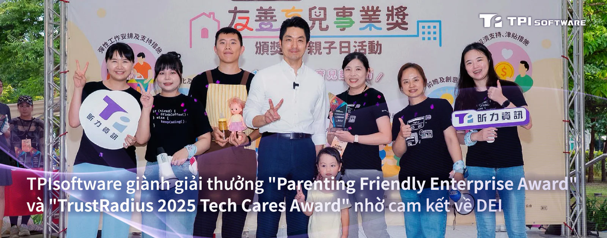

TPIsoftware (TPEx: 7781) vừa được vinh danh với giải thưởng Parenting Friendly Enterprise Award (tạm dịch: Giải thưởng doanh nghiệp thân thiện với nuôi dạy con) của Sở Lao động Thành phố Đài Bắc và TrustRadius 2025 Tech Cares Award (tạm dịch: Giải thưởng công nghệ quan tâm xã hội 2025 của TrustRadius) nhờ cam kết về tính bền vững môi trường cùng các giá trị đa dạng, công bằng và hòa nhập (DEI).

"Chúng tôi thực hiện những hành động cụ thể để xây dựng một môi trường làm việc thân thiện với mọi giới tính và gia đình thông qua các phương pháp toàn diện. Những giải thưởng này chính là minh chứng cho điều mà chúng tôi luôn ủng hộ", bà Yilan Yeh, Tổng Giám đốc TPIsoftware chia sẻ, đồng thời nhấn mạnh những thành tích năm trước như Giải thưởng lãnh đạo bình đẳng giới TCSA do Viện Năng lượng bền vững Đài Loan (TAISE) trao tặng và Giải thưởng nhà tuyển dụng tốt nhât từ hai trang tuyển dụng lớn nhất Đài Loan là 104 Job Bank và Yourator.

"TPIsoftware không chỉ thực hiện trách nhiệm xã hội của doanh nghiệp ở cấp độ tổ chức, mà còn mở rộng đến tất cả các bên liên quan. Công ty cam kết hỗ trợ doanh nghiệp nâng cao năng lực cạnh tranh thông qua các sản phẩm phần mềm ứng dụng AI, giúp họ vận hành hiệu quả và bền vững hơn".

TPIsoftware là một trong 44 doanh nghiệp được Chính quyền thành phố Đài Bắc vinh danh vì đã thúc đẩy môi trường làm việc thân thiện với gia đình. Các doanh nghiệp chiến thắng được lựa chọn thông qua quy trình đánh giá ba vòng dựa trên bảy tiêu chí. TPIsoftware cung cấp nhiều phúc lợi khác nhau để hỗ trợ nhân viên làm cha mẹ, bao gồm giờ làm việc linh hoạt, lựa chọn làm việc từ xa, nghỉ thai sản trước khi sinh 10 ngày và nhiều khoản trợ cấp khác. Ngoài ra, công ty cũng có chính sách hỗ trợ chăm sóc trẻ và dịch vụ chăm sóc trẻ ban ngày, giúp nhân viên có con nhỏ cân bằng giữa công việc và cuộc sống.

Giải thưởng TrustRadius 2025 Tech Cares Award tôn vinh các công ty công nghệ B2B vượt xa trách nhiệm xã hội của doanh nghiệp thông thường trong việc hỗ trợ nhân viên, cộng đồng và môi trường. Là một trong 100 doanh nghiệp được vinh danh năm nay, TPIsoftware hỗ trợ khách hàng trong việc thực hiện mục tiêu ESG thông qua các sản phẩm phần mềm độc quyền: GreenSwift (nền tảng quản lý carbon) và ElectriSwift (hệ thống quản lý năng lượng).

Để chứng minh cam kết sử dụng năng lượng tái tạo trong hoạt động, TPIsoftware đã cung cấp cho văn phòng tại Cao Hùng 10.000 kWh điện xanh theo chương trình Đấu giá năng lượng xanh quy mô nhỏ 2025–2029 của Taipower. Người lao động tại TPIsoftware được hưởng Chương trình hỗ trợ nhân viên (EAP) cùng nhiều phúc lợi khác như khám sức khỏe định kỳ hằng năm, mát-xa miễn phí, hỗ trợ học tập, v.v.

"TPIsoftware áp dụng cơ cấu tổ chức phẳng nhằm khuyến khích giao tiếp cởi mở, thúc đẩy sự gắn kết và cảm giác thân thuộc trong đội ngũ nhân viên", bà Mina Yieh, Phó Chủ tịch điều hành TPIsoftware chia sẻ. "Chúng tôi cam kết sâu sắc với phát triển bền vững, tích cực tham gia các sáng kiến như chương trình quyên góp giày Step 30 và trồng cây tại Đài Đông. Chúng tôi tin rằng thành công thực sự của một công ty được xác định bằng cả lợi nhuận và những tác động tích cực đến môi trường và con người".
