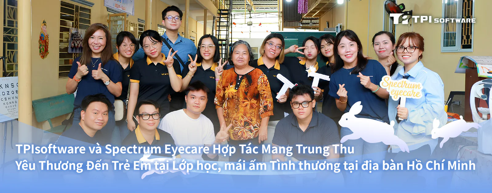
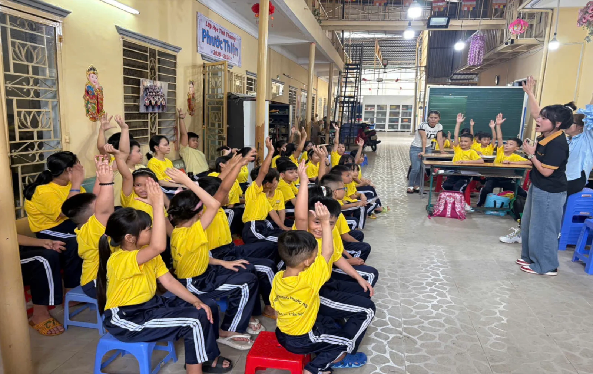

Chương trình từ thiện với chủ đề "Chăm sóc đôi mắt, Thắp sáng tương lai" đã được các thành viên TPIsoftware và chuyên gia từ Spectrum Eyecare thực hiện trong suốt tháng 9. Đội ngũ đã đến thăm Trung tâm Bình Thọ, Chùa Kỳ Quang và Lớp học tình thương Phước Thiện để khám mắt miễn phí và trao tặng 320 cặp kính cho em nhỏ. Nhiều phần quà Trung thu bao gồm bánh trung thu, lồng đèn và dụng cụ học tập cũng được trao tặng.

*Sinh hoạt trò chơi Trung thu cùng lớp trẻ tình thương tại chùa Phước Thiện.*

Ông Đỗ Vương Phong, Tổng giám đốc TPIsoftware Việt Nam, chia sẻ: "Tại TPIsoftware, chúng tôi luôn theo đuổi sứ mệnh 'Tech for Change' - dùng công nghệ để tạo ra sự thay đổi tích cực. Hoạt động lần này là một cách chúng tôi hiện thực hóa sứ mệnh đó ngoài phạm vi công nghệ, trực tiếp đóng góp vào việc xây dựng một tương lai tươi sáng hơn cho thế hệ trẻ."

Đại diện của Spectrum Eyecare, bà Catherine Trần cũng cho biết: "Với phương châm 'See Clear, Give Back', chúng tôi tin rằng thị lực tốt là quyền lợi cơ bản và là nền tảng cho sự phát triển của mỗi đứa trẻ. Hợp tác với một doanh nghiệp có cùng chí hướng vì cộng đồng như TPIsoftware đã giúp chúng tôi lan tỏa sứ mệnh của mình đến nhiều em nhỏ hơn nữa."
