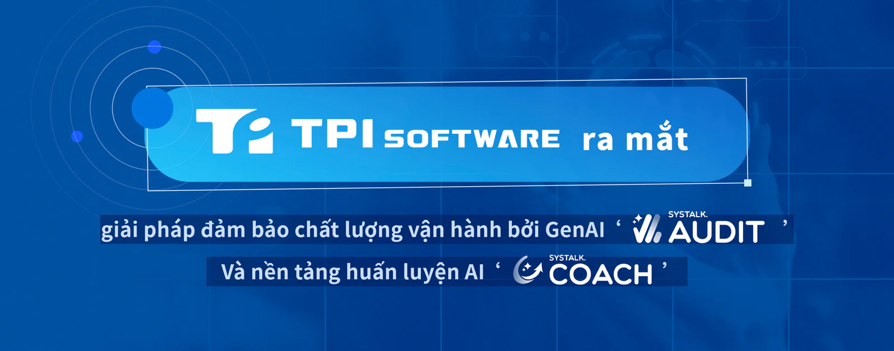

Nhà cung cấp phần mềm hàng đầu Đài Loan [TPIsoftware](/vi) (TPEx: 7781) hôm nay đã ra mắt hai giải pháp AI tạo sinh (GenAI) mới: SysTalk.Audit, giải pháp đảm bảo chất lượng cho trung tâm tổng đài chăm sóc khách hàng và SysTalk.Coach, nền tảng huấn luyện AI hoạt động 24/7. Cùng với SysTalk.ICR và SysTalk.VIKI của công ty, các sản phẩm được trang bị AI này tạo thành một bộ hoàn chỉnh các giải pháp SysTalk.ai được cấp bằng sáng chế, cho phép nâng cao hiệu quả hoạt động và tự động hóa tiên tiến, hướng tới việc xây dựng các hệ thống AI tự chủ.

SysTalk.Audit tự động hóa quy trình QA nhờ khả năng nhận dạng giọng nói đa ngôn ngữ bằng tiếng Quan Thoại, tiếng Phúc Kiến Đài Loan, tiếng Hakka và tiếng Anh. Khác với các phương thức QA truyền thống vốn dựa trên quy tắc và cụm từ được xác định trước để xử lý truy vấn, SysTalk.Audit tích hợp khả năng hiểu ngôn ngữ tự nhiên để diễn giải ý định, cảm xúc và ngữ cảnh trong các cuộc hội thoại giữa khách hàng và tổng đài viên. Hệ thống tự động phân tích mọi tương tác đến, cung cấp khả năng hiển thị toàn diện hiệu suất của tổng đài viên và chất lượng dịch vụ, thay vì chỉ đánh giá dựa trên mẫu nhỏ bằng phương pháp đánh giá thủ công. Trọng số tiêu chí có thể tùy chỉnh, điểm QA khách quan và báo cáo tổng hợp toàn diện giúp nâng cao tính nhất quán của dịch vụ và sự hài lòng của khách hàng.

SysTalk.Coach cung cấp chương trình huấn luyện AI 24/7 để mô phỏng các tương tác thực tế thông qua hình thức nhập vai. Giải pháp này mang đến phản hồi tức thì và trải nghiệm đào tạo nhập môn cá nhân hóa, giúp rút ngắn thời gian học tập của nhân viên mới và giảm chi phí đào tạo tổng thể. Quá trình và hiệu suất học tập được theo dõi, phân tích để cung cấp thông tin chi tiết, cho phép đánh giá mức độ sẵn sàng, mức độ gắn kết và sự phát triển kỹ năng của đội ngũ. SysTalk.Coach cũng sử dụng dữ liệu hiệu suất chất lượng cao thu thập từ người dùng để cải thiện mô hình huấn luyện, cho phép không ngừng tối ưu hóa quy trình đào tạo.

"Phần lớn các sáng kiến AI thất bại do hiểu sai rằng việc sử dụng các công cụ AI cho năng suất cá nhân cũng tương đương với việc triển khai AI chiến lược ở cấp độ doanh nghiệp", ông Jeff Lin, Phó chủ tịch điều hành phụ trách Bộ phận đổi mới và sản phẩm AI của TPIsoftware cho biết, trích dẫn một báo cáo của [MIT](https://mlq.ai/media/quarterly_decks/v0.1_State_of_AI_in_Business_2025_Report.pdf) cho thấy chỉ 5% tổ chức đạt được kết quả có ý nghĩa. "Các năng lực GenAI của chúng tôi được phát triển có mục tiêu rõ ràng, nhằm giải quyết những thách thức cụ thể trong quản lý chất lượng và đào tạo tại trung tâm tổng đài chăm sóc khách hàng, đồng thời giảm thiểu lao động thủ công và thúc đẩy đổi mới sáng tạo".

"Chuyển đổi AI là một sáng kiến mang tính chiến lược, đòi hỏi không chỉ chuyên môn kỹ thuật mà còn cả kinh nghiệm triển khai và kiến thức chuyên ngành", bà Yilan Yeh, Tổng giám đốc TPIsoftware cho biết. "Với 20 năm kinh nghiệm trong lĩnh vực phần mềm, TPIsoftware đã phục vụ hơn 400 khách hàng trong các ngành ngân hàng-dịch vụ tài chính-bảo hiểm, y tế, chính phủ, bán lẻ, sản xuất và thương mại điện tử. Với SysTalk.Service (dịch vụ tư vấn của TPIsoftware dành cho các ứng dụng AI được tối ưu), sứ mệnh của chúng tôi là trao quyền cho khách hàng trong các lĩnh vực bằng các giải pháp AI phù hợp, mang lại tác động có giá trị cao và thúc đẩy tăng trưởng bền vững".
