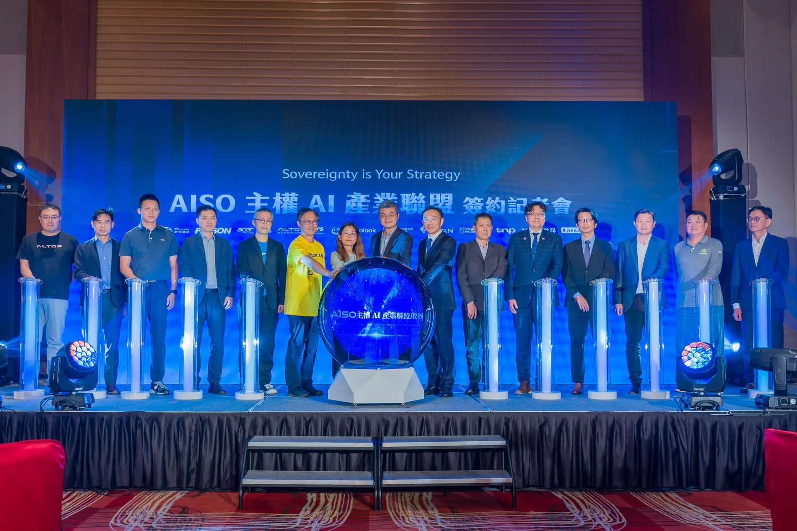

*Lễ ra mắt AISO được khởi xướng bởi ông Pua Khein-Seng, Giám đốc điều hành của Phison; bà Hsu Mei-Ling, Quan chức điều hành cấp cao của Bộ Phát triển Kỹ thuật số; ông Lin Ching-Chin, Cố vấn của Hội đồng Phát triển Quốc gia và ông Ben Yao, Chủ tịch TPIsoftware, cùng với các thành viên trong liên minh.*

TPIsoftware (TPEx: 7781) hôm nay công bố hợp tác chiến lược với Phison Electronics để thành lập **[AISO](https://aisoportal.com/)**, một liên minh với sứ mệnh hỗ trợ các quốc gia xây dựng AI của riêng mình bằng các giải pháp đã được thị trường kiểm chứng và có độ tin cậy cao trên thị trường. AISO, viết tắt của AI for Sovereignty (AI chủ quyền), quy tụ nhiều doanh nghiệp hàng đầu trong ngành như Gogolook, KDAN, TNP, TSTI, Altos, Thinktron, FUCO & Ryzo, Acer Synergy Tech, ECS và Fongcon với vai trò thành viên sáng lập, dưới sự hướng dẫn của Viện Nghiên cứu Công nghệ Công nghiệp Đài Loan (ITRI).

Thông báo được đưa ra tại một buổi họp báo tổ chức vào ngày 23 tháng 3. Sau sự kiện là lễ ký kết biên bản ghi nhớ (MOU) với Cathay Financial Holdings và Delta Electronics để củng cố quan hệ hợp tác, với sự chứng kiến của đại diện đến từ Bộ Phát triển Kỹ thuật số và Hội đồng Phát triển Quốc gia.

AISO được thành lập nhằm cung cấp các giải pháp "chìa khóa trao tay", giúp tăng tốc quá trình triển khai và ứng dụng AI ở cấp độ tổ chức thông qua các giải pháp tích hợp phần cứng và phần mềm. Cách tiếp cận theo mô hình liên minh này mang đến cho doanh nghiệp chi phí hợp lý, khả năng mở rộng và giảm độ phức tạp kỹ thuật khi xây dựng AI tại chỗ. AISO tập trung xây dựng một mạng lưới theo tiêu chuẩn AISO Inside nhằm tăng cường tuân thủ các khung pháp lý toàn cầu, chẳng hạn như Đạo luật AI của EU, cũng như quy định trong nước, đồng thời hỗ trợ toàn bộ vòng đời của AI.

Chủ tịch TPIsoftware Ben Yao cho biết, mặc dù hiện có rất nhiều giải pháp AI, thách thức thực sự của việc áp dụng AI vẫn nằm ở quá trình triển khai. Điều quan trọng là liệu năng lực AI có được tận dụng để tạo ra giá trị hữu hình với quản trị dữ liệu phù hợp và tuân thủ các quy định hay không. Liên minh này hướng tới hỗ trợ triển khai AI trong các lĩnh vực có yêu cầu quản lý nghiêm ngặt như dịch vụ tài chính, y tế và khu vực công, v.v., thông qua các giải pháp trọn gói giúp đẩy nhanh đổi mới sáng tạo và đơn giản hóa triển khai với chi phí chỉ bằng một phần nhỏ so với trước đây.

Giám đốc điều hành Phison Pua Khein-Seng cho biết với công nghệ aiDAPTIV được cấp bằng sáng chế của công ty để tăng tốc suy luận AI, các doanh nghiệp có thể đưa AI vào triển khai thực tế một cách nhanh chóng và ở quy mô lớn với phần mềm sẵn sàng cho doanh nghiệp và hạ tầng chi phí hợp lý khi tham gia vào mạng lưới AISO.

*CEO của Phison - ông Pua Khein-Seng, chủ tịch của TPIsoftware - ông Ben Yao, CTO của Cathay Financial Holdings - ông Marcus Yao và ông L.F. Tseng - CIO/CIS của Delta Electronics cùng nhau ký biên bản ghi nhớ.*

Giám đốc Công nghệ của Cathay Financial Holdings Marcus Yao nhấn mạnh rằng AISO cho phép triển khai kiến trúc AI tại chỗ với khả năng quản trị và lưu trữ dữ liệu được nâng cao, qua đó bổ trợ cho chiến lược ưu tiên điện toán đám mây của doanh nghiệp. Trong khi đó, Giám đốc CNTT/An ninh Thông tin của Delta Electronics L.F. Tseng cho biết giải pháp tích hợp do Phison và TPIsoftware cung cấp đảm bảo tính tự chủ cao hơn, khả năng tương thích và hiệu năng xử lý, từ đó thúc đẩy quá trình chuyển đổi AI.
