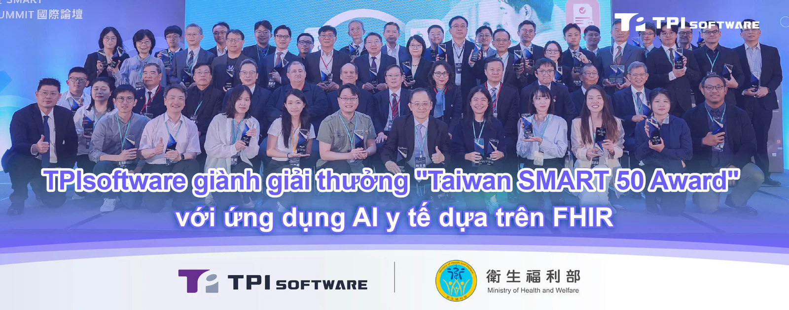

[**TPIsoftware**](/vi) (TPEx: 7781) đã được vinh danh với giải thưởng [**Taiwan SMART 50 Award**](https://www.mohw.gov.tw/cp-7398-86093-1.html) lần đầu tiên nhờ phát triển một ứng dụng AI y tế dựa trên FHIR.

Giải thưởng do Bộ Y tế và Phúc lợi Đài Loan tổ chức nhằm khuyến khích phát triển các ứng dụng y tế thông minh tuân thủ tiêu chuẩn SMART on FHIR, cho phép chia sẻ dữ liệu an toàn và theo thời gian thực giữa các bệnh viện khác nhau. Tổng cộng 50 ứng dụng đã được lựa chọn từ 115 bài dự thi thông qua một đợt kêu gọi công khai. Các ứng dụng này sẽ được niêm yết trên nền tảng Không gian Ứng dụng Y tế Đài Loan (THAS) như một phần trong sáng kiến quốc gia nhằm thúc đẩy liên thông dữ liệu trong lĩnh vực y tế.

*Chú thích ảnh: Tổng Giám đốc Cơ quan Bảo hiểm Y tế Quốc gia, Lian-Yu Chen, trao giải thưởng cho John Chen, đại diện của TPIsoftware.*

Bài dự thi của TPIsoftware là một công cụ mã hóa thủ thuật y khoa ứng dụng AI, một mô-đun của giải pháp y tế digiCare, đã được chứng minh có hiệu quả thực tiễn và tuân thủ tiêu chuẩn SMART on FHIR.

Ứng dụng mã hóa thủ thuật này sử dụng công nghệ Xử lý Ngôn ngữ Tự nhiên (NLP) để xác định xem có sử dụng chất cản quang hay không hoặc chỉ rõ các vị trí giải phẫu trong báo cáo chẩn đoán hình ảnh. Sau khi nhận dạng được các chi tiết lâm sàng, công cụ sẽ tạo các mã đề xuất tương ứng, sau đó nhân viên y tế có thể xem xét và chỉnh sửa thủ công. Quy trình tự động hóa này cải thiện độ chính xác của mã hóa, giảm thiểu tình trạng hồ sơ bảo hiểm bị từ chối và đảm bảo tuân thủ các tiêu chuẩn ICD-10-PCS và DICOM. Quy trình nhập liệu cũng được tinh giản nhờ khả năng tương thích với các hệ thống hiện có như EHR (hồ sơ bệnh án điện tử) và HIS (hệ thống thông tin bệnh viện), giúp nhân viên y tế có thêm thời gian tập trung xử lý các vấn đề phức tạp của bệnh nhân và quá trình chăm sóc.

"Việc được vinh danh là một trong 50 ứng dụng SMART cho thấy năng lực nghiên cứu và phát triển của chúng tôi trong việc hỗ trợ chuyển đổi ngành y tế. Khung tiêu chuẩn hóa này cho phép bệnh viện và trung tâm y tế cung cấp dịch vụ chăm sóc chất lượng cao, dựa trên dữ liệu đầy đủ, với độ nhất quán và bảo mật cao hơn, cùng tính tiện lợi nhờ khả năng triển khai nhanh chóng", Pierre Hsia, Phó Chủ tịch điều hành Bộ phận Phát triển Ứng dụng Doanh nghiệp của TPIsoftware cho biết.

Tổng Giám đốc TPIsoftware, Yilan Yeh, cho biết giải thưởng này đến từ sự am hiểu chuyên sâu về ngành và kinh nghiệm nhiều năm của công ty trong các ngành chịu quản lý chặt chẽ. "Chúng tôi thúc đẩy hợp tác giữa các doanh nghiệp đầu ngành, tổ chức học thuật, cơ sở y tế và cơ quan quản lý nhằm hỗ trợ chăm sóc lấy bệnh nhân làm trung tâm, cũng như hỗ trợ quyết định lâm sàng và điều trị. Dựa trên mô hình của Chương trình nghiên cứu All of Us (All of Us Research Program) tại Hoa Kỳ, chúng tôi cam kết xây dựng cơ sở dữ liệu quốc gia của Đài Loan phù hợp với Hướng dẫn Triển khai Lõi Đài Loan (TW Core Implementation Guide - IG) và tiêu chuẩn FHIR, nơi dữ liệu có thể truy cập được trong một hệ sinh thái mở và chuẩn hóa".
