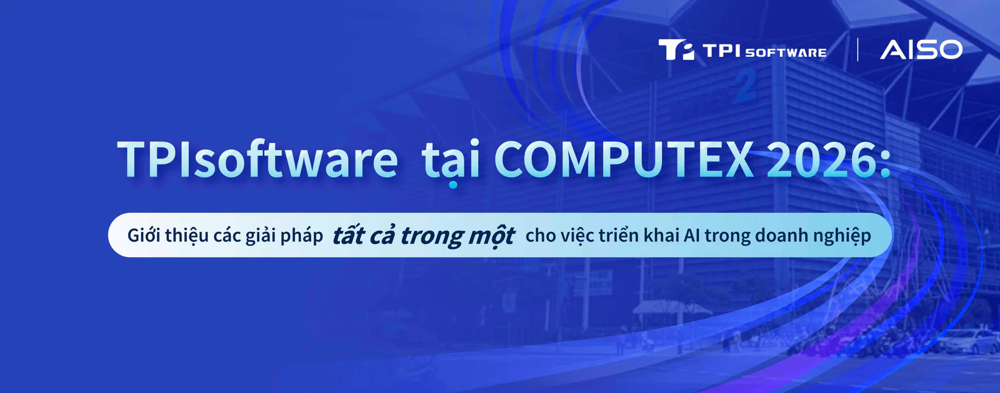

**[**TPIsoftware**](/vi)** (TPEx: 7781) đang hợp tác với Phison Electronics và Elitegroup Computer Systems (ECS), các thành viên đồng sáng lập của **[AISO](https://aisoportal.com/)**, để giới thiệu các giải pháp AI tích hợp tại COMPUTEX 2026. Với chủ đề "AI Together", công ty quy tụ các đối tác phần mềm và phần cứng nhằm hỗ trợ doanh nghiệp triển khai AI với độ phức tạp thấp hơn, quy trình mua sắm tinh gọn hơn và khả năng tương thích cao hơn.

Năm nay, khu trưng bày Open Source Team Taiwan, do Cục Quản lý Công nghiệp số tổ chức, lần đầu tiên ra mắt tại triển lãm COMPUTEX InnoVEX. TPIsoftware giới thiệu dự án mã nguồn mở **[**OpenTPI**](https://tpi.dev/)** thông qua bài thuyết trình tập trung vào cách sáng kiến này hỗ trợ thúc đẩy tính minh bạch công nghệ và đổi mới sáng tạo.

Phiên trình bày cũng trình diễn các kịch bản ứng dụng của dự án mã nguồn mở digiRunner do các thành viên Google Developer Groups on Campus (GDGoc) phát triển. Các ứng dụng trải rộng từ công nghệ tài chính, y tế, pháp lý đến giáo dục, bao gồm công cụ đầu tư, gợi ý ưu đãi thẻ tín dụng, đào tạo giao tiếp với bệnh nhân ứng dụng AI, phân tích tự động luật về bằng sáng chế, dẫn đường trong khuôn viên bằng giọng nói, cổng thông tin hợp nhất, lựa chọn môn học được AI hỗ trợ, trung tâm học bổng và gia sư AI.

"Cam kết của chúng tôi trong việc nuôi dưỡng nhân tài và phổ cập AI luôn là trọng tâm trong sứ mệnh của chúng tôi. Trong thời đại mà năng lực điện toán và khả năng của phần mềm tạo nên lợi thế cạnh tranh, việc mở quyền tiếp cận công khai digiRunner cho phép sử dụng AI tác nhân đáng tin cậy và có thể quản lý được", Yilan Yeh, Tổng Giám đốc TPIsoftware cho biết. "Việc đưa AI từ giai đoạn thử nghiệm vào triển khai thực tế, đồng thời kiểm soát dữ liệu và mô hình sẽ bảo đảm doanh nghiệp khai thác được giá trị từ các sáng kiến AI của mình".

digiRunner của TPIsoftware đã được chuyển đổi từ một cổng API thành cổng AI, cho phép người dùng quản lý tập trung và hiệu quả các mô hình ngôn ngữ lớn (LLM) và các tác nhân AI với khả năng quản trị và giám sát chuyên sâu. Việc tái định vị này phù hợp với nhu cầu của doanh nghiệp trong việc xây dựng và ứng dụng AI trên quy mô lớn, đồng thời bảo vệ dữ liệu nhạy cảm cho các mục đích tuân thủ.

AISO (AI for Sovereignty), do TPIsoftware sáng lập, là một mạng lưới cung cấp các giải pháp phần mềm và phần cứng đáng tin cậy, đã được kiểm chứng trên thị trường, phục vụ quá trình chuyển đổi AI với khả năng triển khai đơn giản "cắm là chạy" cùng chi phí hợp lý.

**Thông tin sự kiện**

Thời gian: Từ ngày 2 đến ngày 5 tháng 6 năm 2026

Địa điểm: Tầng 4, Trung tâm Triển lãm Nangang Đài Bắc, Nhà triển lãm số 2

Gian hàng: S0524

Đăng ký: [https://www.computexonline.com.tw/?userlang=en](https://www.computexonline.com.tw/?userlang=en)
