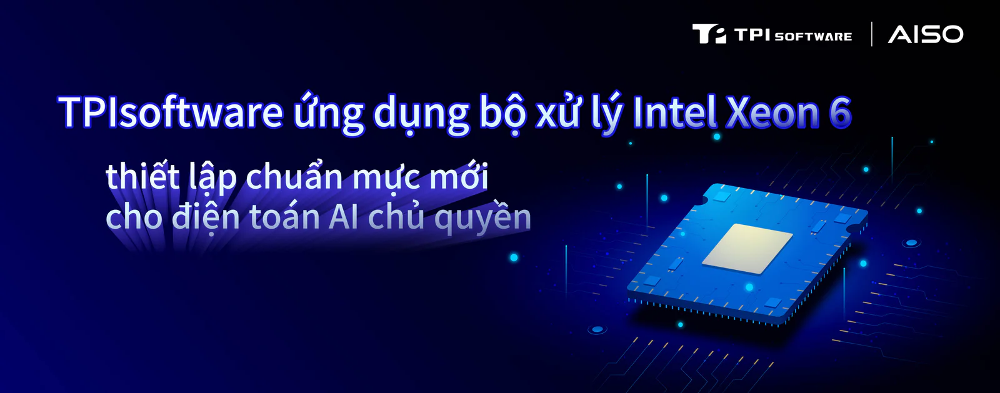

**Tiên phong sử dụng Intel Xeon 6 và Arc Pro B60 nhằm thúc đẩy các ứng dụng AI tạo sinh quy mô lớn cho doanh nghiệp**

Trong bối cảnh nhu cầu về quyền tự chủ dữ liệu và triển khai tại chỗ của doanh nghiệp gia tăng, AI chủ quyền cùng các kiến trúc tích hợp phần mềm-phần cứng đang trở thành làn sóng cạnh tranh then chốt tiếp theo. Đánh dấu một bước đột phá quan trọng trong tích hợp phần mềm-phần cứng, **[TPIsoftware](/vi)** (TPEx: 7781) hôm nay công bố việc ứng dụng bộ xử lý Intel Xeon 6 với các lõi hiệu năng cao (P-Cores) và GPU Intel Arc Pro B60 làm nền tảng điện toán cốt lõi cho các giải pháp AI cấp doanh nghiệp của mình.

Thông qua hợp tác với Intel, TPIsoftware – thành viên của Liên minh Đối tác Intel – hướng đến mục tiêu tăng cường năng lực công nghệ trong lĩnh vực điện toán biên và AI tạo sinh (GenAI), hỗ trợ doanh nghiệp đẩy nhanh quá trình chuyển đổi số đồng thời nâng cao tính ổn định và hiệu năng của các ứng dụng trọng yếu.

Nhằm giải quyết những thách thức về chi phí và kiểm soát dữ liệu mà doanh nghiệp phải đối mặt khi áp dụng GenAI, nền tảng SysTalk.VIKI do TPIsoftware tự phát triển tận dụng các lõi tính toán mạnh mẽ của Intel Xeon 6 để cung cấp nền tảng ổn định và hiệu quả cho các mô hình AI doanh nghiệp phức tạp. Khi kết hợp với GPU Intel Arc Pro, SysTalk.VIKI đã thể hiện hiệu năng suy luận mạnh mẽ và độ trễ thấp trong các thử nghiệm sơ bộ, rất thích hợp với các kịch bản ứng dụng doanh nghiệp có lượng truy cập đồng thời lớn. Thông qua kiến trúc tích hợp này, doanh nghiệp có thể triển khai tại chỗ hoàn toàn, bảo đảm dữ liệu nhạy cảm được quản lý ngay trong nội bộ doanh nghiệp, được hỗ trợ bởi hệ thống an ninh mạng và tuân thủ quy định.

Ben Yao, Chủ tịch HĐQT của TPIsoftware, cho biết: "TPIsoftware đã có nhiều năm kinh nghiệm hoạt động trong các ngành được quản lý chặt chẽ. Chúng tôi hiểu rằng việc duy trì tính ổn định và hiệu năng hệ thống ở mức cao là tiêu chuẩn cốt lõi quyết định thành công của doanh nghiệp. Việc ứng dụng Intel Xeon 6 và Intel Arc Pro B60 không chỉ thể hiện việc tiếp tục làm sâu sắc chiến lược phát triển công nghệ của chúng tôi mà còn là cột mốc quan trọng trong quá trình thúc đẩy Hệ sinh thái tích hợp phần mềm-phần cứng AI chủ quyền AISO. Tận dụng các lợi thế công nghệ hàng đầu thế giới của Intel, chúng tôi sẽ tiếp tục tích hợp nền tảng GenAI tự phát triển, phần mềm trung gian quản lý API và các năng lực AI Gateway nhằm xây dựng những giải pháp nổi bật với khả năng triển khai tại chỗ, quyền tự chủ dữ liệu và điện toán hiệu năng cao. Điều này bảo đảm 100% dữ liệu nhạy cảm của doanh nghiệp được quản lý ngay trong nội bộ doanh nghiệp, tạo điều kiện chuyển đổi thông minh trong mọi ngành nghề trên cơ sở an ninh mạng và tuân thủ".

"Trong bối cảnh các doanh nghiệp trên khắp khu vực Châu Á-Thái Bình Dương và Nhật Bản đang chạy đua khai thác giá trị của AI, họ đang tìm kiếm những nền tảng có thể cung cấp hiệu năng, hiệu quả kinh tế và khả năng kiểm soát dữ liệu nghiêm ngặt trong một kiến trúc duy nhất có khả năng mở rộng. Bằng cách kết hợp bộ xử lý Intel Xeon 6 với GPU Intel Arc Pro, các giải pháp như nền tảng SysTalk.VIKI của TPIsoftware mang đến cho khách hàng một nền tảng GenAI mạnh mẽ được triển khai tại chỗ, giúp giảm chi phí, nâng cao tốc độ phản hồi và bảo đảm dữ liệu nhạy cảm nằm dưới sự kiểm soát của chính doanh nghiệp. Đây chính là nền tảng AI chủ quyền cấp doanh nghiệp mà Intel đang xây dựng cùng các đối tác trên toàn khu vực — giúp các chính phủ và doanh nghiệp có thể tiến nhanh hơn với AI mà không phải đánh đổi việc tuân thủ, bảo mật hay độ tin cậy", Santhosh Viswanathan, Phó Chủ tịch kiêm Giám đốc điều hành Intel khu vực Châu Á-Thái Bình Dương và Nhật Bản cho biết.

Đồng thời, thông qua việc triển khai chiến lược tại Singapore, Việt Nam và Nhật Bản, TPIsoftware sẽ đẩy nhanh quá trình mở rộng sang thị trường Châu Á-Thái Bình Dương, qua đó thúc đẩy sự phát triển quốc tế của các giải pháp AI dành cho doanh nghiệp.

©Intel, the Intel logo and other Intel marks are trademarks of Intel Corporation or its subsidiaries.
