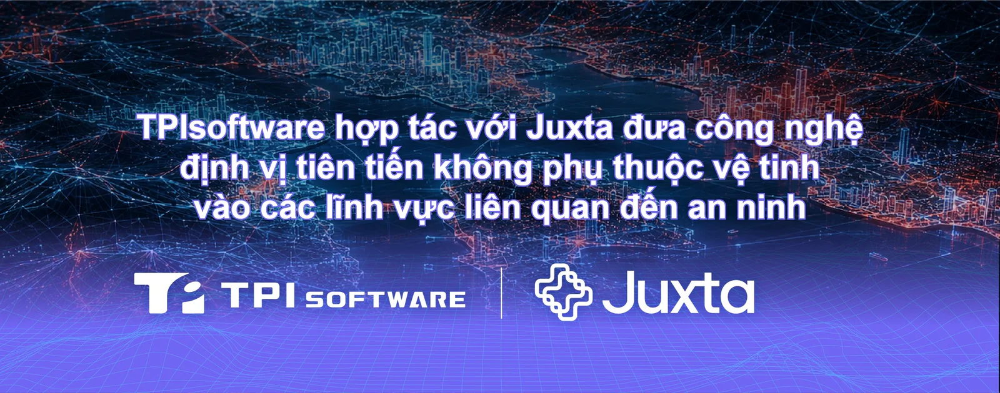

**[TPIsoftware](/vi)** đã ký thỏa thuận đại lý phân phối toàn cầu với Juxta, một công ty đổi mới công nghệ có trụ sở tại Hoa Kỳ, chuyên về **[Hệ thống định vị vạn năng (Universal Positioning System](https://www.juxta.com/about)** **\-** **[UPS)](https://www.juxta.com/about)**, nhằm cung cấp các ứng dụng theo dõi không gian địa lý cho khách hàng tại nhiều khu vực trên thế giới.

Thông qua thỏa thuận này, TPIsoftware sẽ hỗ trợ quản lý mạng lưới đại lý phân phối và cung cấp dịch vụ tích hợp hệ thống tại nhiều khu vực. Công nghệ UPS độc quyền của Juxta sẽ được tích hợp vào các giải pháp AI tích hợp của TPIsoftware để cho phép định vị tự chủ, theo thời gian thực nhằm nâng cao độ chính xác trong theo dõi và an toàn trong phòng ngừa và giảm nhẹ thiên tai, chăm sóc sức khỏe và quản lý logistics để xây dựng khả năng chống chịu trước tình trạng gây nhiễu và can thiệp tín hiệu.

Hệ thống định vị toàn cầu (GPS) đã được sử dụng rộng rãi nhưng phải đối mặt với các lỗ hổng như phạm vi phủ sóng hạn chế, bị gây nhiễu và giả mạo tín hiệu do phụ thuộc vào vệ tinh để điều hướng. Nhằm giải quyết những thách thức này, UPS của Juxta được xây dựng với các cảm biến Bộ đo quán tính (IMU) và công nghệ học máy tiên tiến để thực hiện điều hướng theo thời gian thực, theo dõi tài sản và tự động hóa quy trình vận hành mà không cần các thiết bị phần cứng đắt tiền như bộ thu tín hiệu, thiết bị phát tín hiệu và camera.

UPS hỗ trợ theo dõi với độ chính xác dưới một mét ở mọi nơi trên Trái Đất, ngay cả trong trường hợp GPS bị chặn và tín hiệu bị cản trở. UPS đã được thử nghiệm thực địa và triển khai trong các môi trường chính phủ, quốc phòng, logistics và chăm sóc sức khỏe, nơi khả năng định vị đáng tin cậy là rất quan trọng. Công nghệ này có thể hỗ trợ giám sát hoạt động toàn diện, định vị liên tục trong đường hầm, không gian trong nhà và dưới lòng đất, cũng như điều hướng cho các hệ thống không người lái hoạt động tại vùng núi hoặc khu vực xa xôi, nơi việc thu tín hiệu bị hạn chế hoặc gián đoạn. Công nghệ này cũng đã được ứng dụng trong theo dõi tài sản y tế, vận hành kho bãi và logistics, cùng các môi trường vận hành trọng yếu khác yêu cầu khả năng định vị liên tục, không phụ thuộc vào cơ sở hạ tầng.

"Việc hợp tác với TPIsoftware giúp tăng cường sự hiện diện của chúng tôi trong khu vực, cho phép chúng tôi tận dụng năng lực tích hợp và mạng lưới đã được thiết lập của họ để thâm nhập vào các thị trường lớn hơn tại khu vực Châu Á - Thái Bình Dương", John Ferrara, Nhà sáng lập kiêm Giám đốc điều hành Juxta cho biết. "Được thiết kế nhằm khắc phục những hạn chế của các công nghệ theo dõi truyền thống, Hệ thống định vị vạn năng (UPS) mang tính cách mạng của chúng tôi cung cấp một nền tảng không yêu cầu phần cứng, có khả năng hoạt động ngoại tuyến, giúp biến bất kỳ môi trường nào trở thành không gian thông minh, có thể theo dõi liên tục".

"Sự hợp tác chiến lược này giúp chúng tôi mở rộng phạm vi tiếp cận tới các ngành có tiêu chuẩn tuân thủ cao hơn, đồng thời cho phép tích hợp sâu hơn các giải pháp AI độc quyền của chúng tôi với khả năng định vị của Juxta", Yilan Yeh, Tổng Giám đốc TPIsoftware cho biết. "Thông qua việc tận dụng khả năng định vị chính xác và công nghệ chống nhiễu của Juxta, chúng tôi có thể tiếp tục hỗ trợ khách hàng trong các lĩnh vực chăm sóc sức khỏe, phòng ngừa thiên tai và logistics tại Đài Loan cũng như các thị trường ngoài khu vực Châu Á - Thái Bình Dương, thông qua việc triển khai AI tại chỗ nhằm nâng cao chủ quyền dữ liệu, bảo mật và khả năng chống chịu".
