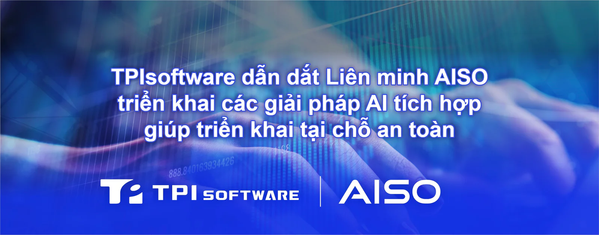

**[TPIsoftware](/vi)** (TPEx: 7781) công bố ra mắt danh mục giải pháp AI tích hợp, trong đó có AISO AI Notebook được cấu hình sẵn với **[OrientAI](/vi/orient-ai)**, nền tảng AI tác nhân dành cho doanh nghiệp. Giải pháp sẵn sàng triển khai này cung cấp năng lực điện toán hiệu năng cao và tăng cường bảo mật dữ liệu bằng cách thực hiện toàn bộ tác vụ AI trực tiếp trên các thiết bị cục bộ.

Điểm khác biệt cốt lõi của AISO so với phần lớn các giải pháp phần cứng hiện nay chỉ tập trung vào năng lực điện toán mà không có nền tảng phần mềm phục vụ quản trị AI, các giải pháp AI tất cả trong một của AISO được cung cấp cùng OrientAI cho khả năng giám sát tốt hơn hoạt động sử dụng AI. Bằng cách tập trung các mô hình ngôn ngữ lớn và tác nhân trên một nền tảng, các tổ chức có thể thiết lập một khung quản trị toàn diện với khả năng kiểm soát truy cập chi tiết dựa trên vai trò, theo dõi token theo thời gian thực và tối ưu hóa chi phí.

Liên minh AISO đang mở rộng danh mục giải pháp thông qua cách tiếp cận phần cứng được định nghĩa bằng phần mềm, kết hợp hài hòa giữa phần mềm tiên tiến và phần cứng chuyên dụng để cung cấp giải pháp cho các ngành dọc. Bên cạnh AI Notebook, hệ sinh thái còn bao gồm Giải pháp AI tất cả trong một cho Chăm sóc sức khỏe thông minh digiCare của TPIsoftware và Giải pháp AI tất cả trong một cho Tài liệu thông minh trong lĩnh vực Chăm sóc sức khoẻ và Sản xuất của KDAN, qua đó mở rộng phạm vi hoạt động của liên minh sang nhiều ngành khác nhau.

Liên minh cũng sẽ ra mắt AISO 1, giải pháp tác nhân AI triển khai tại chỗ mang thương hiệu riêng đầu tiên của mình, vào giữa tháng 10. Hệ thống máy tính để bàn này sẽ tích hợp các mô hình Mixture-of-Experts (MoE) quy mô lớn, cơ sở tri thức riêng và tự động hóa quy trình công việc do tác nhân AI hỗ trợ trên một nền tảng tại chỗ nhỏ gọn. OrientAI cung cấp khả năng quản trị AI thống nhất và quản lý chi phí token trên toàn bộ danh mục giải pháp, giúp các tổ chức tối ưu hóa nguồn lực điện toán trong khi vẫn giữ các dữ liệu nhạy cảm tại chỗ, qua đó đặt nền móng vững chắc cho kỷ nguyên 'AI có chủ quyền' trên quy mô đa ngành.

"Với việc các thành viên mới gia nhập Liên minh AISO, các giải pháp tích hợp trong hệ sinh thái của chúng tôi hiện bao phủ nhiều ứng dụng hơn trong các lĩnh vực chăm sóc sức khoẻ, sản xuất, tài chính, an ninh và chính phủ", Yilan Yeh, Tổng Giám đốc TPIsoftware cho biết. Bà cũng cho biết thêm: "Các tuỳ chọn phần cứng bao gồm AI Notebook, AI PC, máy trạm và máy chủ, tùy thuộc vào quy mô phòng ban và nhu cầu kinh doanh".

Khách hàng hiện có thể dễ dàng lựa chọn giải pháp phù hợp và đặt hàng thông qua **[AISO Portal](https://aisoportal.com/)** mà không phải đối mặt với những trở ngại trong quy trình mua sắm và sự phức tạp khi áp dụng.

TPIsoftware cũng công bố các quan hệ đối tác chiến lược với những doanh nghiệp công nghệ hàng đầu thế giới hiện thực hóa tham vọng tiếp tục mở rộng tầm ảnh hưởng sâu rộng tại các thị trường Châu Á - Thái Bình Dương và Đông Nam Á.

Để biết thêm chi tiết, vui lòng truy cập AISO Portal: **[https://aisoportal.com](https://aisoportal.com/)**
