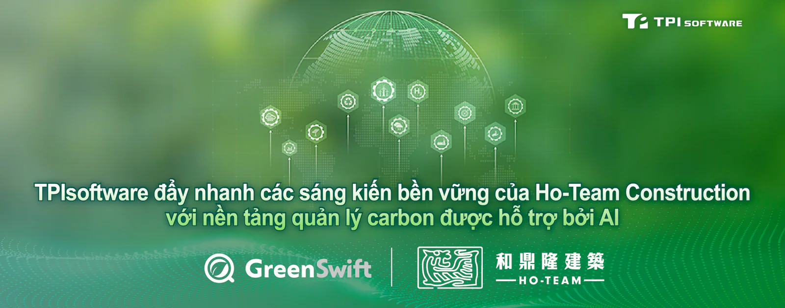

**[TPIsoftware](/vi)** (TPEx: 7781) đã hỗ trợ Ho-Team Construction trong quá trình kiểm kê và báo cáo carbon bằng **[GreenSwift](/vi/products/greenswift)**, nền tảng quản lý carbon tích hợp trí tuệ nhân tạo (AI).

Bureau Veritas – tổ chức hàng đầu thế giới trong lĩnh vực thử nghiệm, giám định và chứng nhận – đã xác minh nỗ lực quản lý phát thải của Ho-Team Construction, đồng thời xác nhận tính toàn vẹn của dữ liệu được báo cáo. Được thực hiện và đánh giá trong phạm vi xác định, báo cáo kiểm kê mà doanh nghiệp xây dựng này biên soạn bằng GreenSwift đã nhận được sự đảm bảo của bên thứ ba, chứng minh hiệu suất về môi trường của công ty một cách đáng tin cậy và tuân thủ tiêu chuẩn ISO 14064-1:2018.

Ho-Team Construction đã tiến hành kiểm kê để thu thập, đo lường, phân tích và báo cáo về phát thải khí nhà kính (GHG) bằng các tính năng do AI hỗ trợ của GreenSwift sau khi hợp tác với TPIsoftware vào năm 2025. GreenSwift là một nền tảng SaaS tập trung quản lý dữ liệu phát thải và cung cấp các chiến lược để cải thiện hành động vì khí hậu. Trợ lý AI của GreenSwift cung cấp hướng dẫn theo thời gian thực và đề xuất các hệ số phát thải cần sử dụng trong quá trình nhập dữ liệu. Các báo cáo kiểm kê phát thải được tạo ra một cách đơn giản nhờ sự hỗ trợ của AI và sẵn sàng để nộp cho bên thứ ba kiểm toán và chứng nhận.

Một cuộc khảo sát của PwC cho thấy mặc dù 80% doanh nghiệp Việt Nam có cam kết liên quan đến ESG, 71% trong số đó vẫn đang ở giai đoạn đầu tìm hiểu hoặc chưa bắt đầu tích hợp dữ liệu ESG. Các tổ chức thường gặp khó khăn trong việc thu thập dữ liệu phát thải đáng tin cậy do hệ thống bị phân mảnh và sự tham gia hạn chế của nhà cung cấp, dẫn đến báo cáo không chính xác và chiến lược sai hướng. Để giải quyết các thách thức này, cần có một phương pháp toàn diện, có cấu trúc, cho phép truy cập dữ liệu theo thời gian thực và phối hợp giữa các nhóm bằng cách sử dụng một giải pháp kỹ thuật số như GreenSwift để tự động hóa việc tích hợp, định lượng và phân tích dữ liệu phát thải nhằm đảm bảo tính nhất quán và hiệu quả.

Ông Chien Tzu-Yun, Phó Giám đốc của Ho-Team Construction, chia sẻ: “Việc nhận được xác minh từ Bureau Veritas là minh chứng cho cam kết của chúng tôi đối với việc giảm thiểu carbon và tính bền vững của môi trường. Việc đưa GreenSwift vào quy trình kiểm kê cho phép chúng tôi đưa ra các quyết định sáng suốt, lập báo cáo dựa trên dữ liệu và áp dụng các thực hành tốt nhất phù hợp với tiêu chuẩn quốc tế. Chúng tôi đang ở một vị thế vững chắc hơn để đón đầu các cơ hội từ thị trường carbon mà Việt Nam dự kiến sẽ vận hành chính thức vào năm 2029.”

Yilan Yeh, Tổng Giám đốc của TPIsoftware, cho biết. “TPIsoftware hỗ trợ các sáng kiến của tổ chức trong việc đạt được mục tiêu phát thải carbon thấp và Net Zero thông qua việc tối ưu hóa quá trình theo dõi, phân tích và báo cáo dữ liệu. Chúng tôi rất vui mừng được tham gia vào tiến trình của Ho-Team Construction nhằm tạo ra những tác động thiết thực đến khí hậu bằng năng lực kỹ thuật của chúng tôi. Chúng tôi tiếp tục thúc đẩy tác động bền vững minh bạch, có thể đo lường được với các đối tác ở Đông Nam Á.”
