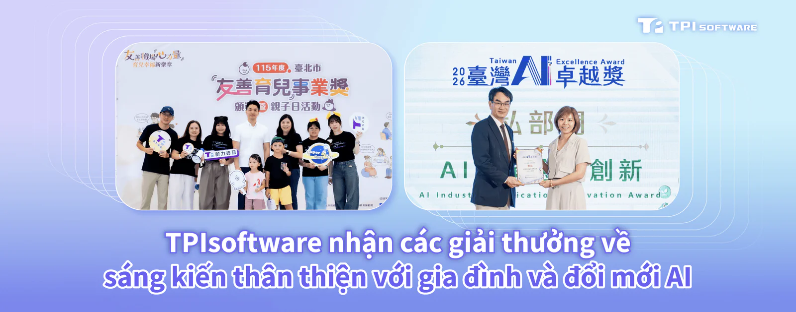

**[**TPIsoftware**](/vi)** (TPEx: 7781) công bố những sự ghi nhận gần đây, gồm giải thưởng Parenting Friendly Enterprise Award nhờ cam kết thúc đẩy tính đa dạng, công bằng và hòa nhập tại nơi làm việc và giải thưởng 2026 Taiwan AI Excellence Award nhờ giải pháp AI tích hợp của công ty.

Được Sở Lao động Chính quyền Thành phố Đài Bắc công nhận năm thứ hai liên tiếp, sự hỗ trợ dành cho người lao động có con nhỏ của TPIsoftware đã được vinh danh với giải thưởng **[Parenting Friendly Enterprise Award](https://bola.gov.taipei/cp.aspx?n=E5C5E8BD24E3A36C)**. Các chương trình và biện pháp phúc lợi như giờ làm việc linh hoạt, 10 ngày nghỉ trước sinh, lựa chọn làm việc từ xa và hỗ trợ học phí đã được triển khai nhằm xây dựng văn hóa nơi làm việc thân thiện với gia đình. Một nền tảng chia sẻ mới được xây dựng nhằm tạo điều kiện cho các hoạt động hỗ trợ lẫn nhau giữa các thành viên trong cộng đồng, thúc đẩy trao đổi đồ chơi và sách, cùng với các hội thảo trực tuyến về nuôi dạy con do chuyên gia hướng dẫn, cung cấp các mẹo chăm sóc trẻ.

Giải pháp AI tích hợp AISO của TPIsoftware được vinh danh là một trong những giải pháp hàng đầu tại giải thưởng **[2026 Taiwan AI Excellence Award](https://aiaward.tissa.tw/winner.html)** tổ chức lần đầu tiên, do Hiệp hội Phần mềm và Dịch vụ Đổi mới Đài Loan (TISSA) trao tặng. Giải pháp chìa khóa trao tay quyền này, được cấu hình sẵn nền tảng quản trị AI tác nhân **[**OrientAI**](/vi/orient-ai)**, cung cấp khả năng kiểm soát thống nhất đối với quyền truy cập và việc sử dụng token, đồng thời hỗ trợ các tác vụ AI cục bộ hiệu năng cao. Giải pháp áp dụng cách tiếp cận kết hợp, giúp bảo đảm tính riêng tư và an toàn của dữ liệu, đồng thời duy trì sự linh hoạt của các dịch vụ đám mây.

Các tùy chọn phần cứng với nhiều thông số kỹ thuật khác nhau cùng các ứng dụng phần mềm trọng yếu có trên **[Cổng thông tin AISO](https://aisoportal.com/)** chuyên dụng, nơi khách hàng có thể trực tiếp đặt hàng qua website. Điều này giúp giảm bớt sự phức tạp và chi phí khi ứng dụng AI, mang đến các giải pháp tiết kiệm chi phí cho doanh nghiệp thuộc mọi quy mô.

48 giải pháp chuyên biệt trong khu vực công và tư nhân, trong đó có ThinkTron và Gogolook — cũng là các thành viên của liên minh AISO — đã được vinh danh và trao giải thưởng Taiwan AI Excellence Award.

"Trong kỷ nguyên ứng dụng AI đang tăng tốc, TPIsoftware ưu tiên cách tiếp cận lấy con người làm trung tâm trong đổi mới công nghệ và phát triển bền vững", bà Yilan Yeh, Tổng Giám đốc TPIsoftware cho biết. "Bên cạnh những giải thưởng nêu trên, năng lực trong việc thiết lập khả năng liên thông dữ liệu y tế của chúng tôi đã được kiểm chứng tại 2026 Taiwan Connectathon, qua đó thể hiện công nghệ chia sẻ dữ liệu an toàn, tuân thủ phù hợp với tiêu chuẩn SMART on FHIR".

"Với năng lực chuyên môn và các sản phẩm, dịch vụ đã được kiểm chứng mà chúng tôi cung cấp, khách hàng của chúng tôi có thể tự tin tiến lên và thúc đẩy tăng trưởng trong môi trường số, đồng thời hướng tới một tương lai đổi mới, có khả năng chống chịu và thích ứng, được thúc đẩy bởi công nghệ lấy con người làm trung tâm", bà Yeh nói thêm.

*Thị trưởng Thành phố Đài Bắc Wan-An Chiang đã trao giải thưởng cho Phó Chủ tịch Điều hành TPIsoftware, bà Mina Yieh*

*Bộ trưởng Bộ Kỹ thuật số Yi-Jing Lin đã trao giải thưởng cho Tổng Giám đốc TPIsoftware, bà Yilan Yeh (Ảnh do TISSA cung cấp)*
