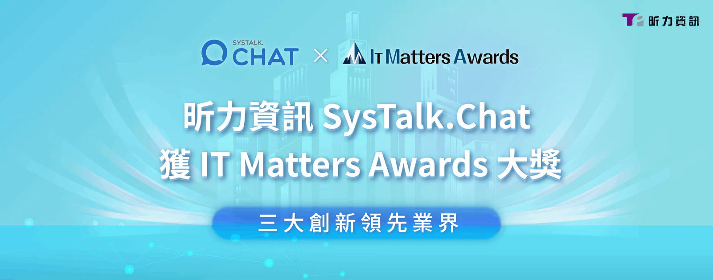

由數位發展部數位產業署指導 IMA 資訊經理人協會創立的第一屆「IT Matters Awards（它時代影響力獎）」，頒獎典禮於 10 月 18 日圓滿落幕，昕力資訊自主研發[交談式 AI 智能客服 SysTalk.Chat](/products/systalk-chat) 甫獲 2023 金漾獎「前瞻技術」首獎，近日再度獲得肯定，於超過 200 件頂尖企業的報名中突圍，勇奪推動 IT 生態圈創新最高殊榮的「IT Matters Awards - IT Matters 產品/專案獎」。SysTalk.Chat 以全國首創「雙腦一流程」、「融合 ChatGPT 協作梳理 AI 大腦」以及「具有視覺的聊天機器人」三大創新，滿足各產業對人性化智能客服的需求，實踐數位轉型。「IT Matters Awards」由超過 50 位產官學界重量級代表擔任評審，旨在表揚 IT 人才友善之企業環境與創新 IT 技術應用，昕力資訊歷經六個月嚴謹的複審、決審脫穎而出。

## 創新架構讓企業建構台灣每年超過千萬人次使用的AI服務

昕力資訊的SysTalk.Chat 智能客服解決方案，已成功為金融、保險、醫療、交通、政府、製造、電商等產業帶來創新變革，每年有超過千萬人次使用 SysTalk.Chat 的服務。SysTalk.Chat 獨家雙腦一流程產品架構，採用 NLU（查詢腦）、FAQ（諮詢腦）和 FLOW（流程）模組建立，並結合 AI 大腦訓練模組，賦予 Chatbot 高精準度大腦與對話邏輯。此外，SysTalk.Chat 提供與 ChatGPT 相互兼容的高效 AI 大腦訓練，能分析檢測語料衝突，成就最擬人的交談對話。SysTalk.Chat 更進一步建構 SysTalk.ICR 智慧光學文字辨識擴展應用場景，搭配 SysTalk.PUZZLE 模型再訓練機制，具高辨識、高精準度，為全球華人市場各產業，提供最完整的 AI 智能客服解決方案。

## 真正融入民眾生活的AI數位勞動力藍圖

昕力資訊 AI 產品事業處副總經理林秀明表示，「昕力台灣 AI 團隊以自研發的一系列產品，發展出完整的 AI 數位勞動力藍圖，不僅在後疫情時代提供超過百萬人次民眾掛號、領藥等7x24小時服務，更拓展至[智能理賠](/solutions/smartclaim)、[智慧建檔](/solutions/smartfilling)等解決方案讓企業節省近四成的重複人力，甚至結合昕力具綜理高效的『[企業服務中台 DigiFusion](/products/digilism)』，串接 IT 核心應用，發展企業全面的創新數位服務．『真正的 AI 是融入民眾生活的 AI』，堅持這個研發理念也是 SysTalk.Chat 每年能服務超過 14,000,000 人次，在台灣壽險產業更以超過 36% 的市佔率奪得市場第一的關鍵因素。」

## 以AI促進企業跨出ESG永續發展的重要一步

在 ESG 永續發展層面，SysTalk.Chat 實現人機共工的工作型態，為企業帶來綠色轉型，用最少的語料、最具效率的方式達到 AI 大腦自主訓練學習以優化客服品質，協助企業在減輕人力維運成本的同時，提升永續經營競爭力。昕力資訊總經理姚勝富表示，「能得到『IT Matters Awards』評審委員的青睞，是對昕力 AI 人工智慧領域優異成績的肯定，也是對台灣本土技術團隊的高度認可。昕力一向以提升台灣數位競爭力與促進 ESG 永續發展為首要使命，對於重視 IT人才生態圈建立的『IT Matters Awards』而言，這也無疑是昕力在 IT 人才培育有成的證明，昕力將繼續努力創新，為客戶提供更優質、更便捷的數位化解決方案，引領台灣企業走在數位轉型的尖端。」

**[關於昕力資訊](/)**

昕力資訊為台灣第一數位轉型科技軟體公司，自主研發[DigiFusion 企業服務中台](/products#digifusion)及[SysTalk.ai 交談式 AI 產品](/products#systalkai)，銷售通路遍及海內外。昕力同時提供全方位[軟體解決方案](/)與[雲端服務](https://www.tpisoftware.com/gcp)，掌握系統上雲龐大需求。我們具有跨國大型專案建置經驗，以高安全性、高執行性及高可靠性之開發質量，協助全球企業客戶靈活因應當地市場的需求，實現數位轉型。客戶產業橫跨國內外金融保險、政府單位、零售電商、製造生產、醫療照護等多元面向 ，皆贏得客戶信賴與多個國際獎項肯定，顯見昕力資訊的頂尖實力。

**[媒體聯繫](/)**

Peggy Tsai

+886-2-2658-0508 #1606

peggy.tsai@tpisoftware.com
