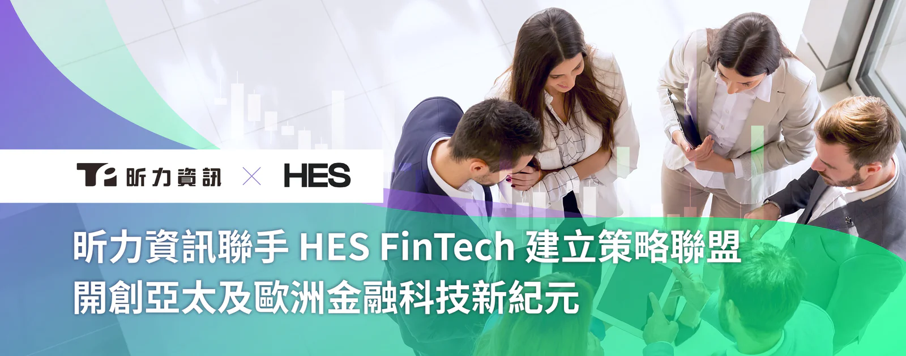

引領台灣數位轉型浪潮的企業級軟體領導廠商昕力資訊，近日宣佈攜手總部位於歐洲的貸款解決方案供應商 HES FinTech 建立策略聯盟。藉由合作夥伴關係，雙方將深化亞太及歐洲金融科技市場布局，為市場挹注創新動能。

此次合作是雙方攜手擴展全球業務版圖的重要一步，不僅是昕力資訊首次進軍歐洲市場的里程碑，同時也為 HES FinTech 提供深入亞洲市場的機會。昕力資訊近年除了在亞太地區如新加坡、越南、日本、泰國等國家設立分公司，更積極拓展至印尼、柬埔寨等新興市場建立強大的合作夥伴網絡。HES FinTech 致力於提供自動化借貸解決方案和貸款管理系統，已服務全球超過 40 個國家。此策略聯盟將結合雙方專業知識與市場優勢，透過彼此產品[企業級 API 管理平台 digiRunner](/products/digirunner) 與[貸款即服務平台 Loanbox](https://hesfintech.com/platform/) 的預整合，優化貸款流程和系統間數據交換，進而提升效率、安全性、靈活性和客戶體驗，為亞太及歐洲金融服務產業帶來生態系統創新。

HES FinTech 的 LoanBox 為新興貸款機構和數位銀行量身打造一站式線上貸款平台，提供全方位財務工具，包括貸款發放、管理、服務、催收、商業智慧 BI 報告及 AI 評分等模組。而昕力資訊的雲原生 API 管理平台 digiRunner 獲 AWS 和 ISO 27001 認證，遵循開放銀行的最高標準，為 LoanBox 提供堅實的安全保障和金融合規。digiRunner 作為中台管理，使 Loanbox 能夠彈性串接其他系統如 AI 信用評分軟體，提升服務創新靈活度，此外，digiRunner 不僅協助 Loanbox 與金融機構、信評機構等服務進行無縫整合，更提供身份驗證和授權機制，完善貸款服務的同時，能高效且安全處理機敏財務數據，從而優化營運流程。

此次合作契機源自於雙方近期一項跨國合作專案，協助泰國當地知名消費金融業者建置雲端貸款管理系統，透過核心業務系統現代化推動商業模式創新，更證明了昕力資訊與 HES FinTech 的產品通過市場驗證。

HES FinTech 共同創辦人 Ivan Kovalenko 表示：「我們期待與昕力資訊的策略聯盟，共同為客戶創造更大的價值。與 digiRunner 的預整合，不僅為 Loanbox 帶來更多創新服務的可能性，digiRunner 全面的資安機制，有效解決潛在數據風險，在貸款產品測試、即時收集用戶回饋和系統間數據交換等方面都有加乘效益，更使我們的客戶無須大規模進行系統翻新，即可受惠於我們最先進的工具。」

昕力資訊總經理姚勝富提到：「我們很榮幸能與 HES FinTech 共同發揮雙方的金融科技實力創造雙贏，打造更多元且安全合規的貸款服務，期待能透過策略聯盟，進一步鞏固我們作為亞太及歐洲金融科技領導者的地位。」

**[關於昕力資訊](/)**

昕力資訊為台灣第一數位轉型科技軟體公司，自主研發[DigiFusion 企業服務中台](/products#digifusion)及[SysTalk.ai 交談式 AI 產品](/products#systalkai)，銷售通路遍及海內外。昕力同時提供全方位[軟體解決方案](/)與[雲端服務](https://www.tpisoftware.com/gcp)，掌握系統上雲龐大需求。我們具有跨國大型專案建置經驗，以高安全性、高執行性及高可靠性之開發質量，協助全球企業客戶靈活因應當地市場的需求，實現數位轉型。客戶產業橫跨國內外金融保險、政府單位、零售電商、製造生產、醫療照護等多元面向 ，皆贏得客戶信賴與多個國際獎項肯定，顯見昕力資訊的頂尖實力。

**[媒體聯繫](/)**

Peggy Tsai

+886-2-2658-0508 #1606

peggy.tsai@tpisoftware.com
