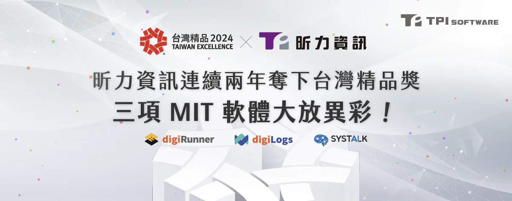

第 32 屆「2024 TAIWAN EXCELLENCE 台灣精品獎」於今日（12/6）舉行頒獎典禮，昕力資訊繼去年首度拿下三項大獎後，今年再度以「[digiRunner 企業級 API 管理平台](/products/digirunner)」、「[digiLogs 一站式日誌管理平台台](/products/digilogs)」、「[SysTalk.ai 智能理賠解決方案](/solutions/smartclaim)」蟬聯三項台灣精品奬，也是台灣資訊軟體廠商的最大贏家！今年的台灣精品獎，由經濟部邀請 140 位各領域專家，從上千件產品中選出 182 家企業的 320 件產品授予殊榮。

昕力資訊總經理葉怡蘭表示，「昕力資訊堅信台灣的軟體實力不輸國際大廠，這也是 18 年來堅持以台灣技術團隊為核心，打造具有國際水準的軟體，連續兩年的獲獎也是台灣精品奬的評審對昕力長年努力的肯定，為了讓更多的企業認識昕力的企業級 IT 應用產品，我們在台灣、歐洲、東南亞市場積極結盟，也參與台灣精品獎的各項海外拓銷活動，都是為了讓其他國家認識台灣的科技產業不是只專精於硬體，資訊軟體...等數位轉型科技也非常擅長！」，葉總經理也提到：「今年我們有兩項企業軟體、一項 AI 智能解決方案獲獎，連續兩年成為同業獲獎最多的公司，足見昕力團隊的研發水準，更體現了全體員工強大的向心力，朝著台灣第一數位轉型科技軟體公司邁進！」

連續兩年獲獎的 digiRunner API 管理平台，能夠透過 API 快速與第三方服務串接，新版本新增沙盒模擬測試功能，能夠在不影響企業對外服務的前提下，於前後端平行開發；並透過智慧快取、負載平衡、平行處理、容器延展四大內建機制，實現尖峰、離峰自動擴容、多節點溝通等專利技術，可在 API 版本更新時，快速完成異質平台間的資料同步，特別在金融產業、醫療機構、政府單位常需面對大量 API 控管的困擾，是台灣唯一符合『開放銀行』、『開放政府』的 APIM 平台，協助我們的客戶提升 90％ 以上開發效率，兼顧企業效率與競爭力！

另一項連續兩年獲獎的產品 digiLogs 一站式日誌管理平台，可以同時管理 55 種以上不同的 Log 格式，是企業最佳的日誌管理工具，尤其在現代 IT 容器化、微服務化的趨勢下，衍生出的棘手管理問題，例如最常見的當系統發生問題時難以追查問題根源時，在新版本 digiLogs 就可快速處置，利用可視化的網絡拓樸關聯監控端點的狀態（EDR），並透過根因分析（RCA）精準定位問題所在，快速解決問題、大幅減少修復時間，進而提升企業 IT 營運績效。 digiLogs 與 digiRunner 皆已取得 ISO 27001 資訊安全認證，可完全滿足企業稽核與法遵要求與合規。

在 AI 應用產品方面，今年瞄準保險產業推出由 SysTalk.ai 團隊研發的「AI 智能理賠解決方案」，解決長久以來保險業的痛點，打造自動化理賠流程，針對相關投保、理賠、核保過程中格式持續變動的文件，建立保險業專屬的 AI 模型，運用 AI 文本分析技術與 NLU 解析醫囑，快速在中英混雜的醫囑中找出中心句和關鍵詞，省去人工登打資料的時間；另外在改良傳統 OCR 技術方面，以 SysTalk.ICR 掃描辨識各種不同的單據、診斷證明書，無需建立各種模版，就能偵測不同格式文件中的必要欄位，做到自動表單欄位解析，並能直接辨識國際通用的 ICD 9/10-CM 與健保手術代碼；昕力「AI 智能理賠解決方案」除了能加速理賠時效與維持理賠計算資料的一致性，提升保戶的滿意度之外，還提供目前最適合企業應用的『自適應 AI 模型機制』，持續讓企業自主提升模型信心值，使企業無需有特定 AI 團隊也能達成 100% 自主營運 AI 模型的任務。

**[關於昕力資訊](/)**

昕力資訊為昕力資訊為台灣第一數位轉型科技軟體公司，自主研發[DigiFusion 企業服務中台](/products#digifusion)及[SysTalk.ai 交談式 AI 產品](/products#systalkai)，銷售通路遍及海內外。昕力同時提供全方位[軟體解決方案](/)與[雲端服務](https://www.tpisoftware.com/gcp)，掌握系統上雲龐大需求。我們具有跨國大型專案建置經驗，以高安全性、高執行性及高可靠性之開發質量，協助全球企業客戶靈活因應當地市場的需求，實現數位轉型。客戶產業橫跨國內外金融保險、政府單位、零售電商、製造生產、醫療照護等多元面向 ，皆贏得客戶信賴與多個國際獎項肯定，顯見昕力資訊的頂尖實力。

**[媒體聯繫](/)**

Peggy Tsai

+886-2-2658-0508 #1606

peggy.tsai@tpisoftware.com
