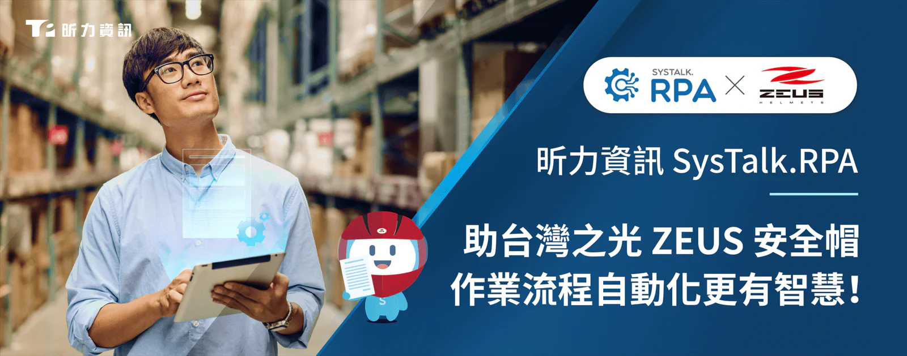

台灣的產業環境近年面臨嚴峻的考驗，尤其在少子化的趨勢下，製造業勞動力短缺問題也就成為產業亟需解決的困境，因此如何將企業內部重複性高、繁瑣且單調的工作自動化，進而把員工的勞動力放在高價值的事務上，成為製造業管理階層的首要任務。國內首屈一指安全帽製造商，並以「ZEUS」品牌行銷全球的隆輝安全帽，為了想解決大量重複性人工作業，尤其是訂單轉單的作業程序，耗費同仁許多無謂的時間，故開始有導入 RPA 的想法，且選擇有服務能量的昕力資訊作為合作夥伴。

隆輝在[SysTalk.RPA 流程自動化](/products/systalk-rpa)的應用情境，同樣也是製造行業共同想解決的痛點，以訂單轉銷貨為例，負責人需要將訂單轉出庫再轉分倉再轉銷貨，如果一天接到 200 筆訂單，就要在系統上重複 600 次以上相同的動作；但使用 RPA 替代後，人員只需登錄訂單後等待一段時間，RPA 就會幫忙執行中間過程，直接轉成銷貨單，而中間等待的時間，員工就能繼續登錄接受訂單，一方面加快作業效率，另一方面也降低了人工登打的錯誤機率。

隆輝安全帽總經理李明輝表示：「這次導入 SysTalk.RPA 的過程能圓滿順利，其實取決於全體員工的投入，在一開始請同仁評估選商的過程中，大家就充分參與調研、訪談，最終選擇昕力資訊除了具有豐富的跨產業導入經驗，還有專業強大的服務能量，可以有效減少內部溝通的成本。」李總經理接著表示，「自從導入 SysTalk.RPA 後，幫同仁節省了約 99% 無效的等待時間，在轉單這項作業上近乎完全取代人力，使同仁能更妥善的安排其他工作，改善整體營運效率！」

昕力資訊 AI 產品事業處副總經理林秀明進一步指出，「企業在面臨普遍勞力短缺的趨勢下，RPA 流程自動化會是各個產業的因應解方，昕力已經有許多跨產業的建議經驗，包括：金融保險、房地產、製造業、旅宿業…等，並且藉由導入 RPA 的機會，也可針對公司內部行之有年的流程、規定做一次全面的健檢優化，在全面體檢的過程中，我們與客戶也會響應政府企業減碳的政策，給予適當的建議，節省紙本的消耗。」在企業最關心的 RPA 導入時效方面，林副總經理建議：「如果以一般導入兩條流程的時間來說，實施導入的時間在六週內，施行後立馬就有初步可見效益。」

**[關於昕力資訊](/)**

昕力資訊為昕力資訊為台灣第一數位轉型科技軟體公司，自主研發[DigiFusion 企業服務中台](/products#digifusion)及[SysTalk.ai 交談式 AI 產品](/products#systalkai)，銷售通路遍及海內外。昕力同時提供全方位[軟體解決方案](/)與[雲端服務](https://www.tpisoftware.com/gcp)，掌握系統上雲龐大需求。我們具有跨國大型專案建置經驗，以高安全性、高執行性及高可靠性之開發質量，協助全球企業客戶靈活因應當地市場的需求，實現數位轉型。客戶產業橫跨國內外金融保險、政府單位、零售電商、製造生產、醫療照護等多元面向 ，皆贏得客戶信賴與多個國際獎項肯定，顯見昕力資訊的頂尖實力。

**[媒體聯繫](/)**

Peggy Tsai

+886-2-2658-0508 #1606

peggy.tsai@tpisoftware.com
