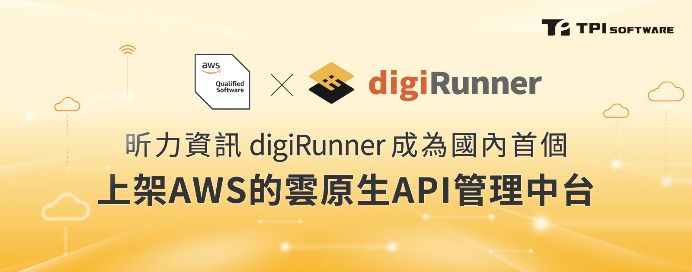

國內數位轉型科技領導廠商[昕力資訊](/)針對近年蓬勃發展的雲端服務積極布局雲原生軟體，其中，台灣團隊研發的企業級API管理平台 - digiRunner，日前通過全球雲端服務領導廠商Amazon Web Services（AWS）縝密的技術架構審核，已正式上架 AWS Marketplace，digiRunner 除了擁有七項發明專利與 ISO 27001 資訊安全認證，也連續兩年獲得2023、2024台灣精品獎的肯定，此次 AWS 原廠審核包括安全性設計、架構檢核，以及部署與維運管理流程等等，在 AWS 雲端環境下，協助開發者以更高效的靈活性與擴展性，快速佈署，為企業加快推出數位應用、持續數位創新！

digiRunner 為昕力台灣團隊自主研發的企業級 API 管理中台，此次通過AWS FTR 審查，也正式成為 AWS 獨立軟體開發夥伴（ISV Partner），除了成功上架 AWS Marketplace，得以觸及全球32個AWS區域、數百萬個 AWS Marketplace 用戶，未來也將持續強化與 AWS 的合作，創造更優質的客戶體驗！

這幾年全球市場的競爭型態已經發生了劇烈的變化，企業已經意識到市場的快速轉變，即時回應市場的速率成了生存關鍵，企業上雲已經不是課題，而是如何在雲端進行更有效的創新，昕力資訊digiRunner API管理平台的特性就是協助企業用戶更快、更方便地管理大量API，利用其業務中台的優勢，打造各種數位服務；digiRunner以容器化技術 (Container) 佈署於AWS，除了使用最小的系統資源、輕量化的優勢，更允許IT人員在不同環境中都能維持一致性的運行，尤其在多雲環境中更加重要，此外，還為開發團隊提供更快速開發、測試、佈署流程，縮短上線週期，搶佔市場先機。

昕力資訊總經理葉怡蘭表示：「隨著主管機關法規的放寬，最近幾年，我們協助很多 BFSI 產業客戶上雲，也觀察到越來越多企業積極尋求將其業務應用和資源轉移到雲端平台，當然也可能伴隨著複雜的技術挑戰和運營風險，我們與 AWS 合作正是為我們的客戶尋求最穩健的雲端供應商，利用其豐富的工具和服務，不僅簡化了複雜的基礎設施管理，方便維運，使我們的客戶能夠更專注於核心業務。」葉總經理續表示：「昕力資訊的產品發展策略是提供客戶完整的雲原生軟體產品與應用，運用容器化技術與微服務實現 IT 架構現代化，大幅縮短開發團隊各種創新服務上線時程，事實上我們也已經完成許多指標性的數位創新案例，為客戶帶來卓越的商業效益，今後我們也會借著AWS全球優勢，將昕力的軟體產品推向海外。」

昕力資訊新加坡分公司總經理簡怡雯也提到，「我們不僅聚焦台灣市場，更積極與 AWS 海外團隊攜手合作，目前我們正在與 AWS 越南團隊密切合作，計畫在越南推出相關解決方案，進一步強化雙方在國際範疇的戰略合作。這次合作不僅限於技術層面，更將為我們海外市場拓展帶來新的契機，同時也加深與 AWS 在全球的夥伴關係。」
