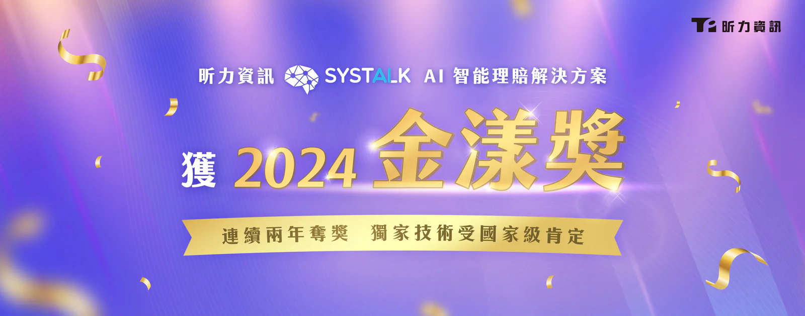

昕力資訊以領先業界的數位革新科技，延續去年得獎的氣勢，今年再度拿下由中華民國軟體協會所主辦的 2024 金漾獎，以獨家開發之 [SysTalk.ai 智能理賠解決方案](/solutions/smartclaim)獲得「智慧應用組」佳作。昕力資訊的智能理賠解決方案專為產壽險業設計開發，解決保險業者長久以來作業上的痛點，針對投保、理賠、核保過程中格式持續變動的各類文件，建立保險業專屬 AI 模型，為民眾提供最實際的理賠申請服務，也加快整體理賠效率。

## 以最適合企業應用的自適應AI 推動產壽險業數位轉型再進化

捨棄傳統 OCR 技術，昕力團隊獨立開發 ICR 智慧光學字元辨識（Intelligent Character Recognition），結合昕力 AI 文本分析能力，以自主研發 NLP 自然語言技術為核心，對於自有演算法可高度掌握，不僅能完整將民眾理賠文件轉換成文字、並解析成全球通用的國際疾病代碼(ICD-9、10)以及台灣專用的健保手術代碼，優化作業效率，大幅降低人為判斷誤差。另外昕力也運用 RPA 流程自動化技術，串接自動理賠引擎，實現跨系統運行，完善理賠、審核及判讀流程，同時降低理賠風險。SysTalk.ai 智能理賠解決方案運用目前最適合產業應用的自適應 AI 的框架，讓產壽險業者完成導入後，能夠自主維運並持續優化 AI 模型，強調只需以少量資料即可快速訓練模型，客戶不必再為後續應用需求額外負擔成本、應對不斷增長的業務需求，實現 100% 自主維運。

## 『讓民眾分秒間完成理賠申請』的AI實績再受肯定

由中華民國資訊軟體協會主辦的金漾獎今年邁入第十屆，為國內指標性企業獎項，過去十年持續帶領著科技產業深耕與創新，獎勵優秀團隊以新興數位技術實現產業革新與轉型，厚植台灣軟實力，落實智慧生活、智慧商務之理念。昕力去年憑 SysTalk.Chat AI 智能客服機器人與 DigiFusion 企業服務中台奪獎，今年再度交出亮眼成績單，憑著 SysTalk.ai 智能理賠解決方案，讓『民眾分秒間完成理賠申請』的研發理念，再度獲得金漾獎評審肯定。

昕力資訊創新暨 AI 產品發展處副總經理林秀明表示：「SysTalk.ai 以自主研發 NLP 自然語言技術為核心，具備真人般的資訊處理能力，突破過往技術瓶頸，在解析應用情境方面表現相當出色，就產壽險業者的實際應用面而言，從理賠立案、理算、派件皆能全面自動化，另外，昕力也結合獨家 AI 再進化機制，讓客戶導入我們的解決方案後只需運用基礎人力，就可自行維運、持續優化系統，這也是許多金融保險業者在尋求數位轉型的重要著眼點之一。」
