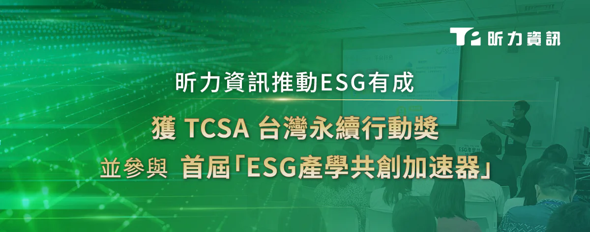

由台灣永續能源研究基金會 (TAISE) 主辦的 TCSA 台灣永續行動獎今年已邁入第17屆，是台灣最具指標的永續獎項，昕力資訊今年以「昕知識．共好圈」為主題，分享昕力在知識教育領域所作出的貢獻，昕力資訊做為台灣少數的純軟體業者，長期以來對於推動資訊技術知識的普及不遺餘力，除了成立以最新技術知識的部落格--「昕力大學」之外，更定期舉辦線上「技術小聚」，由昕力資深的工程師透過實際案例與經驗，無私的共享壓箱絕學，縮短產業知識落差，促進良性的公平競爭，這與昕力長期以來的公司治理理念一致，也與TCSA台灣永續行動獎推動的企業永續發展目標 SDGs 吻合，故獲評審青睞在SDG04項目中拿下銅級殊榮。

除此之外，在產學合作的層面，昕力響應由教育部與遠見主導的「ESG產學共創加速器」媒合活動，會中昕力以科技驅動為核心，與同樣關注永續議題的企業及學校夥伴，介紹由我們研發團隊打造的 GreenSwift 碳盤查管理平台，聚焦提供企業永續的具體解決方案，讓企業、大學分享各自的人才與專業，實現跨域、跨產業共學共創，善盡永續發展的社會責任；也受台北電腦公會邀請，參與「EMS能源管理系統淨零轉型」 系列論壇，說明我們的 AI 智慧建築節能系統 ElectriSwift 如何運用人工智慧將企業大樓的能源消耗最小化，進而達成節能減碳，並節省未來的碳費支出。

昕力資訊總經理葉怡蘭表示：「昕力資訊做為台灣企業資訊軟體的領導者，今年透過我們自力開發的系統，進行首次的溫室氣體盤點，組織邊界包含國內外共15個據點，也透過這樣的契機，推動公司同仁參與各項節能減碳競賽，並陸續獲得『世界地球日 Custos 減碳大賽第一名』、『我的減碳存摺 內科園區 第三名』的好成績，同時也舉辦了第一屆昕力跳蚤市場，讓同仁將家裡不再使用的好東西，找到下一位愛惜它的主人，不僅能養成大家惜物愛物的習慣，更是愛護地球資源的永續表現！」
