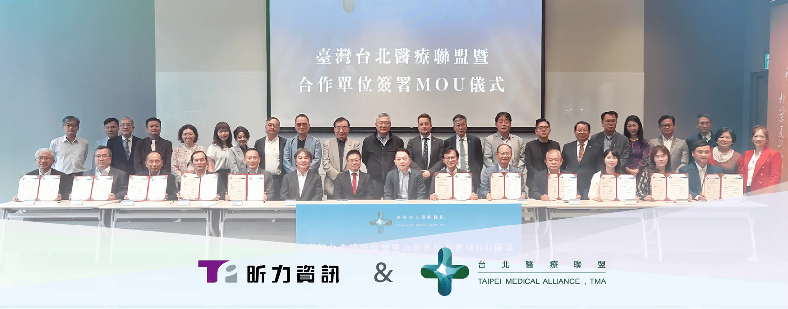

昕力資訊（7781）與社團法人台北醫療聯盟協會於30日正式簽署了「公益交流合作備忘錄」（MOU），共同推動醫療科技與學術的永續發展，打造資源共享平台，開展醫療數位轉型與 AI 相關計畫與實證，達到促進醫療場域的數位革新，進而改善醫病關係。雙方將共同投入進行知識交流循環，並通過定期舉辦研討會、專業訓練及各類學術交流活動，推動醫療數位轉型知識的深化與傳播。

衛生福利部政務次長呂建德、前衛生福利部政務次長王必勝、前立法委員蔡適應均親臨現場，共同見證這一重要時刻，除此之外，此次合作的夥伴包括多家醫療機構、學術機構及相關企業，如全國長照社團法人聯合會、中華民國醫師公會全國聯合會、台灣美容外科醫學會、國立中興大學醫學院等。

台北醫療聯盟理事長趙忠傑表示：「此次北醫盟邀集各個領域的先進簽署合作備忘錄，就是希望整合各領域的資源，截長補短、發揮所長，為台灣的醫療產業發展盡一份心力，與昕力資訊的合作是借重昕力在數位轉型的專業與經驗，不論是導入 AI 智能語音、HIS系統的現代化、醫療上雲，或是配合衛福部推動 FHIR 電子病歷交換，都需要強而有力的數位轉型企業投入，構建完善的醫療管理與健康服務體系，進一步提升整體醫療服務品質。」

昕力資訊董事長姚勝富表示：「昕力資訊很榮幸受台北醫療聯盟邀請，與所有夥伴推動醫療合作公益平台，昕力過去在金融數位轉型領域深耕超過15年，協助無數國內外大型金融機構數位轉型，現在我們將輔導產業數位化經驗與做法轉帶到醫療院所。昕力能做到在不影響日常運作的狀態下，為醫院『無痛升級』、『汰舊換新』，提供完全不同的數位化體驗，民眾可以透過 AI 智能語音完成預約看診或是衛教、用藥說明，而醫師可以透過內部數位服務中台授權檢查患者過去所有的病歷、檢查、過敏史等，做到最適切的診斷，醫院也可透過健康管理平台追蹤病人在治療前後的數據，供醫護人員分析，實現醫療健康服務的數位化和創新化，進而打造更好的醫病關係與環境。」
