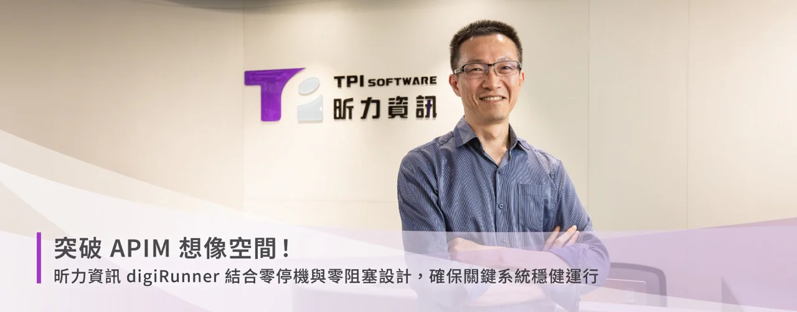
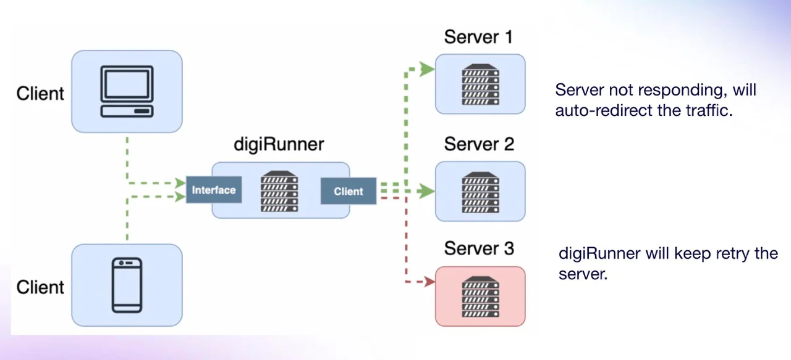
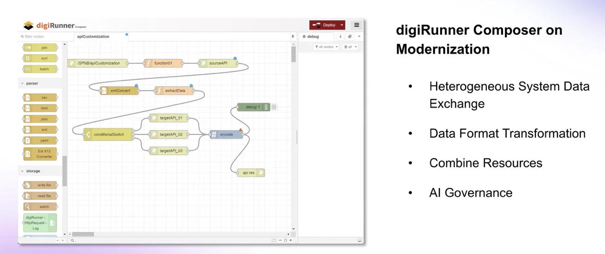

*昕力資源企業應用產品發展處副總 夏宏彰*

隨著網路時代來臨，現今大多數服務都透過數位形式來傳遞，而API正是背後關鍵功臣。舉例而言，企業對外開放自家系統API，讓其他開發者將它運用於各類產品，可望為消費者提供多元便利服務，甚至激發更多創新應用場景。

縱使API經濟魅力無窮，但企業在開放API時，面對龐大資料流量，亟需思考如何落實API管理（APIM），以便能隨時掌握API運用情況，確保資料傳輸中的安全性、隱密性、合規性及穩定度。

為協助企業應對API管理挑戰，昕力資訊不斷精準其所孕育的「digiRunner」APIM平台。如今推出的digiRunner 4.0，從過往VM-based轉為Container-based，除基於API-First開發架構來提升部署彈性，亦藉由專利技術實現自動擴展（Auto-Scaling）、面對高併發場景依然確保零停機，使digiRunner脫離一般APIM格局，成為足以保護 關鍵系統的強大APIM。

**獨特價值，深獲國際認可**

昕力資源企業應用產品發展處副總 夏宏彰指出，綜觀APIM市場，一直以來幾乎所有產品都定位在API管理範疇，digiRunner剛開始也不例外，以致眾家產品差異有限。現在，digiRunner「專為關鍵應用而生的APIM」的獨特價值，使其成為台灣唯一連續三年獲得2024 Financial Times Top 500的軟體廠商， 走出臺灣邁向國際舞台 ，適用於講求穩定運作與服務不中斷的應用場景，像是金融產業Core Banking、醫療產業HIS系統，乃至電力系統或交通運輸系統…等，一出狀況就可能釀成重大災損甚或危害人命的關鍵服務。digiRunner的價值，即是確保這些服務穩定運行不中斷。

為此昕力從基礎架構面切入，以導入微服務架構為起手式，讓digiRunner得以運行在容器與Kubernetes（K8s）環境；接著引入相關機制，時時偵測服務運作，一旦遇到難以承受的巨大流量，便藉由Auto Scaling來符合即時需求。所謂Auto Scaling，即是當digiRunner遇到流量急遽變化時，就立即自動擴充或縮減資源；因digiRunner支援Container和K8s關鍵技術，所以即便執行自動縮放，仍繼續維持正常運行，保持服務不中斷。

談到digiRunner如何以API Gateway角色，實現關鍵系統的保護效果？夏宏彰解釋，digiRunner獨家支援負載平衡（Load Balance）機制，平時可將流量依既定分配比例分散至後端多台伺服器，以營造流暢存取體驗；若有伺服器出現異狀，便能依照用戶的設定、將流量重新導向正常主機，以確保系統穩定性與可靠性。

*digiRunner 遇到後端主機失敗時，將流量導向正常主機; 復原後再將流量導回原主機。*

**整合縱橫深耕發展， 擁抱開源社群**

大致上來說，digiRunner與其他APIM一樣，都支援安全性、擴充性、變化彈性；但digiRunner 4.0還能進一步滿足關鍵服務所在意的高可用（High Availability）、高可信（Reliability）及高容錯（Fault Tolerance）。意即不管遭遇任何狀況，系統都可快速從災害中復原，或啟動備援機制，繼續維持正常運作，滿足既定SLA目標。

此外隨著digiRunner版本進化到4.0，效能也出現長足進步，可望維持零阻塞API運行狀態。主要來自兩大關鍵。一是「智慧快取」，透過獨特演算邏輯，能有效評估後端系統運行狀態、再執行快取，確保系統效能不受影響。二是「In-Memory Gateway」，讓資料運作全部落在Memory，其中由Master節點指揮所有Slave節點執行同步，以確保資料一致性。

至於用以加速完成API加值開發的API Composer，亦是digiRunner當中一大亮點。API Composer的效益，除了支持快速組合轉換的API設計模式外，亦有助於實踐API-First概念；用戶可根據實際介接需求，預先定義API規格，接著再建立流程來符合所需規格並執行資料交換，因此原來的系統不需再做什麼修改，完全由digiRunner與外部的系統或新的使用者溝通、提供相關訊息。

*digiRunner 支持快速組合轉換的 API 設計模式*

論及digiRunner在今年（2024）的顯著變化，不只是版本更新，亦在於它已通過AWS FTR認證，現階段用戶可直接在AWS Marketplace購買digiRunner，繼而部署在雲端的容器／K8s環境。值得一提，昕力為雲端版digiRunner設計多元方案選項，基本上由Lite版與Enterprise版，搭配Standalone及HA (高可用性) ，形成二乘二組合、四種提供方式；<strong>介於Lite與Enterprise之間的中間版本，則包括 Auto Scaling 及 Open Search等彈性選項。</strong>關於價格也有三種模式，包括免費試用一個月、計時制（用多少付多少）、年訂閱制。

另一方面昕力為digiRunner鋪陳未來重要發展路徑即是開源計畫。之所以投入開源，主要是為了創造「由下而上」效應，對工程師或技術人員等一般使用者產生影響，連帶牽動整個企業的APIM採購決策。為此昕力特別成立開源辦公室，期望釐清相關法規、授權及文件準備等事項，循序利用開源資源或管道，將digiRunner推向開源世界。

昕力在開源市場整合橫向與緃向策略，橫向上主要在吸引開發者社群的參與與共創。這不僅能夠促進創新，還能加速產品的迭代更新。透過開源模式，我們希望提供更高的透明度和靈活度，讓企業能根據自身需求進行定制化的開發，進一步提升 API 管理平台的適用性和價值; 緃向上我們和 SUSE 深入合作，以其全球知名的 Rancher K8s Open Source 平台整合上述開源模型架構，提供友善易用的現代化微服務系統開發框架。未來我們規劃結合 BPM、BI 等其他開源工具，在關鍵系統應用方面，共同打造豐富便捷的開發社群，提供源源不絕的價值與獨創性

截至目前，digiRunner已有眾多成功案例。在臺灣，協助臺北市政府建立APIM平台，旨在促進各機關異質應用系統資料介接，以利市府推動資料開放政策，拓展創新應用的可能性；此APIM平台建構於K8s環境，且一併搭配API Developer Portal，供外部民眾理解平台提供哪些API、這些API規格為何。在海外，越南最大連鎖藥店Pharmacity在AWS雲平台部署digiRunner，佈建API管理平台，為全國數百家分店同步庫存資料、進出貨資料，乃至協助其電商平台處理採購、客戶基本資料建檔、訂單處理等作業。

值得關注的，昕力正與客戶積極合作，規劃以digiRunner為AI Gateway，協助管理LLM服務、Token、安全隱私、資料交換；甚至扮演LLM、RAG資料庫之間溝通橋樑，讓企業在安全、準確的前提下獲取GenAI生成結果，由此觀之昕力不斷為digiRunner開創更多應用想像空間。

**[下載 digiRunner](https://aws.amazon.com/marketplace/seller-profile?id=seller-jnqhhvmszbeua)**
