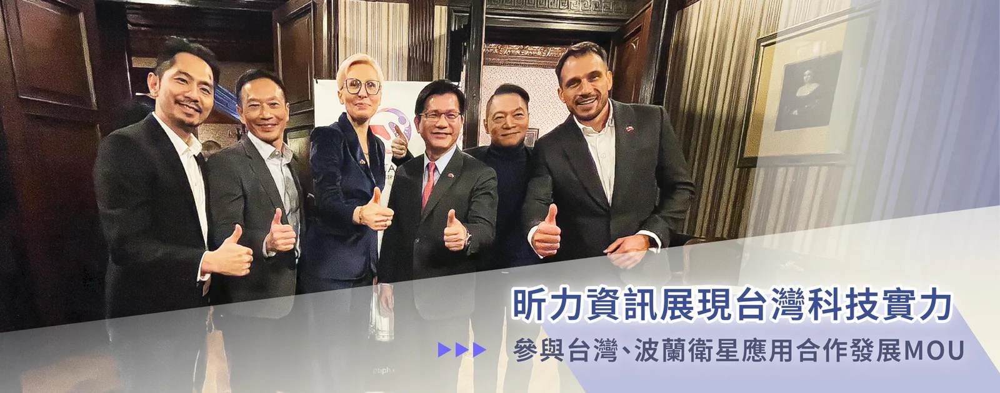

全球太空產業蓬勃發展，也吸引愈來愈多台灣廠商跨足太空商業應用領域，昕力資訊（7781）看準這波未來趨勢，與台灣波蘭商業協會、波蘭 SINOTAIC，以及數家廠商，於12月2日於台灣太空國際年會（TASTI），在外交部政務次長吳志中的見證下，共同參與兩國航太合作備忘錄（MOU）簽署儀式，此次的合作昕力憑藉多年資訊科技的耕耘，與跨產業、跨領域的 API 管理落地經驗，扮演關鍵角色，肩負在實證場域支援多軌道多星系服務共同 API 的應用，及多軌多星系網路切換與分流驗證，用以發展支援3D多維網路服務的共通 API 研發。

昕力資訊作為國內唯一自主研發國際級 API 管理軟體的廠商，能夠將台灣本土的科技推向衛星通訊應用，證明了台灣軟體科技的實力，透過 digiRunner 強大的關鍵系統 API 管理能力，整合低、中、同步軌道的衛星與多個衛星運營商的相互操作，使網路可以無縫切換，或是同時使用多個軌道和運營商提供的服務，在不同衛星系統之間進行動態切換，確保連線穩定性與性能最佳化，或是根據商業應用需求，將數據分流到不同的軌道和運營商，進而支援包括地面、空中（如無人機）及太空在內的多層次通信需求，這些應用在智慧城市、自動駕駛、物聯網和遠程醫療等需要大規模連線的商業場景至關重要。

近年來波蘭經濟穩定發展，已成為歐洲最重要的新興市場之一，昕力資訊董事長姚勝富同30家企業，於上週剛結束與外交部長林佳龍參與「強化台波經濟合作論壇」之訪問行程，於波蘭羅茲市（Łódź）與市長茲達諾弗絲卡（Hanna Zdanowska）等人，共同見證波蘭台灣工商會會長 Agnieszka Sygitowicz 與台灣波蘭商業協會趙忠傑理事長簽署合作備忘錄，藉此促進兩國間的商業合作，本週即馬不停蹄地參與台、波兩國的太空衛星合作MOU的簽署。

姚勝富董事長表示：「昕力資訊除積極耕耘金融、醫療、製造及政府單位外，首次跨足參與航太產業之應用，我們為響應及支持政府之優化應用衛星網路整合技術政策，很榮幸能代表台灣的資訊廠商與加強國際商業合作，並成為台、波太空計劃的一部分。透過昕力資訊 MIT 研發的 digiRunner API 管理平台特性，在衛星通訊領域導入及應用 API 資訊之整合與交換。我們期待一方面未來能促成更多跨越國界的創新，並以科技的力量加速全球數位化進程；另一方面亦對昕力資訊深入多元產業打開新的面向。」
