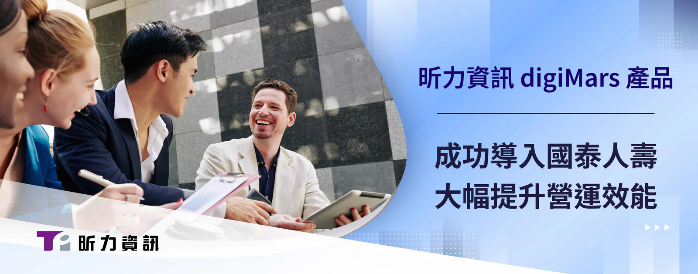

近年數位化浪潮席捲各產業，尤其跟民眾生活息息相關的保險、金融、醫療等服務因為疫情關係更是倍速成長，昕力資訊不僅在「金融科技」方面為同業之最，深耕「保險科技」領域十多年的經驗同樣受業界信賴，此次協助國泰人壽針對投保、理賠必備的影像文件管理與流程，導入獨家 digiMars 資料庫管理工具、 digiFlexis 企業流程管理平台，解決原有系統無法提升的作業效率，同時更進一步優化流程，全面提升營運效率。

壽險業需要的大量的影像管理，特別在投保或理賠案件中，投保文件、醫療院所的單據掃描、登打，常常是業務員最耗時耗力的一環，此次昕力資訊為了改善國泰人壽現行作法，分別針對作業面、系統面的痛點，提出在核心系統變動最少的條件下，客製全新的流程影像平台，其開放的系統架構、高效處理機制，解決原先流程與表單不同步的問題，使新系統效率提升 86 倍，能有效降低維運成本；在系統本身的痛點，面臨實體環境難以擴充的困難，加上巨量資料亦難以維護，阻礙了整體營運績效的提升，但採用昕力資訊 digiFlexis 全面性管理規劃建議，並且導入昕力獨家「digiMars資料庫監控工具」後，不僅減輕了系統管理負擔，還能同時監控管理 60 台以上主機、節省檔案空間達 40% 以上，顯示昕力資訊不只在技術層面的能力，更是對於產業深度了解的完全體現。

企業在數位轉型的過程中，常常落入升級硬體或導入軟體的迷思，卻忽略在數位升級的同時，企業內部的生態、人員、作業流程等等因素，事實上，這些因素常常也是企業能不能成功數位轉型的關鍵，昕力資訊的 digiFlexis 企業流程管理顧問服務，就是為了輔導企業數位化的過程中，同時能夠將數位轉型基因植入企業DNA中，能夠高度整合、敏捷管理，適應各種進階流程與應用，協助企業流程再造，發揮最大行動力；另外，此次國泰人壽導入的 digiMars 是一套針對 MongoDB 管理工具，能滿足監控、告警、備份還原等全面管理需求，更提供全面的教育與顧問服務，從規劃、設計到維運一條龍服務，補足原廠支援有限的缺點。

昕力資訊總經理葉怡蘭表示：「其實不只金融業，保險產業在轉型的過程中，也需要技術能力強、又具有完整產業深度的資訊服務夥伴，所以昕力不但能為客戶在技術面提出適合的系統規劃建議，在營運管理面更能提供專業的顧問服務，成為客戶信任的長期合作夥伴。」
