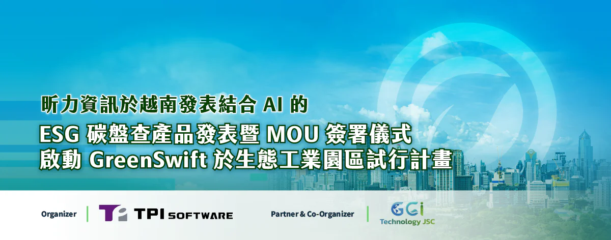
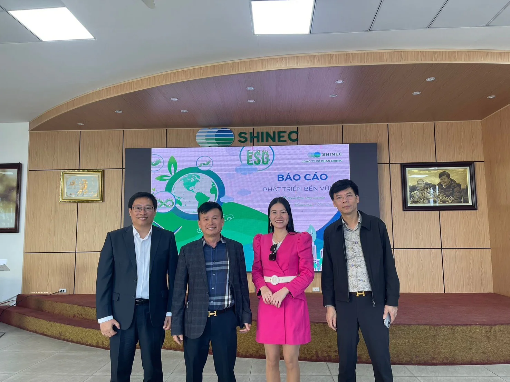

作為領先的企業軟體解決方案提供商，昕力資訊 (\*7781) 將於 12 月 26 日在越南河內舉辦產品發表會暨產業合作備忘錄（MOU）簽署儀式，正式推出結合 AI 的創新碳盤查管理平台「GreenSwift」。 並宣告與越南知名生態工業園區 Nam Cau Kien Eco-Industrial Park 確定合作啟動 GreenSwift 試行計劃，成功在越南市場邁出重要一步。

*由左至右分別是越南昕力資訊總經理 Do Vuong Phong, Nam Cau Kien Eco-Industrial Park 董事長 Pham Hong Diep, ESG 專家 Dr. Nguyen Kim Anh, Coastal Design and Investment 董事長 Dr. Mai Van Sy。*

此次試行計劃由越南昕力資訊總經理 Do Vuong Phong 與 ESG 學界專家 Dr. Nguyen Kim Anh 共同拜訪 Nam Cau Kien Eco-Industrial Park ，與對方董事長 Pham Hong Diep 探討推動智慧化 ESG 管理課題。計畫將運用昕力資訊的 GreenSwift 碳盤查產品，協助園區實現 ESG 永續策略，完整碳盤路徑並提升能源管理效率。更多應用資訊也將於發表會當天揭曉。

簽署儀式將由昕力資訊與合作夥伴 GGI (Global Green Innovation) 領銜，匯聚產業領袖、政府代表及 ESG 專家，攜手推動碳數據揭露的透明合規，助力越南邁向 2025 淨零排放的目標。邀請越南政府高層代表以及 ESG 學界專家 Dr. Nguyen Kim Anh 一同見證。此外，越南知名的投資公司 Katina Capital Partners 創辦人暨 CEO Tony Kuo、SI 解決方案先驅 ITD 集團董事長 Mai Hoai An、越南保險領導廠商 Bao Long Insurance 副董事長 Phan Quoc Dzung 以及智慧空間資訊服務供應商 ThinkTron Ltd. 總經理 Thomas Cheng 等多位重量級嘉賓均將出席。簽署為推進環境、社會和治理（ESG）標準的合作備忘錄，為越南永續市場的未來合作奠定堅實基礎。

在 GreenSwift 產品發表會中，特別邀請越南政府交通部和科技部代表，從科技政策角度剖析越南邁向永續發展的機會與挑戰。此外，越南科學技術研究院地理研究所 ESG 顧問 Dr. Nguyen Kim Anh 也將分享深度解析，探討 ESG 標準如何落實於越南各產業的實際行動中。

越南昕力資訊總經理 Do Vuong Phong 將於現場展示 GreenSwift 的產品亮點及創新功能。該平台結合生成式 AI ，協助企業高效完成溫室氣體盤查與永續報告編制，進而達到符合國際標準的碳管理要求，實現合規目標。

昕力資訊總經理葉怡蘭表示：「透過 GreenSwift SaaS 碳數據管理平台，企業得以突破永續技術和成本限制，快速完成碳盤查流程，進一步將資源聚焦於核心業務的創新與成長。與昕力的另一項 ESG 產品 - 優化和減少能源消耗的 ElectriSwift AI 建築節能系統，打造出完整的企業綠色方案，長遠來看，昕力資訊期望透過雙平台，串連政府、企業、民眾，攜手建立長期的永續路徑。」
