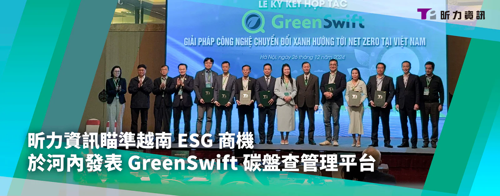

昕力資訊（7781）與越南合作夥伴於 26 日在河內簽署合作備忘錄（MOU），並正式推出結合 AI 的創新碳盤查管理平台「GreenSwift」，攜手越南企業共同實現低碳永續目標，推動當地 ESG 轉型。

本次活動由昕力資訊和越南 ESG 顧問公司 Global Green Innovation Technology（GGI）共同主辦，集結了越南政府官員、私營部門及 ESG 專家參與其盛，並由 ESG 學界專家 Dr. Nguyen Kim Anh、越南知名投資公司 Katina Capital Partners、SI 解決方案先驅 ITD 集團、越南保險領導廠商 Bao Long Insurance，以及智慧空間資訊服務供應商 ThinkTron Ltd. 等多位嘉賓共同簽署合作備忘錄，為越南永續市場的未來合作奠定堅實基礎。活動現場也向與會者展示了 GreenSwift 的產品亮點及創新功能，該平台整合七大溫室氣體排放，涵蓋國際溫室氣體盤查範疇一至三，結合生成式 AI 自動化碳排放量的蒐集與計算，讓企業輕鬆掌控碳足跡，並且透過內、外部雲端協作方式，高效編制溫室氣體報告書，顯著提升碳盤查效率，達到符合國際標準的碳管理要求，助力企業滿足合規目標。

GreenSwift SaaS 碳盤查管理平台可全面追蹤、收集、計算溫室氣體排放量，並自動生成符合國際標準 ISO 14064-1:2018 與 IPCC 規範的報告書，亦可因應法規要求進行客製化，簡化碳揭露作業，讓企業在減碳永續方面的策略與成果更加公開透明。其 SaaS 訂閱模式，不僅能支援大型企業跨廠區大規模碳盤查，也適用於中小型企業的組織架構，靈活滿足不同企業需求。

企業為邁向淨零排放目標實施 ESG，長期投入永續倡議行動將有助於提升品牌形象，讓企業、投資人與社會間產生正循環的發展。越南昕力資訊總經理 Do Vuong Phong 表示：「昕力積極響應越南政府的號召投身永續發展的行列，致力於協助企業應對綠色轉型的種種挑戰，推出 GreenSwift 不僅讓越南企業能利用現代科技實現減碳永續目標，更彰顯了我們與合作夥伴共創永續未來的決心。」

昕力資訊日前也宣布與位於越南海防市的 Nam Cau Kien Eco-Industrial Park 合作啟動試行計劃，未來將在園區導入 GreenSwift 與 ElectriSwift AI 建築節能系統，構築完整的企業永續藍圖。該生態工業園區董事長 Pham Hong Diep 表示：「此次與昕力資訊建立合作夥伴關係，意味著我們將共同推動氣候行動永續倡議，透過尖端技術提升能源效率，共同實現永續發展的未來願景。」
