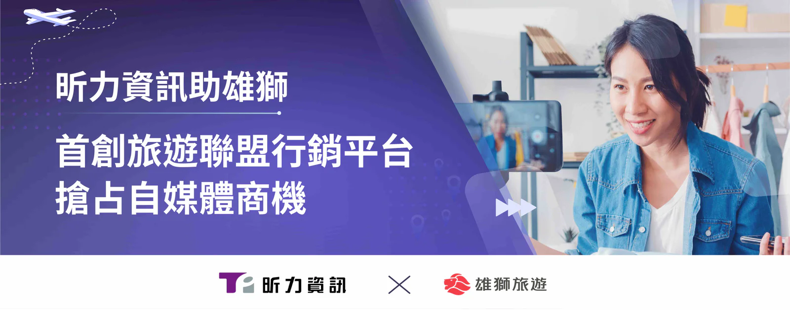

自媒體時代強勢來襲，旅遊業的數位行銷與銷售模式無不迎來翻新變革，民眾出遊已不再倚賴旅行社協助辦理及安排常規行程，轉而關注網紅或旅遊達人的分享文或YouTube影片，傳統門市點對點的銷售手法已難完全吸引消費者目光，如何串聯網路社群才是旅遊業者在這數位時代下的應對之道。

致力滿足企業創新需求的昕力資訊協助旅行業龍頭雄獅旅遊建置專屬聯盟行銷平台，創作者可利用此平台自助生成特定旅遊商品之推廣連結並分享到網路社群，以此獲取分潤；而雄獅亦可借助網路名人號召力進行導、促購，規模化經營分眾行銷策略，利用流量紅利提升品牌曝光與顧客轉換率，達成業者與自媒體 KOL/KOC雙方無縫對接與媒合，實現旅遊業與網紅生態圈全新商業模式，開拓更多元的市場，將再行銷效益最大化。

**分潤機制自動化，實現高效無縫行銷管理**

傳統人工逐筆查驗、追蹤訂單的繁瑣程序往往是業務流程一大痛點，雄獅聯盟行銷平台結合專屬追蹤碼技術即時更新訂單狀況，從下單到完成交易皆可掌握，省去人力成本，更提供視覺化統計報表供查詢點擊率、訂單金額、訂單數量、佣金金額等關鍵指標，以利檢視數據與行銷成果。其自動分潤結算功能可依行銷通路、 旅遊產品類型設定導購佣金比例，並自動計算分潤金額，從申請提領、覆核、查詢付款狀態、核撥出納到入帳皆可在後台一站完成，實現自動化無縫分潤作業管理。

雄獅旅遊行銷長張有群表示：「據DMA統計，超過四成客戶偏好網紅行銷，足見KOL對消費者購買決策仍有不小的影響力。雄獅旅遊領先業界建置媒合平台，開創網紅創作者間互惠共好的商業夥伴關係，共享數位時代所帶來的機會與效益。雄獅聯盟行銷平台讓旅遊網紅創作者能分享第一手旅遊心得，以旅客視角介紹旅遊資訊，弭平旅遊市場資訊落差，不管是國內外行程，抑或是自由行、跟團、鐵道旅遊、郵輪旅遊等，一般民眾也能因此擁有更多元化的旅遊選擇，對旅遊業者、網紅與消費者三方皆有利。」

昕力資訊總經理葉怡蘭表示：「昕力團隊採用混合型（Water-Scrum-fall）專案管理方法，結合了傳統的瀑布式管理（Waterfall）和敏捷的SCRUM框架，透過兩者的優勢，以提升專案的靈活性，有效掌控時程與追蹤成效，比原定期程提前1.5個月完成上線，這次與雄獅的合作不僅顛覆了以往旅遊業者跟自媒體一對一的媒合方式，更打破一般旅遊平台代理經銷分潤模式，取而代之的是更符合當代需求的自動化聯盟行銷平台，為旅遊業做了異業結盟的創新示範。不論旅遊業抑或是任何產業，昕力都能憑著數位專業與技術量能協助客戶實踐創新想法。」
