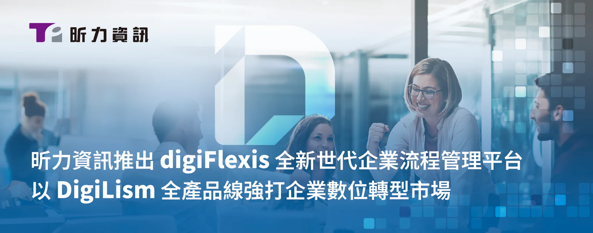

企業在人力資源越來越寶貴的趨勢下，紛紛開始著手數位轉型的工作，以達到最少人力、最佳效率的目標，但在現今混合辦公的新型態下，傳統的單一功能 BPM 系統已無法滿足企業全方位的效益需求，也不單是導入e化系統、無紙化就可達成，而是必須仰賴專業團隊協助與使用正確的工具，才是能真正成功實現流程自動化與效率提升的關鍵，數位轉型軟體大廠昕力資訊（˙7781）今日發表新一代企業流程管理平台（BPM）- [digiFlexis](/products/digiflexis)，突破傳統 BPM 限制，digiFlexis 首創整合「人、文件、流程」三大 BPM 核心功能，並導入No-Code 設計理念，讓企業無需仰賴 IT 團隊即可快速建置業務流程，產品特色包含智能報表分析、動態表單設計、跨系統 API 整合等創新功能，協助企業打造新生代高效能的數位化工作環境。

**新一代BPM - digiFlexis 全面覆蓋各行各業使用情境**

digiFlexis 一改坊間 BPM 系統的缺點，能兼顧「人、文件、流程」三大管理核心，並打造適合各種規模的企業採用的平台，能因應企業不同流程的需求，組織不同單位間人員協作，快速加入相對應的審核角色，進而改善企業因缺乏彈性而產生資訊斷點的狀況。digiFlexis 具有多項優點，採用直觀的 Widget 模組化首頁，讓使用者可依需求自由拖拉客製專屬自己的工作介面，在系統管理者方面，也能搭配專屬的儀表板分析，即時掌握各項進行中流程瓶頸，即時改善、加快速率，也具備開放式 API 支援，無縫整合原本的ERP、CRM等企業系統，讓公司員工快速上手、無縫銜接。

而透過直覺式拖曳操作，使用者可快速建立動態表單與審核流程，無須技術背景即可輕鬆上手。更重要的是，所有審核關卡均可靈活調整，無論是新增關卡、指派協辦人員或在退回時快速跳關，都能在 3 分鐘內完成設定，確保流程高效運作。

此外，digiFlexis 支援行動裝置簽核與彈性通知機制，大幅提升審閱效率與管理便利。系統更全面相容 AWS、GCP、Azure 雲端環境，協助企業在日益競爭的市場中保持靈活性與效率，同時確保資訊安全與系統穩定性。

**更名再前進！DigiLism 產品線 以全新形象深耕市場**

為展現產品創新精神，昕力資訊同步發表 DigiLism 全新的企業應用軟體系列識別系統，系列名稱也一併由原本的 DigiFusion 改為 [DigiLism](/products/digilism)， 以傳遞更清晰的設計理念，並將 [digiFlexis](/products/digiflexis) 納入產品家族，加上原有的 [digiRunner](/products/digirunner) API 管理平台、[digiLogs](/products/digilogs) 日誌管理平台、[digiMars](/products/digimars) 大數據管理服務，全方位的產品藍圖充分展現 DigiLism 數位化的核心理念與思維模式。新版的 DigiLism 標誌設計以幾何空間交錯方式結合「D」與「L」，搭配象徵『活力』與『創意』的橙色，與傳達『穩定』與『專業』的深灰色，足見其強調「創新」與「專業」的平衡的產品本質，標誌中的對話框設計則更進一步展現了 DigiLism 作為溝通橋樑的角色，強調其連接客戶需求與數位方案的核心使命，展現出昕力資訊在數位科技領域中的全面思維與實踐精神。

昕力資訊總經理葉怡蘭表示：「在全球化與數位化的雙重挑戰下，企業必須持續調整經營腳步以因應環境變化，我們在服務客戶的過程中，看到許多企業面臨資訊孤島的挑戰，特別是在跨部門協作上遇到瓶頸，所以昕力 digiFlexis 的推出不只是一個產品，更代表我們累積 20 年的服務經驗，以及對企業流程管理 BPM 的全新思維，透過整合人員協作、文件管理與流程自動化，我們期待能為企業打造更高效、更敏捷的營運模式。」葉總經理接著說：「digiFlexis 已成功協助多家指標性企業完成數位轉型，包括知名影音、大型保險業者，以及政府部門等，相信也能成為台灣更多企業在數位轉型之路上最值得信賴的夥伴。」
