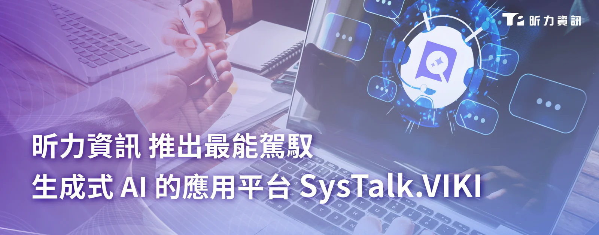

**RAG、LLM、Prompt Engineering 三管齊下 驅動企業 AI 智慧轉型**

生成式 AI 狂潮席捲全球，企業爭相投入 AI 之際，也面臨著 AI 所帶來的諸多挑戰，如 AI 幻覺、實際應用受限、資料外洩風險等，以致企業無法實現具體的創新應用。數位轉型軟體開發商昕力資訊（7781）以堅實的研發量能，正式推出企業專屬生成式 AI 應用平台— [SysTalk.VIKI](/products/systalk-viki)，加速企業內部建立 AI 助理與人的「雙隊伍合作模式」，毫無 IT 背景的使用者也能輕鬆使用 AI，SysTalk.VIKI 具備完整架構全面支持地端部署，串接企業內部知識庫，生成有憑有據、安全可信的內容； 透過 AI 執行例行工作，釋放人力並專注於規劃、決策，以雙隊伍共同驅動企業轉型。

**打造企業專屬生成式 AI，彈性擴充、精準檢索、安全可靠**

SysTalk.VIKI 利用檢索增強生成（Retrieval-Augmented Generation，RAG）技術，結合大型語言模型（Large Language Model，LLM）和為企業量身打造的提示工程（Prompt Engineering），為企業提供快速、精準且可信的跨部門知識管理解決方案。

與傳統知識管理系統不同，SysTalk.VIKI 將企業的知識進行結構化處理，運用專屬的知識圖譜與文件切割技術（Chunking），將大量資料轉化為機器可理解的內容，強化知識庫的靈活性與實用價值。企業可透過直覺化操作介面輕鬆上傳文件，搭配最適參數建議，並根據業務需求彈性擴充。

為解決資料外洩風險，SysTalk.VIKI 設置完善的權限控管與審核機制，設置資訊護欄（Guardrail）確保企業數據的安全性與隱私保護，避免機密資料的洩露或不當處理並阻擋敏感詞，為企業打造一個安全可靠的 AI 平台。SysTalk.VIKI 作為 AI 核心架構，不僅能滿足企業現有需求，還具備高度擴展性，未來將推出新一代語音質檢平台，內建關鍵話術及敏感詞檢測功能，優化客服品質與效率。

**解決生成式AI應用創新的難題，企業營運效率全面升級**

昕力資訊創新暨 AI 產品發展處副總經理林秀明表示：「當大家都在讚嘆 AI 的潛力時，真正的挑戰在於如何將這些技術轉化為具體的創新應用，並符合企業真正的需求。許多企業面臨的困境在於缺乏一個簡單易用的創新工具，來幫助他們快速構建、測試和落地新想法。Systalk.VIKI 正是應對這一需求的完美解決方案，就如同 SysTalk.VIKI 的命名也奠基於四大要素之上——價值（Value）、智慧（Intelligence）、知識（Knowledge）、資訊（Information）幫助企業輕鬆落實創新應用，無需繁瑣的學習與整合，更釋放人力資源，讓團隊專注於更高價值的創意與決策。讓企業能夠將創新應用信手拈來，SysTalk.VIKI 正是最值得信賴的選擇！」

昕力資訊總經理葉怡蘭表示：「台灣已有半數企業（54.2%）開始導入生成式 AI，更有近 37% 的企業將『生成式 AI 應用工具或方案導入』視為優先資源投入面向，足見企業開始重視 AI 應用，SysTalk.VIKI 即是專為企業量身打造的得力助手，可符合企業跨部門的多元應用，真正以智慧應用發揮資訊與知識的最大價值，讓企業在數位時代下保持競爭優勢，持續提供創新的動能。」

昕力資訊秉持著「The right AI. The right decisions. The best result.」，不只陸續推出貼近企業需求的產品，更擁有專精金融、保險、醫療產業的專業 AI 導入團隊，於六年內成功導入 40 個以上的 AI 專案，從企業應用規劃、紮實的技術能量、持續優化的顧問服務，為企業全面提升 AI 應用價值。
