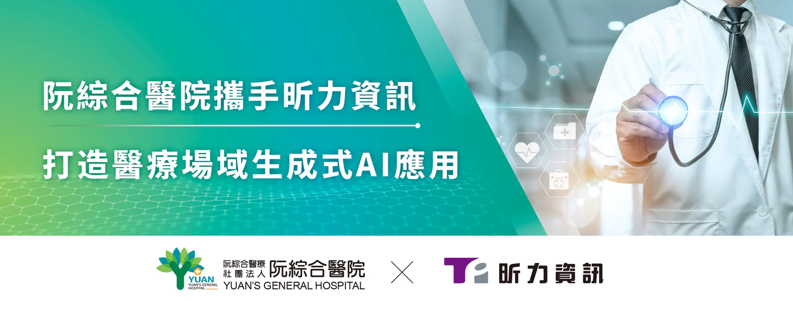

高雄在地阮綜合醫院與數位轉型軟體公司[昕力資訊](/) (7781) 今日宣布將聯袂參加「2025高雄智慧城市展」，推出雙方攜手打造的醫療場域生成式AI平台，運用最新生成式 AI 技術，提供醫護人員個人化的服務，將所需的文件或資料提取、轉換、統整，加快作業處理流程，釋放醫事人員的寶貴時間，讓更多精力專注於病患照護，為高雄地區醫療服務開創全新里程碑。

2025高雄智慧城市展將於3月20日至22日在高雄展覽館盛大登場，由高雄市政府、台灣智慧城市產業聯盟及台北市電腦公會共同主辦，重點展示高雄市透過產官學研合作打造的「智慧高雄AI燈塔計畫」成果，特別是智慧醫療主題館，今年集結南臺灣18家醫療院所與大學共同參與，全面展現南台灣智慧醫療的創新能量！

**阮綜合醫院「智能搜尋魔板」「癌藥事審FHIR轉換」跨界整合醫療資訊**

昕力資訊利用自家產品 [digiRunner](/products/digirunner) API 管理平台的特性，作為與阮綜合醫院合作開發的生成式 AI 平台背後的基礎架構，實現將嚴謹的醫事流程化繁為簡，並且針對醫院人員不同的角色，設定各種專屬「服務」，例如『AI智能搜尋魔板』能根據醫事人員的需求，提取必要的 HIS 資料，自動整合並分析病患資料，並結合生成式 AI 技術生成關鍵摘要，能大幅節省醫護人員在資料整理上的時間投入，使他們能更專注於患者照護，提升整體醫療效率和品質，建構更好的醫病關係。

另一項針對『癌藥事審FHIR格式轉換』的功能，則是通過AI驅動的智能分析，自動將原始資料轉換為符合國際 FHIR（Fast Healthcare Interoperability Resources）標準的格式，使得原本需要醫務人員耗費大量時間手動對應的工作，在幾秒鐘內即可完成，解決過去格式不符合 FHIR 標準的痛點，更可以無縫銜接不同醫療機構間的資料交換，為台灣醫療體系邁向國際標準化的道路前進。另外值得一提的是，此服務功能仍能維持一定彈性，醫護人員亦可檢視轉換後的內容並進行個別微調，確保資料的準確性和完整性。

**生成式 AI 多元應用 翻轉醫療照護現場**

阮綜合醫院陳鴻曜院長表示：「阮綜合醫院創立至今秉持『誠信、關懷、合作、創新』的核心價值，不斷追求醫療服務的精進與創新，除了與昕力合作開發的生成式AI平台，阮綜合面對護理人力短缺的挑戰，自力開發的『護理紀錄五部曲』將過去80%需要人工處理的護理資料，運用Gen AI 技術自動匯入，有效縮短護理人員紀錄時間，減少繁瑣操作，同時提升紀錄準確性，更降低新進護理人員交班壓力，促進友善職場環境，一舉數得，獲得院內人員高度肯定。」

昕力資訊總經理葉怡蘭表示：「昕力資訊以『AI賦能+在地深耕』全力佈局醫療產業的數位轉型，也非常榮幸受阮綜合醫院的邀請與高屏地區18家醫院共襄盛舉，展現南台灣智慧醫療的能量！」葉總經理接著提到，面對醫療院所接下來的數位轉型挑戰：「昕力資訊由國人自主研發的『digiRunner 企業級 API 管理平台』擁有高度彈性的中台技術架構，能夠在不需更動醫院原有醫療資訊系統（HIS）的基礎上，快速實現 FHIR 標準資料格式的轉換，有效解決醫院過去跨系統資料互通的難題，與衛福部近日啟動的「臺灣醫療資訊標準大平台」，全面導入醫療資料交換標準FHIR，實現醫療資料互通、醫療規則標準化的政策接軌，也完全體現了昕力資訊『Tech for Change』的企業理念，並相信透過科技創新，能為台灣醫療體系帶來實質改變、樹立新標竿！」
